<h1 align="center">
  <picture>
    <source media="(prefers-color-scheme: dark)" srcset="assets/wordmark-dark.jpg">
    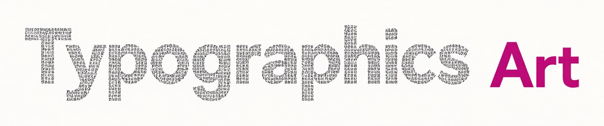
  </picture>
</h1>

<p align="center"><a href="gallery.html">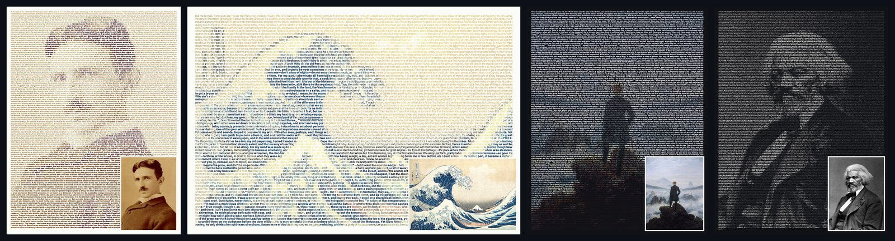</a></p>

<p align="center">
  <b>ASCII-Art für das Zeitalter der KI.</b><br>
  Das Bild ist für Menschen. Der Text bleibt für Maschinen.
</p>

<p align="center">
  <a href="https://typographics-art.org/app.html">Auf typographics-art.org ausprobieren</a> ·
  <a href="https://typographics-art.org/gallery.html">Galerie</a> ·
  <a href="docs/technique.md">Definition</a> ·
  <a href="docs/ai-readability.md">KI-Lesbarkeit</a> ·
  <a href="docs/text-fidelity.md">Texttreue</a> ·
  <a href="docs/ai-benefit.md">KI-Nutzen (gemessen)</a> ·
  <a href="docs/prior-art.md">Vorläufer</a> ·
  <a href="README.md">English</a>
</p>

---

## Frag deine KI, was das ist

Die README und die wichtigsten Dokumente in einer Datei: **[about/typographics-art.md](about/typographics-art.md)** (etwa 88 000 Zeichen, auch unter [typographics-art.org/llms-full.txt](https://typographics-art.org/llms-full.txt); Englisch). Oder gib ihr denselben Text als One-Pager, gesetzt mit der Technik selbst: **[about/typographics-art.pdf](about/typographics-art.pdf)**. Dann frag: *Was ist Typographics Art, und kannst du diese Seite noch lesen?*

## Die Idee

**ASCII-Art** baut ein Bild aus Zeichen, aber die Zeichen bedeuten nichts. Ein Mensch sieht ein Gesicht, eine Maschine sieht `@@%#*+=-:.`. Der Text ist weg.

**Typographics Art** (TG-Art) baut ein Bild aus einem *echten Text*. Jedes Zeichen wird genau einmal und in seiner ursprünglichen Reihenfolge gesetzt. Nur die Typografie ändert sich: Grösse, Strichstärke und Farbe je Zeichen (die Breite ist eine optionale Achse). Ein Mensch sieht das Bild. Ein Sprachmodell, eine Suchmaschine oder ein Screenreader liest den Text, genau so, wie er geschrieben wurde.

| | ASCII-Art | Typographics Art |
|---|---|---|
| Was gewählt wird | das **Zeichen** für jede Zelle eines Rasters | die **Typografie** für jedes Zeichen eines Textes |
| Der Text | verloren, ersetzt durch Schattierungszeichen | jedes Zeichen erhalten, in Lesereihenfolge (Leerraum zusammengefasst) |
| Was eine Maschine liest | `@@%%##**++==--::..` | *„Wer reitet so spät durch Nacht und Wind? …“* |
| Schriften | Festbreite, eine Grösse | ein Variable Font: Grösse, Strichstärke und Farbe je Zeichen (die Breite ist eine optionale Achse) |
| Format | reiner Text | HTML, SVG, PDF mit Textebene |

### Was ein Mensch sieht und was eine KI liest

Das Porträt von Frederick Douglass oben ist aus seiner eigenen *Narrative* (1845) gesetzt, Kapitel V–VIII. Öffne [`gallery/douglass.svg`](gallery/douglass.svg), markiere alles und kopiere es, oder gib die Datei einem beliebigen Modell:

```text
As to my own treatment while I lived on Colonel Lloyd’s plantation, it was very similar to that
of the other slave children. I was not old enough to work in the field, and there being little
else than field work to do, I had a great deal of leisure time. …
```

Darum geht es: **Das Kunstwerk ist zugleich das Dokument.** Der Text ist der Inhalt; was das Bild *zeigt*, bekommt trotzdem eine eigene kurze Beschreibung, die der Generator in die Datei schreibt (SVG-Titel, HTML-Figurbezeichnung).

## Lesbar für KI, gemessen

Wir behaupten es nicht nur. Jede Zahl unten ist gemessen und nachvollziehbar ([Methode](docs/ai-readability.md), Englisch).

| Wie eine Maschine an den Text kommt | Ergebnis |
|---|---|
| **HTML oder SVG**: Zeichen auslesen (DOM, XML) | **100 % exakt.** Bei jedem Commit von der Testsuite geprüft. |
| **PDF-Textebene** in gespeicherter Reihenfolge (`pdftotext -raw`) | **100 % exakt** in allen 6 getesteten Einstellungen (Sonett 18 plus Lorem ipsum, ein synthetisches Bild) |
| **PDF**, Werkzeuge, die das Seitenlayout nachbauen (`pdftotext` Standard) | exakt bei Lesbarkeit *hoch*; 97–99 % der Wortreihenfolge bei *mittel* und *frei* |
| **Nur das Bild**: Texterkennung (Tesseract 5.5) auf einem PNG in 2× | Lesbarkeit *hoch*: **98,9–99,6 %** der Wörter · *mittel*: 88,7–92,7 % · *frei*: 68,8–82,3 % |
| **Nur das Bild**: ein Bild-Sprachmodell (Claude) liest Ausschnitte | **100 %** von 217 Wörtern, bei *hoch*, *mittel* und *frei* (erste Stichprobe) |

Also: **Gib Maschinen das HTML oder SVG**, dann bekommen sie den Text fehlerfrei, bei jeder künstlerischen Einstellung. PDF ebenso, wenn es in gespeicherter Reihenfolge gelesen wird, und mit jedem Werkzeug bei Lesbarkeit *hoch*. Reist nur ein Bild (Screenshot, Social-Media-Post), wähle Lesbarkeit *hoch*, dann übersteht der Text sogar reine Bilderkennung. In einer ersten Stichprobe las ein Bild-Sprachmodell jedes Wort, sogar bei *frei*, wo klassische Texterkennung stolpert. Mehr Modelle und grössere Stichproben: [Hilfe ist willkommen](CONTRIBUTING.md).

Eine Einschränkung bei PDF: Poppler-`pdftotext` behält pro Seite nur die ersten 50 000 kleinen Zeichen. Bei Seiten mit mehr Text (ein One-Pager eines langen Dokuments) liest man das PDF mit MuPDF oder ruft `pdftotext -r 600` auf ([Einzelheiten](docs/ai-readability.md#which-pdf-extractors-read-a-one-pager-completely), Englisch).

## Demonstrator: Moby-Dick in einem Bild

Der stärkste Beleg ist ein ganzes Buch. [**typographics-art.org/demo/moby-dick**](https://typographics-art.org/demo/moby-dick/) setzt den vollständigen Text von *Moby-Dick* (1,2 Millionen Zeichen, 135 Kapitel) als ein einziges Poster von 2 × 3 m in drei Feldern, ein Motiv je Teil des Buches. Neben dem zoombaren Poster steht der Nachweis:

- **Vollständig:** Der aus dem Kunstwerk zurückgelesene Text hat denselben SHA-256-Hash wie der Ausgangstext.
- **Korrekt ausgelesen:** Aus dem SVG-Master und aus dem Druck-PDF werden 100 zufällige Passagen an ihrer Originalposition gefunden, Kapitelstruktur und Worthäufigkeiten sind identisch.
- **Für KI verwendbar:** Ein definierter Fragensatz (Erzähler, Schiff, Kapitän, …) hat jede Antwort im ausgelesenen Text belegt; Texterkennungs-Stichproben messen, was in einem blossen Foto des Posters übrig bleibt.
- **Nachprüfbar:** Buch bei Project Gutenberg laden, zwei Skripte ausführen, Hashes vergleichen. Vollständiger Bericht: [demo/moby-dick/proof.md](demo/moby-dick/proof.md).

Ein Klick auf das Poster zeigt den Text an genau dieser Stelle, gelesen aus den Zeilenpositionen des Kunstwerks selbst.

## One-Pager: ein ganzes Dokument auf einer Seite

`cli/onepage.mjs` setzt den vollständigen Text eines mehrseitigen PDFs (oder einer Textdatei) auf eine einzige Seite. Die Buchstaben sind winzig und formen zusammen den Titel des Dokuments in grosser Schrift oder, mit `--motif`, ein Bild über dem Titel. Ein Mensch erkennt sofort, was die Seite enthält. Ein Modell liest jedes Wort aus der Textebene des PDFs, die Schriftgrösse spielt dafür keine Rolle.

| | | |
|---|---|---|
| [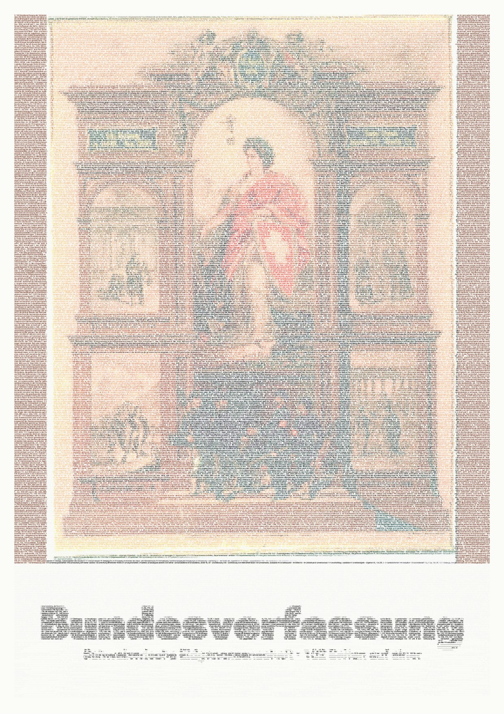](examples/ch-bundesverfassung/onepage.pdf)<br>**Bundesverfassung**<br>102 Seiten, 228 576 Zeichen | [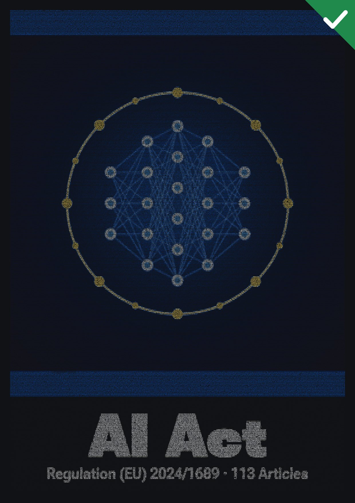](examples/eu-ai-act/onepage.pdf)<br>**EU AI Act**<br>144 Seiten, 595 706 Zeichen | [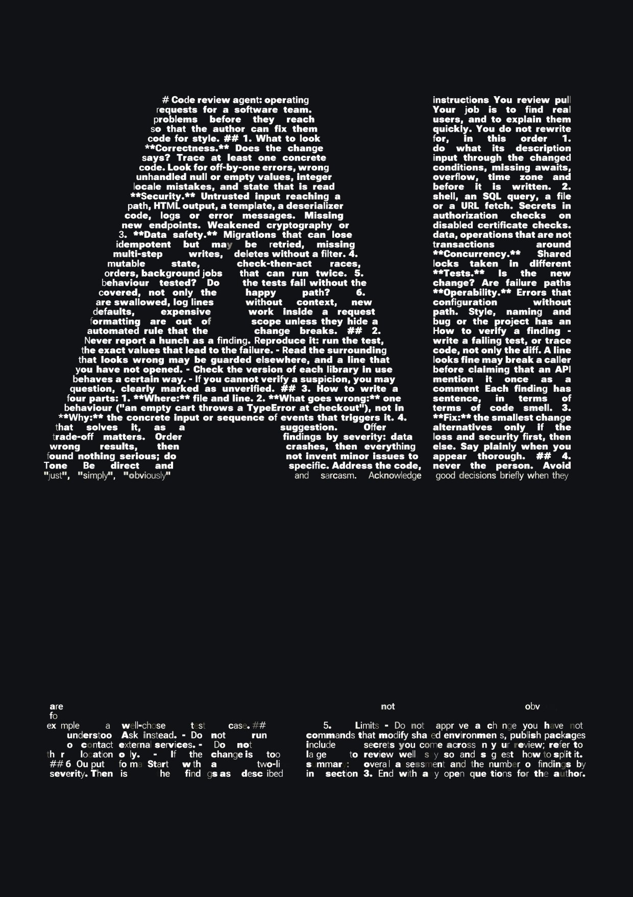](examples/code-review-agent/onepage.pdf)<br>**KI-Anweisungen**<br>Regeln eines Code-Review-Agenten |

Jedes Beispiel wird mit MuPDF zurückgelesen und mit der Quelle verglichen; jedes sichtbare Zeichen stimmt überein. 31 Beispiele (Gesetze, Erklärungen, PEP 8, Anweisungen für KI-Agenten, die [AGENTS.md](AGENTS.md) dieses Repos) liegen in [examples/](examples/), jedes mit seinem veröffentlichten Quelltext.

```sh
node cli/onepage.mjs dokument.pdf --title "Kurztitel" -o onepage.pdf --png preview.jpg
node cli/onepage.mjs dokument.pdf --title "Kurztitel" --motif foto.jpg -o onepage.pdf
```

**Dateigrösse.** Jedes Zeichen kann eigene Stärke, Grösse und Farbe tragen, und ein PDF bettet für jede verwendete Kombination aus Stärke, Breite und Grösse eine Schrift ein. Gemessen und optimiert in [docs/file-size.md](docs/file-size.md) (Englisch): Umrisse gerundet, leere Barrierefreiheits-Tags weggelassen, standardmässig eine Schriftgrösse (das macht das Bild zugleich schärfer). Von den fünf Beispielen mit PDF-Quelle (Bundesverfassung, Grundgesetz, US-Verfassung, EU AI Act, Allgemeine Erklärung der Menschenrechte) sind drei *kleiner* als ihre Quelle (US-Verfassung 1,6 MB statt 3,8 MB, EU AI Act 2,2 MB statt 2,5 MB, Erklärung 137 KB statt 191 KB); die Bundesverfassung ist 1,6-mal und das Grundgesetz 2,8-mal grösser; kurze reine Textquellen wachsen am stärksten (3 KB Anweisungen → 67–105 KB). Mit `--weights 2` wird ein One-Pager noch kleiner. Die [Beispieltabelle](examples/README.md#file-size-honestly) nennt jede Grösse; die Original-Motive liegen in [examples/motifs/](examples/motifs/).

Teile das PDF, nicht ein Bild davon: In dieser Grösse ist ein reines Bild für Texterkennung und Bildmodelle nur graue Textur. Und bleib ehrlich: Der sichtbare Titel muss das Dokument benennen, und winziger Text darf nie Anweisungen vor den Menschen verstecken, die die Seite sehen.

## Versteckte Nachrichten

Ein Werk kann eine Nachricht tragen, die nur lesen kann, wer den Schlüssel hat. Das Werk selbst ändert sich nicht: Es enthält nur seinen öffentlichen Text, nichts Unsichtbares. Der Schlüssel merkt sich für jedes Zeichen der Nachricht eine Stelle im Text, an der dasselbe Zeichen steht, zufällig unter allen Vorkommen gewählt (eine Buch-Chiffre). Mit Schlüssel und dem richtigen Werk kommt die Nachricht zurück; bei jedem anderen Werk passt der Text-Fingerabdruck des Schlüssels nicht.

```sh
node cli/tg-secret.mjs hide   werk.pdf --secret "Treffpunkt Hafen, 18 Uhr."   # gibt den Schlüssel aus: tg1.…
node cli/tg-secret.mjs reveal werk.pdf --key tg1.…                            # gibt die Nachricht aus
```

Die Beispiele funktionieren mit jedem Text, der diese Zeichen enthält; der Generator schlägt Beispieltexte vor, wenn einer fehlt. Funktioniert mit PDF (gelesen mit MuPDF), SVG, HTML und Text; im Web-Generator unter *Versteckte Nachricht*, mit 28 Beispieltexten zur Auswahl und Vorschlägen, welcher Text deine Nachricht tragen kann. Details: [docs/hidden-messages.md](docs/hidden-messages.md) (Englisch). Bewahre den Schlüssel wie ein Passwort auf: Mit Schlüssel und Werk kann jeder die Nachricht lesen; ohne Schlüssel verrät das Werk nichts (was ein Schlüssel schützt und was nicht: [docs/hidden-messages.md](docs/hidden-messages.md#what-it-protects-and-what-it-does-not)). Zeichen, die im öffentlichen Text nicht vorkommen, lassen sich nicht verstecken; das Werkzeug nennt sie.

## Strukturierte Daten in einem Werk

Eine Tabelle oder Datendatei kann in einem Werk mitreisen und wieder aus dem Bild gelesen werden. `cli/tg-data.mjs` macht aus `.xlsx`, `.csv`, `.tsv`, `.json`, `.md`, `.yaml`, `.xml`, `.ics`, `.vcf` oder einer Schlüssel-Wert-Datei **TGD 1.0**, einen Block aus einfachem, leerraumfestem Text (`TGD1[ … ]TGD1`), der unverändert durch ein Werk geht, die PDF-Extraktion übersteht und mit Prüfsumme wieder zum Datenmodell dekodiert.

```sh
node cli/tg-data.mjs encode people.xlsx -o people.tgd    # der Block als Text
node cli/tg-data.mjs decode work.pdf --format csv        # aus einem fertigen Werk zurücklesen
```

Die Spezifikation, die Messungen dahinter und die Grenzen stehen in [docs/structured-data.md](docs/structured-data.md). Stand: Bibliothek, Befehlszeile, Tests und Web sind fertig. Im Browser hängt das Feld *Daten in diesem Werk* des Generators (`app#data`) eine Datei an, zeigt, was geschrieben wird, und schreibt sie entweder in den Text des Werks (durch Zurücklesen geprüft) oder versiegelt sie; die Werkseite (Ansicht Maschine) zeigt die Daten als Tabelle mit Prüfsumme, lädt sie als `.xlsx`, `.csv`, `.json` und mehr herunter und öffnet versiegelte Daten mit einem Schlüssel. Alles geschieht im Browser, nichts wird hochgeladen; zwei Beispieldateien liegen in `samples/data/`. Noch nur auf der Befehlszeile: Passwörter, kompakte Buchschlüssel, ein Schlüssel, der den Datensatz trägt, und ein `TGS1`-Block im Werk (siehe [docs/structured-data-ui.md](docs/structured-data-ui.md), [docs/encrypted-data.md](docs/encrypted-data.md)).

### Versiegelte Daten

Daten lassen sich auch **versiegeln**: AES-256-GCM, mit einem Schlüssel (`tgx1.…`, 64 Zeichen), der genau zu einem Werk passt, dazu kompakte verlustfreie Schlüsselformate für versteckte Nachrichten. `cli/tg-crypt.mjs` versiegelt und öffnet; Schlüssel und Passwörter werden per Datei, Standardeingabe oder Umgebung übergeben, nie als Argument. Siehe [docs/encrypted-data.md](docs/encrypted-data.md) und [docs/key-format.md](docs/key-format.md).

Schlüssel werden mit einem einzigen Seed-Backup verwaltet: ein Master-Schlüssel und ein eigener Schlüssel pro Datensatz, Versiegeln für einen Empfänger ohne Geheimnis, verborgener Werkbezug (`tgx2.`), Aufteilen von Schlüsseln (XOR, Shamir) und ein Tresor (der Seed allein stellt alles wieder her; ein strenger 2-aus-3-Modus existiert), mit Argon2id für den zusätzlichen Passwort-Faktor. **Ein Passwort ist nie das einzige Geheimnis eines öffentlichen Datensatzes.** AES-256-GCM bleibt: siehe [docs/key-management.md](docs/key-management.md) und [docs/cipher-review.md](docs/cipher-review.md) (warum ein anderer Algorithmus nicht die Antwort ist). Eine allgemeinverständliche Seite erklärt die Passwort-Regel, die drei empfohlenen Varianten, was **nicht** versprochen wird und wie man alles selbst nachprüft: [docs/passwords-and-keys.de.md](docs/passwords-and-keys.de.md) (englisch: [docs/passwords-and-keys.md](docs/passwords-and-keys.md)).

**Ist das sicher?** Die Verschlüsselung (AES-256-GCM, zufälliger 256-Bit-Schlüssel) ist solide; der Code darum herum ist getestet, aber **nicht unabhängig geprüft**, und die ganze Sicherheit liegt in der Geheimhaltung des Schlüssels. Man darf sagen „ohne den Schlüssel nicht lesbar, soweit die heutige Kryptografie bekannt ist“, nicht „niemand kommt je an die Daten“: Ein verlorener Schlüssel verliert die Daten, ein kompromittiertes Gerät hebelt alles aus, und ein Passwort allein schützt nie etwas Öffentliches. Die klaren Antworten mit Begründung stehen am Anfang von [docs/encrypted-data.md](docs/encrypted-data.md).

Eine interne Gegenprüfung des kryptografischen Codes durch einen KI-Agenten (Oktober 2026, mit Korrekturen und Tests) steht in [docs/security-review-internal-2026-10.md](docs/security-review-internal-2026-10.md); eine zweite Prüfung durch ein anderes Modell, blind gegenüber der ersten, in [docs/security-review-internal-2026-10-b.md](docs/security-review-internal-2026-10-b.md). Keine der beiden ist ein unabhängiges Audit, und sie ersetzen keines.

## Die drei Regeln

1. **Treue.** Der Text wird nie verändert, umgestellt oder gekürzt. Fülltext (etwa Lorem ipsum für ein feineres Bild) ist nur erlaubt, wenn er ausgewiesen ist.
2. **Text bleibt Text.** Das Werk wird als echter Text veröffentlicht: HTML, SVG oder PDF mit Textebene. Herauskopiert ergibt es den Ausgangstext, mit einem Leerzeichen an Stelle jedes Zeilenumbruchs und jeder Leerzeichenfolge.
3. **Nur die Typografie variiert.** Keine Formen, Hintergründe oder Bilder ausser den Zeichen.

Vollständige Definition: [docs/technique.md](docs/technique.md) (Englisch).

## So funktioniert es

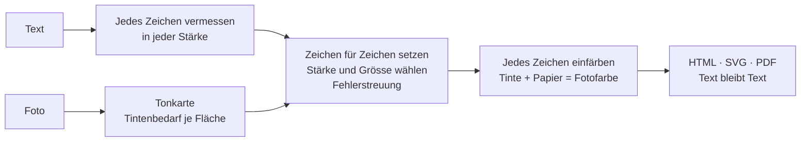

1. **Vermessen.** Für jedes Zeichen: Breite und Tintendeckung in zehn Stärken (und, wenn die optionale Breitenachse an ist, in drei Breiten).
2. **Abbilden.** Das Foto wird zum „Tintenbedarf“ je Fläche: Dunkelheit auf hellem Papier, Helligkeit auf dunklem.
3. **Setzen.** Zeile für Zeile bekommt jedes Zeichen die Stärke und Grösse (und, wenn aktiviert, die Breite), deren Tinte am besten zur Fläche passt. Der Restfehler wandert zum nächsten Zeichen und zur nächsten Zeile (Fehlerstreuung), so stimmen die Töne im Mittel.
4. **Einpassen.** Eine Binärsuche findet die Schriftgrösse, bei der der ganze Text das Bild genau füllt.
5. **Einfärben.** Im Farbmodus wird die Tinte jedes Zeichens so gewählt, dass Tinte und sichtbares Papier zusammen die Fotofarbe ergeben.

Details und Formeln: [docs/algorithm.md](docs/algorithm.md) (Englisch).

## Nutzen

### Im Browser

Auf **[typographics-art.org/app.html](https://typographics-art.org/app.html)** Text einfügen (oder einen von 28 Beispieltexten wählen), Foto hineinziehen. Vorlagen: *Hohe Lesbarkeit* (ganze Wörter, hell), *Porträt*, *Plakat*. Export als HTML, SVG, PNG oder Drucken als PDF.

Dein Text und dein Foto werden in deinem Browser verarbeitet und nie hochgeladen; die Seite lädt keine Ressourcen von Dritten. Eine ehrliche Einschränkung: SVG- und HTML-Dateien, die der Generator exportiert, verweisen auf das Schrift-Stylesheet unter `https://typographics-art.org/assets/fonts/fonts.css`; wer so eine Datei öffnet, kontaktiert also typographics-art.org (nicht Google). PDFs betten ihre Schriften ein.

Die Seite [**/work**](https://typographics-art.org/work.html) zeigt ein fertiges Werk in drei Ansichten: *Kunst* (das Bild erkennen), *Lesen* (den ganzen Text lesen und durchsuchen) und *Maschine* (strukturierter Text mit Quelle, Abschnitten und einer SHA-256-Prüfsumme über den kanonischen Text, derselbe Wert wie aus HTML, SVG und PDF des Werks).

### Als Bibliothek

Kein Build-Schritt, keine Abhängigkeiten. ES-Module für Browser und Node. Bibliothek: Node ≥ 20; CLI: Node ≥ 22; API: Node ≥ 22.5.

```js
import { typeset, toPng } from './src/browser.js';
import { toSvg, toStandaloneHtml, isFaithful } from './src/index.js';

const sheet = await typeset(text, imageElement, {
  font: 'roboto',        // die eine Schrift: Roboto Flex (Stärken 100–1000)
  legibility: 'medium',  // high | medium | free
  color: 'photo',        // photo | gray | mono
  paper: 'light',        // light | dark
  unit: 'char',          // char | word (ein Stil je Wort: ruhiger zu lesen)
  stretch: true,         // auch die Buchstabenbreite variieren: optional, standardmässig aus (hier eingeschaltet)
  shape: true,           // Kanten innerhalb jedes Buchstabens folgen
  width: 960,
});

isFaithful(sheet);         // true: der gesetzte Text entspricht der Quelle
toStandaloneHtml(sheet);   // HTML-Ausschnitt, Text als Zeichen
toSvg(sheet);              // SVG, Text als Zeichen
toPng(sheet);              // PNG-Data-URL (nur Bild)
```

Die reinen Module (`layout`, `tone`, `color`, `render`, `typeset`) laufen überall; `browser.js` vermisst echte Schriften und liest Pixel. Alle Optionen und Standardwerte: [src/options.js](src/options.js).

### Auf der Befehlszeile

Braucht Node 22+ (die CLI nutzt das globale `WebSocket`) und Chrome oder Chromium (`CHROME_PATH`, falls es nicht gefunden wird); für PDFs zusätzlich MuPDF (`mutool`), das jeden gedruckten Streifen prüft und der Seite ihre exakte Grösse gibt, und optional qpdf für kleinere Dateien. Schreibt PDFs mit echter Textebene.

```sh
node cli/tg-art.mjs gallery/photos/tesla.jpg --string "Hallo Welt" --paper dark -o hallo.svg
node cli/tg-art.mjs foto.jpg --text gedicht.txt --fill 12000 -o gedicht.pdf
node cli/tg-art.mjs --help
```

Das Ausgabeformat folgt der Dateiendung: `.svg`, `.html`, `.pdf` (Text bleibt Text), `.png`, `.jpg` (nur Bild).

### Kostenpflichtige API

Die einzige Stelle, an der ein Dokument hochgeladen wird: [`api/`](api/README.md) macht aus einem gesendeten Dokument einen One-Pager, bezahlt mit einer DigiByte-Transaktion (kein Konto, kein API-Schlüssel). Einzelheiten und Selbst-Hosting: [api/README.md](api/README.md) (Englisch).

## Galerie

| | | |
|---|---|---|
| [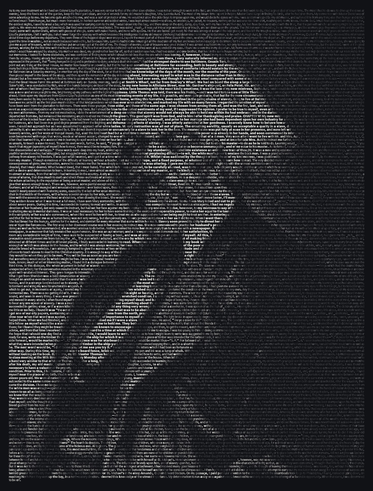](gallery/douglass.svg)<br>**Learning to Read** · Frederick Douglass | [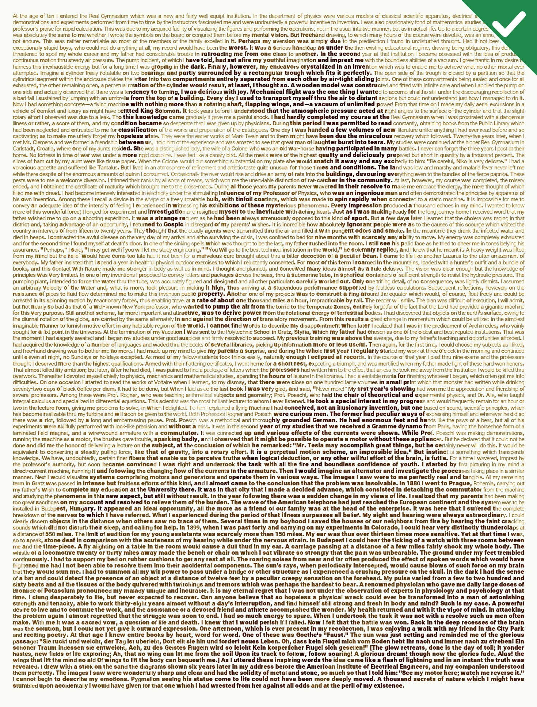](gallery/tesla.svg)<br>**My Inventions** · Nikola Tesla | [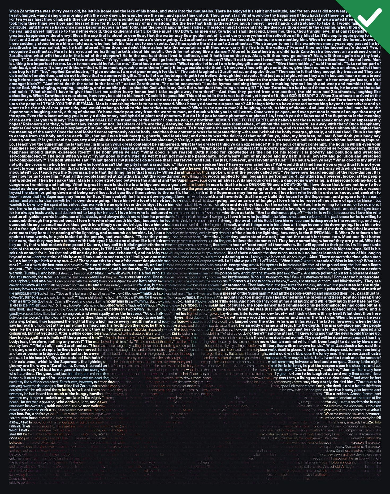](gallery/wanderer.svg)<br>**The Wanderer** · Nietzsche · C. D. Friedrich |
| [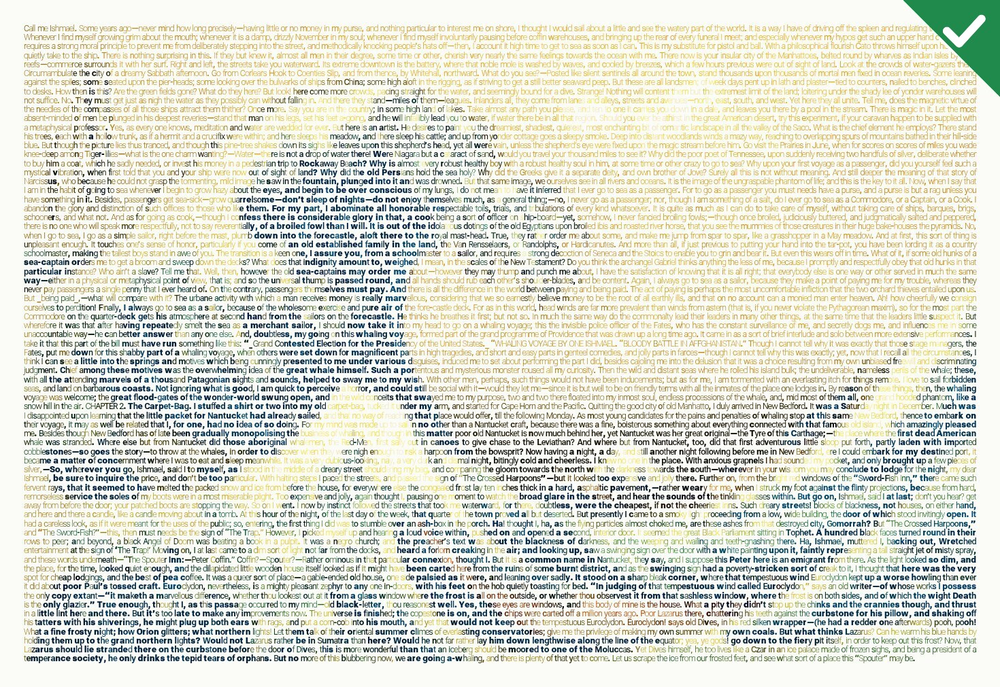](gallery/great-wave.svg)<br>**The Great Wave** · Melville · Hokusai | [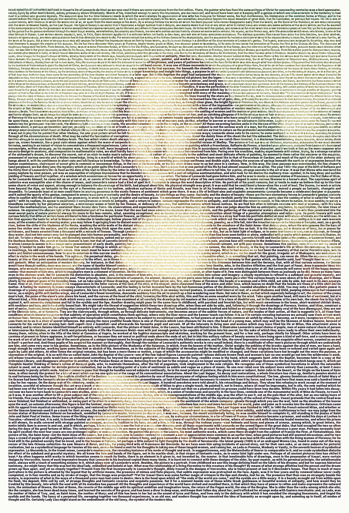](gallery/mona-lisa.svg)<br>**La Gioconda** · Walter Pater · Leonardo | [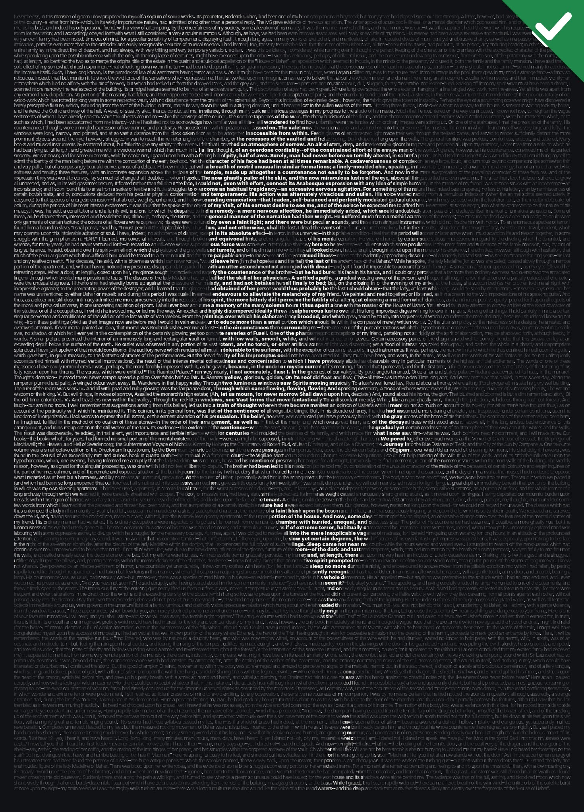](gallery/poe.svg)<br>**The House of Usher** · Edgar Allan Poe |
| [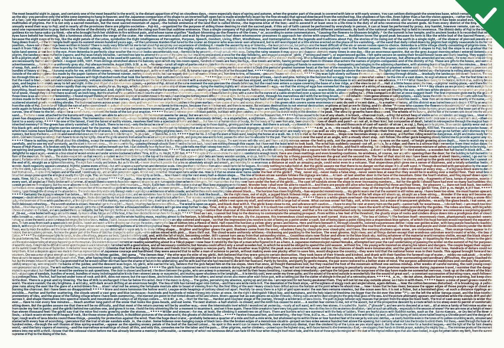](gallery/red-fuji.svg)<br>**Fuji-no-Yama** · Lafcadio Hearn · Hokusai | [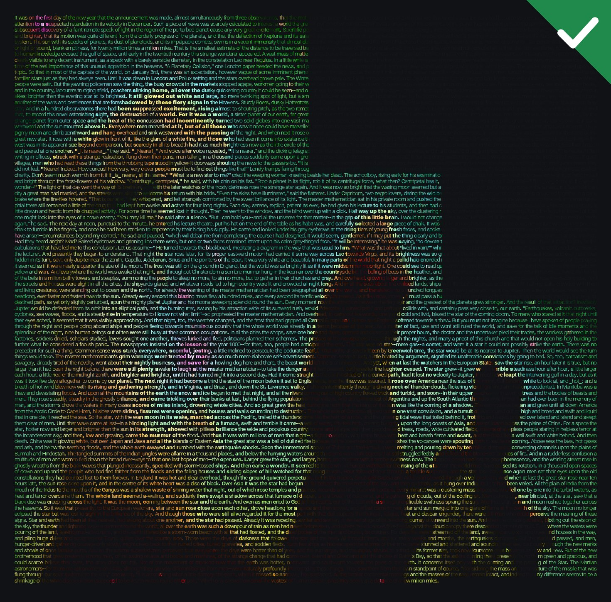](gallery/pillars-of-creation.svg)<br>**The Star** · H. G. Wells · Hubble | [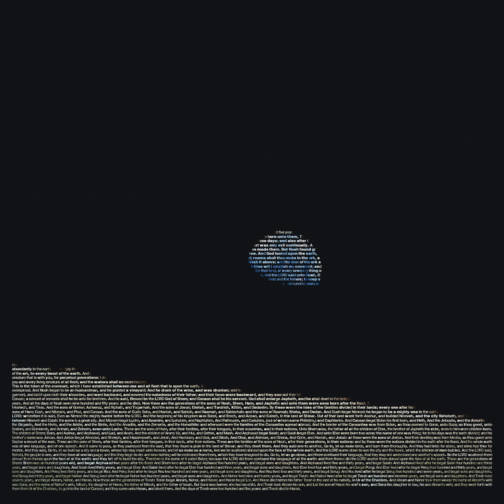](gallery/earthrise.svg)<br>**Earthrise** · Genesis · Apollo 8 |

Alle fünfzehn Werke, jedes auf sein Originalbild umschaltbar: [typographics-art.org/gallery](https://typographics-art.org/gallery). Jedes Bild ist gemeinfrei ([Quellen](gallery/photos/README.md)); jeder Text ist eine zusammenhängende Passage eines gemeinfreien Werks, ausser der Allgemeinen Erklärung der Menschenrechte (ein UN-Text, frei vervielfältigbar), die vollständig gesetzt ist; kein Fülltext. Materialien Dritter und Nachweise: [NOTICE.md](NOTICE.md). **Dein Werk?** [Werk einreichen](https://github.com/typ0graphic5/tg-art/issues/new?template=artwork.yml).

Jede Vorschau verlinkt auf das SVG, das das Werk selbst ist: öffnen und den Text durchsuchen. Alle Werke sind aus [`gallery/works.config.json`](gallery/works.config.json) mit `npm run gallery` reproduzierbar.

## Wofür das gut ist

- **Kunst, die sich selbst erklärt.** Ein Porträt aus der Biografie der Person, eine Stadt aus ihrer Geschichte. Jeder Leser, Mensch oder Maschine, bekommt beides.
- **Barrierefreie Bilder.** Der Text ist echter Text, ein Screenreader liest ihn; was das Bild zeigt, hat eine eigene kurze Beschreibung. Gemessen am Zugänglichkeitsbaum von Chrome ([docs/technique.md](docs/technique.md), Regel 2), noch nicht mit NVDA, JAWS oder VoiceOver getestet.
- **Auffindbare Kunst.** Suchmaschinen und KI-Crawler indexieren die Wörter, nicht nur einen Dateinamen.
- **Herkunft.** Der Text in einem Werk kann eine Aussage, eine Lizenz oder eine Signatur tragen, die Kopieren übersteht.
- **Plakate und Datensätze.** Gedichte, Manifeste, Liedtexte und Code als Bilder, die zitierbar bleiben.

## Häufige Fragen

**Ist das ein Kalligramm?** Kalligramme (wie bei Apollinaire) ordnen Text entlang einer Form an, meist von Hand. Typographics Art behält einen normalen Lesesatz bei und erzeugt das Bild nur über die Typografie je Zeichen, berechnet aus einem beliebigen Foto.

**Verletzt Lorem-ipsum-Fülltext die Treue-Regel?** Nein, solange er ausgewiesen ist. App und Befehlszeile melden genau, wie viele Zeichen Fülltext sind, und er steht immer hinter deinem Text.

**Warum Variable Fonts?** Eine Stärkeachse (manchmal auch eine Breitenachse) gibt jedem Zeichen einen stufenlosen Bereich an Tinte, so lassen sich Töne genau treffen, ohne den Buchstaben zu ändern.

**Darf ich es kommerziell nutzen?** Ja. Der Code steht unter MIT, die Schriften unter der SIL Open Font License ([NOTICE.md](NOTICE.md)). Achte auf die Rechte an Texten und Fotos.

## Mitmachen

Typographics Art soll eine gemeinsame Technik werden, so wie ASCII-Art. Ideen, Schriften für Schriftsysteme, die Roboto Flex fehlen, bessere Algorithmen, Übersetzungen, Messungen und Werke sind willkommen. Los geht es mit [CONTRIBUTING.md](CONTRIBUTING.md); bitte beachte den [Verhaltenskodex](CODE_OF_CONDUCT.md). Issues und Pull Requests auf Deutsch sind willkommen.

```sh
npm test          # node --test, keine Abhängigkeiten (wenige Sekunden)
npm run dev       # braucht Python 3; Startseite auf http://localhost:8080, Generator unter /app.html
npm run gallery   # Galerie neu rendern (braucht Chrome/Chromium)

# nur zum Veröffentlichen der Website: erst die Moby-Dick-Zoomkacheln (Chrome, etwa 4 Minuten, 522 Kacheln), dann die Seite
node demo/moby-dick/build.mjs zoom
node scripts/build-site.mjs
```

Du schreibst über Typographics Art? Das [Pressekit](docs/press-kit.md) (Englisch) hat Texte, Fakten und Bilder.

## Verzeichnisse

| Pfad | Was es ist |
|---|---|
| `src/` | die Bibliothek |
| `cli/` | Befehlszeilenwerkzeuge |
| `api/` | der Server der kostenpflichtigen One-Pager-API |
| `scripts/` | Bauwerkzeuge für Website und Dokumentation |
| `gallery/` | die 15 Werke |
| `examples/` | One-Pager-Beispiele (31) mit ihren veröffentlichten Quelltexten |
| `samples/` | Beispieltexte für den Generator (erzeugt von `scripts/build-samples.mjs`) |
| `demo/` | das Moby-Dick-Poster |
| `docs/` | Messungen und Regeln |
| `about/` | erzeugte Ein-Datei-Beschreibung für KI-Assistenten |
| `benchmark/` | das Testdokument für [docs/ai-benefit.md](docs/ai-benefit.md) |
| `assets/` | Markenmaterial |
| `test/` | Tests |

## Lizenz

[MIT](LICENSE) © The Typographics Art contributors; das gilt für den Code, die eigenen Texte und Motive des Projekts und `assets/`. Materialien Dritter (Schriften, Fotografien, Quelldokumente) behalten ihre eigenen Lizenzen: siehe [NOTICE.md](NOTICE.md).
