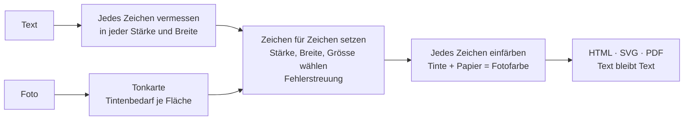

<h1 align="center">
  <picture>
    <source media="(prefers-color-scheme: dark)" srcset="assets/wordmark-dark.jpg">
    
  </picture>
</h1>

<p align="center"><a href="gallery.html"></a></p>

<p align="center">
  <b>ASCII-Art für das Zeitalter der KI.</b><br>
  Das Bild ist für Menschen. Der Text bleibt für Maschinen.
</p>

<p align="center">
  <a href="https://typographics-art.org/app.html">Auf typographics-art.org ausprobieren</a> ·
  <a href="https://typographics-art.org/gallery.html">Galerie</a> ·
  <a href="docs/technique.md">Definition</a> ·
  <a href="docs/ai-readability.md">KI-Lesbarkeit</a> ·
  <a href="README.md">English</a>
</p>

---

## Frag deine KI, was das ist

Alles aus diesem Repository, README und Dokumente, in einer Datei: **[about/typographics-art.md](about/typographics-art.md)** (44 000 Zeichen, auch unter [typographics-art.org/llms-full.txt](https://typographics-art.org/llms-full.txt)). Oder gib ihr denselben Text als One-Pager, gesetzt mit der Technik selbst: **[about/typographics-art.pdf](about/typographics-art.pdf)**. Dann frag: *Was ist Typographics Art, und kannst du diese Seite noch lesen?*

## Die Idee

**ASCII-Art** baut ein Bild aus Zeichen, aber die Zeichen bedeuten nichts. Ein Mensch sieht ein Gesicht, eine Maschine sieht `@@%#*+=-:.`. Der Text ist weg.

**Typographics Art** (TG-Art) baut ein Bild aus einem *echten Text*. Jedes Zeichen wird genau einmal und in seiner ursprünglichen Reihenfolge gesetzt. Nur die Typografie ändert sich: Grösse, Strichstärke, Breite und Farbe. Ein Mensch sieht das Bild. Ein Sprachmodell, eine Suchmaschine oder ein Screenreader liest den Text, genau so, wie er geschrieben wurde.

| | ASCII-Art | Typographics Art |
|---|---|---|
| Was gewählt wird | das **Zeichen** für jede Zelle eines Rasters | die **Typografie** für jedes Zeichen eines Textes |
| Der Text | verloren, ersetzt durch Schattierungszeichen | 1:1 erhalten, in Lesereihenfolge |
| Was eine Maschine liest | `@@%%##**++==--::..` | *„Wer reitet so spät durch Nacht und Wind? …“* |
| Schriften | Festbreite, eine Grösse | Variable Fonts: Stärke, Breite, Grösse, Farbe je Zeichen |
| Format | reiner Text | HTML, SVG, PDF mit Textebene |

### Was ein Mensch sieht und was eine KI liest

Das Porträt von Frederick Douglass oben ist aus seiner eigenen *Narrative* (1845) gesetzt, Kapitel V–VIII. Öffne [`gallery/douglass.svg`](gallery/douglass.svg), markiere alles und kopiere es, oder gib die Datei einem beliebigen Modell:

```text
As to my own treatment while I lived on Colonel Lloyd’s plantation, it was very similar to that
of the other slave children. I was not old enough to work in the field, and there being little
else than field work to do, I had a great deal of leisure time. …
```

Darum geht es: **Das Kunstwerk ist zugleich das Dokument.** Kein Alt-Text nötig, der Inhalt *ist* der Alt-Text.

## Lesbar für KI, gemessen

Wir behaupten es nicht nur. Jede Zahl unten ist gemessen und nachvollziehbar ([Methode](docs/ai-readability.md)).

| Wie eine Maschine an den Text kommt | Ergebnis |
|---|---|
| **HTML oder SVG**: Zeichen auslesen (DOM, XML) | **100 % exakt.** Bei jedem Commit von der Testsuite geprüft. |
| **PDF-Textebene** in gespeicherter Reihenfolge (`pdftotext -raw`) | **100 % exakt** in allen 6 getesteten Einstellungen |
| **PDF**, Werkzeuge, die das Seitenlayout nachbauen (`pdftotext` Standard) | exakt bei Lesbarkeit *hoch*; 97–99 % der Wortreihenfolge bei *mittel* und *frei* |
| **Nur das Bild**: Texterkennung (Tesseract 5.5) auf einem PNG in 2× | Lesbarkeit *hoch*: **98,9–99,6 %** der Wörter · *mittel*: 88,7–92,7 % · *frei*: 68,8–82,3 % |
| **Nur das Bild**: ein Bild-Sprachmodell (Claude) liest Ausschnitte | **100 %** von 217 Wörtern, bei *hoch*, *mittel* und *frei* (erste Stichprobe) |

Also: **Gib Maschinen das HTML oder SVG**, dann bekommen sie den Text fehlerfrei, bei jeder künstlerischen Einstellung. PDF ebenso, wenn es in gespeicherter Reihenfolge gelesen wird, und mit jedem Werkzeug bei Lesbarkeit *hoch*. Reist nur ein Bild (Screenshot, Social-Media-Post), wähle Lesbarkeit *hoch*, dann übersteht der Text sogar reine Bilderkennung. In einer ersten Stichprobe las ein Bild-Sprachmodell jedes Wort, sogar bei *frei*, wo klassische Texterkennung stolpert. Mehr Modelle und grössere Stichproben: [Hilfe ist willkommen](CONTRIBUTING.md).

## Demonstrator: Moby-Dick in einem Bild

Der stärkste Beleg ist ein ganzes Buch. [**typographics-art.org/demo/moby-dick**](https://typographics-art.org/demo/moby-dick/) setzt den vollständigen Text von *Moby-Dick* (1,2 Millionen Zeichen, 135 Kapitel) als ein einziges Poster von 2 × 3 m in drei Feldern, ein Motiv je Teil des Buches. Neben dem zoombaren Poster steht der Nachweis:

- **Vollständig:** Der aus dem Kunstwerk zurückgelesene Text hat denselben SHA-256-Hash wie der Ausgangstext.
- **Korrekt ausgelesen:** Aus dem SVG-Master und aus dem Druck-PDF werden 100 zufällige Passagen an ihrer Originalposition gefunden, Kapitelstruktur und Worthäufigkeiten sind identisch.
- **Für KI verwendbar:** Ein definierter Fragensatz (Erzähler, Schiff, Kapitän, …) hat jede Antwort im ausgelesenen Text belegt; Texterkennungs-Stichproben messen, was in einem blossen Foto des Posters übrig bleibt.
- **Nachprüfbar:** Buch bei Project Gutenberg laden, zwei Skripte ausführen, Hashes vergleichen. Vollständiger Bericht: [demo/moby-dick/proof.md](demo/moby-dick/proof.md).

Ein Klick auf das Poster zeigt den Text an genau dieser Stelle, gelesen aus den Zeilenpositionen des Kunstwerks selbst.

## One-Pager: ein ganzes Dokument auf einer Seite

`cli/onepage.mjs` setzt den vollständigen Text eines mehrseitigen PDFs (oder einer Textdatei) auf eine einzige Seite. Die Buchstaben sind winzig und formen zusammen den Titel des Dokuments in grosser Schrift oder, mit `--motif`, ein Bild über dem Titel. Ein Mensch erkennt sofort, was die Seite enthält. Ein Modell liest jedes Wort aus der Textebene des PDFs, die Schriftgrösse spielt dafür keine Rolle.

| | | |
|---|---|---|
| [](examples/ch-bundesverfassung/onepage.pdf)<br>**Bundesverfassung**<br>102 Seiten, 228 576 Zeichen | [](examples/eu-ai-act/onepage.pdf)<br>**EU AI Act**<br>144 Seiten, 595 706 Zeichen | [](examples/code-review-agent/onepage.pdf)<br>**KI-Anweisungen**<br>Regeln eines Code-Review-Agenten |

Jedes Beispiel wird mit MuPDF zurückgelesen und mit der Quelle verglichen; alle stimmen überein. Zehn Beispiele (Gesetze, Erklärungen, PEP 8, Anweisungen für KI-Agenten, die [AGENTS.md](AGENTS.md) dieses Repos) liegen in [examples/](examples/).

**Dateigrösse.** Jedes Zeichen trägt eigene Stärke, Breite, Grösse und Farbe, und ein PDF bettet für jede verwendete Kombination aus Stärke, Breite und Grösse eine Schrift ein. Gemessen und optimiert in [docs/file-size.md](docs/file-size.md): Umrisse gerundet, leere Barrierefreiheits-Tags weggelassen, standardmässig eine Schriftgrösse (das macht das Bild zugleich schärfer). Drei der fünf PDF-Beispiele sind jetzt *kleiner* als ihre Quelle (US-Verfassung 1,6 MB statt 3,8 MB, EU AI Act 2,2 MB statt 2,5 MB), die übrigen bis 2,8-mal grösser; kurze reine Textquellen wachsen am stärksten (3 KB Anweisungen → 67–105 KB). Mit `--weights 2` wird ein One-Pager noch kleiner. Die [Beispieltabelle](examples/README.md#file-size-honestly) nennt jede Grösse; die Original-Motive liegen in [examples/motifs/](examples/motifs/).

Teile das PDF, nicht ein Bild davon: In dieser Grösse ist ein reines Bild für Texterkennung und Bildmodelle nur graue Textur. Und bleib ehrlich: Der sichtbare Titel muss das Dokument benennen, und winziger Text darf nie Anweisungen vor den Menschen verstecken, die die Seite sehen.

## Versteckte Nachrichten

Ein Werk kann eine Nachricht tragen, die nur lesen kann, wer den Schlüssel hat. Das Werk selbst ändert sich nicht: Es enthält nur seinen öffentlichen Text, nichts Unsichtbares. Der Schlüssel merkt sich für jedes Zeichen der Nachricht eine Stelle im Text, an der dasselbe Zeichen steht, zufällig unter allen Vorkommen gewählt (eine Buch-Chiffre). Mit Schlüssel und dem richtigen Werk kommt die Nachricht zurück; bei jedem anderen Werk passt der Text-Fingerabdruck des Schlüssels nicht.

```sh
node cli/tg-secret.mjs hide   werk.pdf --secret "Treffpunkt Hafen, 18 Uhr."   # gibt den Schlüssel aus: tg1.…
node cli/tg-secret.mjs reveal werk.pdf --key tg1.…                            # gibt die Nachricht aus
```

Funktioniert mit PDF (gelesen mit MuPDF), SVG, HTML und Text; im Web-Generator unter *Versteckte Nachricht*. Bewahre den Schlüssel wie ein Passwort auf: Mit Schlüssel und Werk kann jeder die Nachricht lesen. Zeichen, die im öffentlichen Text nicht vorkommen, lassen sich nicht verstecken; das Werkzeug nennt sie.

## Die drei Regeln

1. **Treue.** Der Text wird nie verändert, umgestellt oder gekürzt. Fülltext (etwa Lorem ipsum für ein feineres Bild) ist nur erlaubt, wenn er ausgewiesen ist.
2. **Text bleibt Text.** Das Werk wird als echter Text veröffentlicht: HTML, SVG oder PDF mit Textebene. Herauskopiert ergibt es genau den Ausgangstext.
3. **Nur die Typografie variiert.** Keine Formen, Hintergründe oder Bilder ausser den Zeichen.

Vollständige Definition: [docs/technique.md](docs/technique.md) (Englisch).

## So funktioniert es



1. **Vermessen.** Für jedes Zeichen: Breite und Tintendeckung in zehn Stärken (und drei Breiten bei Schriften mit Breitenachse).
2. **Abbilden.** Das Foto wird zum „Tintenbedarf“ je Fläche: Dunkelheit auf hellem Papier, Helligkeit auf dunklem.
3. **Setzen.** Zeile für Zeile bekommt jedes Zeichen die Stärke, Breite und Grösse, deren Tinte am besten zur Fläche passt. Der Restfehler wandert zum nächsten Zeichen und zur nächsten Zeile (Fehlerstreuung), so stimmen die Töne im Mittel.
4. **Einpassen.** Eine Binärsuche findet die Schriftgrösse, bei der der ganze Text das Bild genau füllt.
5. **Einfärben.** Im Farbmodus wird die Tinte jedes Zeichens so gewählt, dass Tinte und sichtbares Papier zusammen die Fotofarbe ergeben.

Details und Formeln: [docs/algorithm.md](docs/algorithm.md) (Englisch).

## Nutzen

### Im Browser

Auf **[typographics-art.org/app.html](https://typographics-art.org/app.html)** Text einfügen, Foto hineinziehen. Vorlagen: *KI-sicher* (immer lesbar), *Porträt*, *Plakat*. Export als HTML, SVG, PNG oder Drucken als PDF. Alles läuft lokal, nichts wird hochgeladen.

### Als Bibliothek und auf der Befehlszeile

Codebeispiele stehen in der [englischen README](README.md#use-it). Kurz:

```sh
node cli/tg-art.mjs foto.jpg --text gedicht.txt --fill 12000 -o gedicht.pdf
```

Braucht Node 22+ und Chrome oder Chromium; für PDFs zusätzlich MuPDF (`mutool`), das jeden gedruckten Streifen prüft und der Seite ihre exakte Grösse gibt, und optional qpdf für kleinere Dateien. Schreibt PDFs mit echter Textebene.

## Wofür das gut ist

- **Kunst, die sich selbst erklärt.** Ein Porträt aus der Biografie der Person, eine Stadt aus ihrer Geschichte. Jeder Leser, Mensch oder Maschine, bekommt beides.
- **Barrierefreie Bilder.** Der Inhalt ist die Beschreibung: Screenreader lesen den Text vor.
- **Auffindbare Kunst.** Suchmaschinen und KI-Crawler indexieren die Wörter, nicht nur einen Dateinamen.
- **Herkunft.** Der Text in einem Werk kann eine Aussage, eine Lizenz oder eine Signatur tragen, die Kopieren übersteht.
- **Plakate und Datensätze.** Gedichte, Manifeste, Liedtexte und Code als Bilder, die zitierbar bleiben.

## Häufige Fragen

**Ist das ein Kalligramm?** Kalligramme (wie bei Apollinaire) ordnen Text entlang einer Form an, meist von Hand. Typographics Art behält einen normalen Lesesatz bei und erzeugt das Bild nur über die Typografie je Zeichen, berechnet aus einem beliebigen Foto.

**Verletzt Lorem-ipsum-Fülltext die Treue-Regel?** Nein, solange er ausgewiesen ist. App und Befehlszeile melden genau, wie viele Zeichen Fülltext sind, und er steht immer hinter deinem Text.

**Darf ich es kommerziell nutzen?** Ja. Der Code steht unter MIT, die Schriften unter der SIL Open Font License. Achte auf die Rechte an Texten und Fotos.

## Mitmachen

Typographics Art soll eine gemeinsame Technik werden, so wie ASCII-Art. Ideen, Schriften, bessere Algorithmen, Übersetzungen, Messungen und Werke sind willkommen. Los geht es mit [CONTRIBUTING.md](CONTRIBUTING.md); Issues und Pull Requests auf Deutsch sind willkommen.

Du schreibst über Typographics Art? Das [Pressekit](docs/press-kit.md) (Englisch) hat Texte, Fakten und Bilder.

## Lizenz

[MIT](LICENSE) © The Typographics Art contributors
