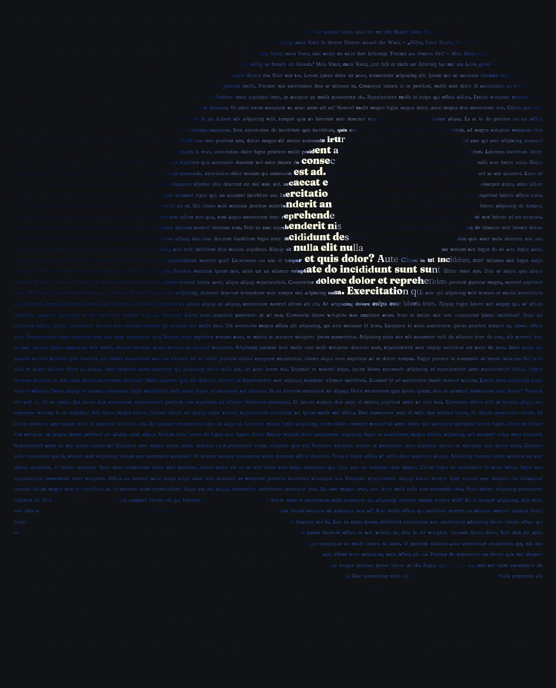
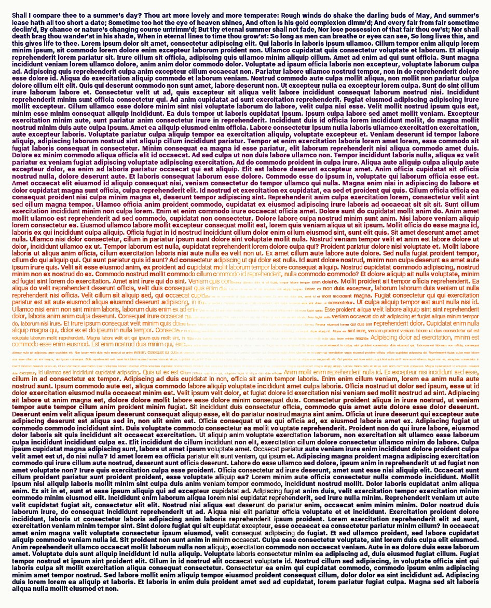
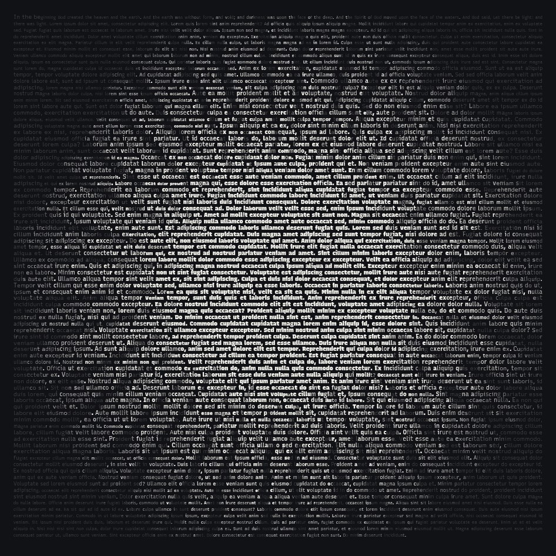
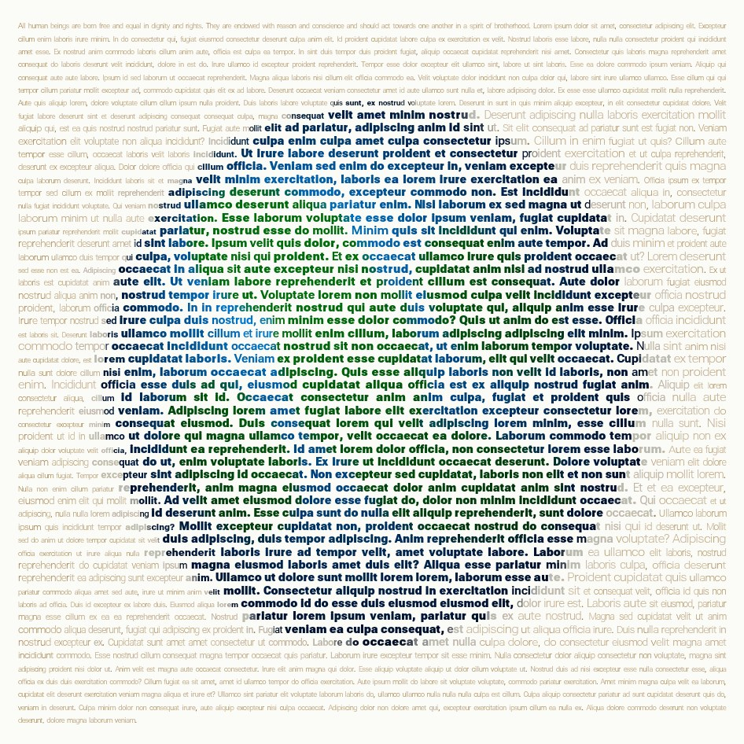
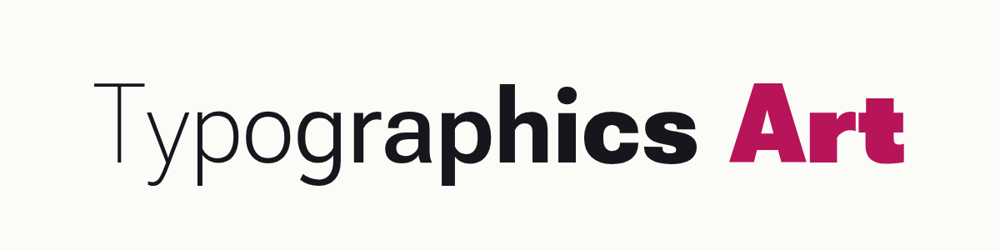
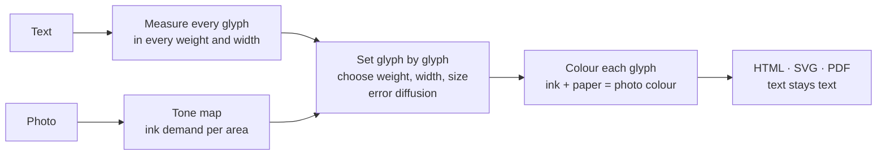
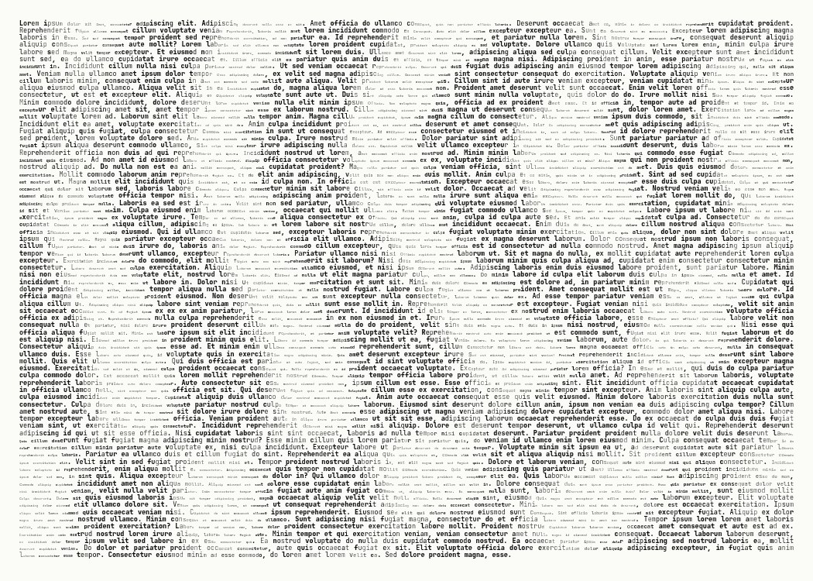

<p align="center">
  
  
  
  
</p>

<h1 align="center"></h1>

<p align="center">
  <b>ASCII art for the age of AI.</b><br>
  The picture is for people. The text stays for machines.
</p>

<p align="center">
  <a href="https://tg-art.org">Try it on tg-art.org</a> ·
  <a href="https://tg-art.org/gallery.html">Gallery</a> ·
  <a href="docs/technique.md">Definition</a> ·
  <a href="docs/ai-readability.md">AI readability</a> ·
  <a href="README.de.md">Deutsch</a>
</p>

---

## The idea

**ASCII art** builds a picture out of characters, but the characters mean nothing. A person sees a face; a machine sees `@@%#*+=-:.`. The text is gone.

**Typographic Art** (TG Art) builds a picture out of a *real text*. Every character of the text is set once, in its original order. Only its typography changes: size, weight, width and colour. A person sees the picture. A language model, a search engine or a screen reader reads the text, exactly as it was written.

| | ASCII art | Typographic Art |
|---|---|---|
| What is chosen | the **character** for each cell of a grid | the **typography** for each character of a text |
| The text | lost, replaced by shading characters | kept 1:1, in reading order |
| What a machine reads | `@@%%##**++==--::..` | *"Wer reitet so spät durch Nacht und Wind? …"* |
| Fonts | monospace, one size | variable fonts: weight, width, size, colour per glyph |
| Format | plain text | HTML, SVG, PDF with a text layer |

### What a person sees, and what an AI reads

The moon above is set from Goethe's *Erlkönig*. Open [`gallery/erlkoenig.svg`](gallery/erlkoenig.svg), select all and copy, or hand the file to any model:

```text
Wer reitet so spät durch Nacht und Wind? Es ist der Vater mit seinem Kind; Er hat den Knaben
wohl in dem Arm, Er faßt ihn sicher, er hält ihn warm. Mein Sohn, was birgst du so bang dein
Gesicht? – Siehst, Vater, du den Erlkönig nicht? …
```

That is the whole point: **the artwork is also the document.** No alt text needed; the content *is* the alt text.

## Readable for AI, measured

We do not just claim it. Every number below is measured and reproducible ([method](docs/ai-readability.md)).

| How a machine gets the text | Result |
|---|---|
| **HTML or SVG**: reading the characters (DOM, XML) | **100 % exact.** Checked by the test suite on every commit. |
| **PDF text layer** in stored order (`pdftotext -raw`) | **100 % exact** in all 6 tested settings |
| **PDF**, tools that rebuild the visual layout (`pdftotext` default) | exact at legibility *high*; 97–99 % of the word order kept at *medium* and *free* |
| **Only the picture**: OCR (Tesseract 5.5) on a PNG at 2× | legibility *high*: **98.9–99.6 %** of words · *medium*: 88.7–92.7 % · *free*: 68.8–82.3 % |
| **Only the picture**: a vision-language model (Claude) reading crops | **100 %** of 217 words, at *high*, *medium* and *free* (first sample) |

So: **give machines the HTML or SVG**, and they get the text perfectly, at any artistic setting. PDF works the same when read in stored order, and with every tool at legibility *high*. If only an image travels (a screenshot, a social post), choose legibility *high* and the text survives even pure image recognition. A first sample with a vision-language model read every word, even at *free*, where classic OCR stumbles. More models and larger samples: [help is welcome](CONTRIBUTING.md).

## Demonstrator: Moby-Dick in one picture

The strongest proof is a whole book. [**tg-art.org/demo/moby-dick**](https://tg-art.org/demo/moby-dick/) sets the complete text of *Moby-Dick* (1.2 million characters, 135 chapters) as a single 2 × 3 m poster in three panels, one motif per part of the book. Next to the zoomable poster, the page shows the proof:

- **Complete:** the text read back from the artwork has the same SHA-256 hash as the source text.
- **Read back correctly:** from the SVG master and from the print PDF, 100 random passages are found at their original positions, chapter structure and word frequencies are identical.
- **Usable by AI:** a defined question set (narrator, ship, captain, …) has every answer grounded in the extracted text; OCR samples measure what survives in a mere photo of the poster.
- **Reproducible:** download the book from Project Gutenberg, run two scripts, compare the hashes. Full report: [demo/moby-dick/proof.md](demo/moby-dick/proof.md).

Click anywhere on the poster and the page shows the text at that spot, read from the artwork's own line offsets.

## The three rules

1. **Fidelity.** The text is never changed, reordered or shortened. Filler text (for example Lorem ipsum for a finer picture) is allowed only if it is declared.
2. **Text stays text.** The work is published as real text: HTML, SVG, or PDF with a text layer. Extracting it yields exactly the source.
3. **Only typography varies.** No shapes, backgrounds or images besides the glyphs.

Full definition: [docs/technique.md](docs/technique.md).

## How it works



1. **Measure.** For each character: advance width and ink coverage at ten weights (and three widths for fonts with a width axis).
2. **Map.** The photo becomes an "ink demand" per area: darkness on light paper, brightness on dark paper.
3. **Set.** Line by line, each glyph gets the weight, width and size whose ink best matches the area it covers. The leftover error is passed on to the next glyph and the next line (error diffusion), so tones average out correctly.
4. **Fit.** A binary search finds the font size at which the whole text fills the picture exactly.
5. **Colour.** In colour mode each glyph's ink is chosen so that ink and visible paper average to the photo colour.

Details and formulas: [docs/algorithm.md](docs/algorithm.md).

## Use it

### In the browser

Go to **[tg-art.org](https://tg-art.org)**, paste a text, drop a photo. Presets: *AI-safe* (always legible), *Portrait*, *Poster*. Export HTML, SVG, PNG, or print to PDF. Everything runs locally; nothing is uploaded.

### As a library

No build step, no dependencies. ES modules for browsers and Node ≥ 20.

```js
import { typeset, toPng } from './src/browser.js';
import { toSvg, toStandaloneHtml, isFaithful } from './src/index.js';

const sheet = await typeset(text, imageElement, {
  font: 'roboto',        // roboto | fraunces | recursive | archivo | notoserif | mono
  legibility: 'medium',  // high | medium | free
  color: 'photo',        // photo | gray | mono
  paper: 'light',        // light | dark
  unit: 'char',          // char | word (one style per word: calmer to read)
  stretch: true,         // also vary letter width (fonts with a width axis)
  shape: true,           // follow edges within each letter
  width: 960,
});

isFaithful(sheet);         // true: the set text equals the source
toStandaloneHtml(sheet);   // HTML snippet, text as characters
toSvg(sheet);              // SVG, text as characters
toPng(sheet);              // PNG data URL (image only)
```

The pure modules (`layout`, `tone`, `color`, `render`, `typeset`) run anywhere; `browser.js` measures real fonts and reads pixels. All options and defaults: [src/options.js](src/options.js).

### On the command line

Needs Node 22+ and Chrome or Chromium (`CHROME_PATH` if it is not found). Writes PDFs with a real text layer.

```sh
node cli/tg-art.mjs photo.jpg --text poem.txt --fill 12000 -o poem.pdf
node cli/tg-art.mjs photo.jpg --string "Hello world" --font fraunces --paper dark -o hello.svg
node cli/tg-art.mjs --help
```

The output format follows the file extension: `.svg`, `.html`, `.pdf` (text stays text), `.png`, `.jpg` (image only).

## Gallery

| | | |
|---|---|---|
| [](gallery/erlkoenig.svg)<br>**Erlkönig** · Goethe | [](gallery/sonnet-18.svg)<br>**Sonnet 18** · Shakespeare | [](gallery/let-there-be-light.svg)<br>**Let there be light** · Genesis 1:1–3 |
| [](gallery/article-1.svg)<br>**Article 1** · Universal Declaration of Human Rights | [](gallery/waves.svg)<br>**Waves** · Lorem ipsum | **Yours?**<br>[Submit an artwork](https://github.com/typographic-art/tg-art/issues/new?template=artwork.yml) |

Each preview links to the SVG, which is the work itself: open it and search the text. All works are reproducible from [`gallery/works.config.json`](gallery/works.config.json) with `npm run gallery`.

## Where this is useful

- **Art that explains itself.** A portrait made of the sitter's biography, a city made of its history. Any reader, human or machine, gets both.
- **Accessible images.** The content is the description: screen readers read the text, no separate alt text is needed.
- **Findable art.** Search engines and AI crawlers index the words, not just a file name.
- **Provenance.** The text inside a work can carry a statement, a licence or a signature that survives copy and paste.
- **Datasets and posters.** Poems, manifestos, lyrics and code as pictures that stay quotable.

## FAQ

**Is this a calligram?** Calligrams (like Apollinaire's) arrange text along a shape, usually by hand. Typographic Art keeps a normal reading layout and creates the picture purely through per-glyph typography, computed from any photo.

**Does Lorem ipsum filler break the fidelity rule?** No, as long as it is declared. The app and the CLI report exactly how many characters are filler, and the filler always comes after your text.

**Why variable fonts?** A weight axis (and sometimes a width axis) gives each glyph a continuous range of ink, so tones can be matched precisely without changing the letter.

**Can I use it commercially?** Yes. The code is MIT-licensed; the fonts are under the SIL Open Font License. Mind the rights to the texts and photos you use.

## Contributing

Typographic Art is meant to become a shared technique, like ASCII art. Ideas, fonts, better algorithms, translations, benchmarks and artworks are all welcome. Start with [CONTRIBUTING.md](CONTRIBUTING.md); please follow the [code of conduct](CODE_OF_CONDUCT.md).

```sh
npm test          # node --test, no dependencies
npm run dev       # app at http://localhost:8080
npm run gallery   # re-render the gallery (needs Chrome/Chromium)
```

Writing about Typographic Art? The [press kit](docs/press-kit.md) has texts, facts and images.

## Licence

[MIT](LICENSE) © The Typographic Art contributors
