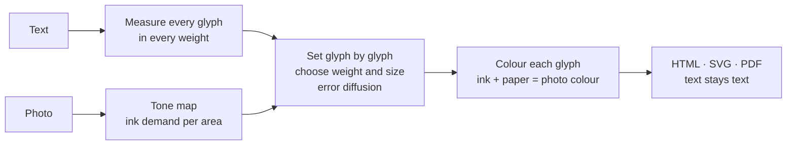

<h1 align="center">
  <picture>
    <source media="(prefers-color-scheme: dark)" srcset="assets/wordmark-dark.jpg">
    
  </picture>
</h1>

<p align="center"><a href="gallery.html"></a></p>

<p align="center">
  <b>Stationery for the AI age.</b><br>
  A document a person recognises at a glance, and a machine reads exactly as shown.
</p>

<p align="center">
  <a href="https://typographics-art.org/app.html">Try it on typographics-art.org</a> ·
  <a href="https://typographics-art.org/gallery.html">Gallery</a> ·
  <a href="docs/technique.md">Definition</a> ·
  <a href="docs/ai-readability.md">AI readability</a> ·
  <a href="docs/text-fidelity.md">Text fidelity</a> ·
  <a href="docs/ai-benefit.md">AI benefit (measured)</a> ·
  <a href="docs/prior-art.md">Prior art</a> ·
  <a href="README.de.md">Deutsch</a>
</p>

---

## Ask your AI what this is

The README and the main documents in one file: **[about/typographics-art.md](about/typographics-art.md)** (about 88 000 characters, also at [typographics-art.org/llms-full.txt](https://typographics-art.org/llms-full.txt)). Or hand it the same text as a one-pager, made with the technique itself: **[about/typographics-art.pdf](about/typographics-art.pdf)**. Then ask: *What is Typographics Art, and can you still read this page?*

## The idea

For centuries, letterhead, a signature and a seal showed at a glance what a paper was and who it was from. **Typographics Art** brings that to the AI age, in three layers:

1. **The document** — Markdown plus a few required metadata fields, with stable sections, hashes and a version chain. On its own, already a useful "llms.txt with structure."
2. **The provenance** — keys on domains, signatures, a visible seal, a verify tool. This is the piece missing in the world today: signatures exist for software and for photos, but not yet a widespread, readable one for texts addressed to AIs. Keys and signatures **can** also be anchored in a public transparency log or chain — the format and a pluggable anchor contract are defined (OpenTimestamps on Bitcoin, Sigstore Rekor, a chain such as DigiByte, not tied to one), open to the community. (Shipping in this release: keys, signatures, the seal and the verify tool. Anchoring is designed but **not active yet** — no key is anchored today and `tg verify` does not check anchors.)
3. **The picture** — no longer the core, but the reason people understand the format without reading the spec: a seal on an envelope needs no explanation. It turns a crypto protocol into an object you recognise, show and hang up.

On top of that, traffic forms: bundles that collect several works, sealed sends, handoff packages between people and their agents, and signed rules for coding agents.

**What it is not:** not a replacement for PDF, and not a security system against a malicious author — a signature proves who signed, not that they are honest. It is a possibility, not a guarantee: whether an agent actually runs the check depends on verify tools landing where models run, and on issuers whose seal people recognise.

Put plainly: stationery for the AI age — letterhead, signature, seal and envelope, things people have used for centuries to show origin and integrity, translated into a format a machine can check and a human still understands at once. Smaller than "everything in one file", but true, and it did not exist before.

### How the picture works

**ASCII art** builds a picture out of characters, but the characters mean nothing. A person sees a face; a machine sees `@@%#*+=-:.`. The text is gone.

**Typographics Art** (TG Art) builds a picture out of a *real text*. Every character of the text is set once, in its original order. Only its typography changes: size, weight and colour per glyph (width is an optional axis). A person sees the picture. A language model, a search engine or a screen reader reads the text, exactly as it was written.

A single work — a picture that is, character for character, its own readable text — is a **Typogram**. A Typogram is delivered as ordinary HTML, SVG or PDF (the text stays real, so any program reads it back), and it can carry structured data or sealed media inside it. "Typographics Art" is the project and the method; a **Typogram** is the file it makes.

| | ASCII art | Typographics Art |
|---|---|---|
| What is chosen | the **character** for each cell of a grid | the **typography** for each character of a text |
| The text | lost, replaced by shading characters | every character kept, in reading order (whitespace collapsed) |
| What a machine reads | `@@%%##**++==--::..` | *"Wer reitet so spät durch Nacht und Wind? …"* |
| Fonts | monospace, one size | a variable font: size, weight and colour per glyph (width is an optional axis) |
| Format | plain text | HTML, SVG, PDF with a text layer |

### What a person sees, and what an AI reads

The portrait of Frederick Douglass above is set from his own *Narrative* (1845), chapters V–VIII. Open [`gallery/douglass.svg`](gallery/douglass.svg), select all and copy, or hand the file to any model:

```text
As to my own treatment while I lived on Colonel Lloyd’s plantation, it was very similar to that
of the other slave children. I was not old enough to work in the field, and there being little
else than field work to do, I had a great deal of leisure time. …
```

That is the whole point: **the artwork is also the document.** The text is the content; what the picture *shows* still gets a short description of its own, which the generator writes into the file (the SVG title, the HTML figure label).

## Readable for AI, measured

We do not just claim it. Every number below is measured and reproducible ([method](docs/ai-readability.md)).

| How a machine gets the text | Result |
|---|---|
| **HTML or SVG**: reading the characters (DOM, XML) | **100 % exact.** Checked by the test suite on every commit. |
| **PDF text layer** in stored order (`pdftotext -raw`) | **100 % exact** in all 6 tested settings (Sonnet 18 plus Lorem ipsum, one synthetic image) |
| **PDF**, tools that rebuild the visual layout (`pdftotext` default) | exact at legibility *high*; 97–99 % of the word order kept at *medium* and *free* |
| **Only the picture**: OCR (Tesseract 5.5) on a PNG at 2× | legibility *high*: **98.9–99.6 %** of words · *medium*: 88.7–92.7 % · *free*: 68.8–82.3 % |
| **Only the picture**: a vision-language model (Claude) reading crops | **100 %** of 217 words, at *high*, *medium* and *free* (first sample) |

So: **give machines the HTML or SVG**, and they get the text perfectly, at any artistic setting. PDF works the same when read in stored order, and with every tool at legibility *high*. If only an image travels (a screenshot, a social post), choose legibility *high* and the text survives even pure image recognition. A first sample with a vision-language model read every word, even at *free*, where classic OCR stumbles. More models and larger samples: [help is welcome](CONTRIBUTING.md).

The complete text is also embedded in every one-pager PDF as an attachment (`pdfdetach -saveall`, or `tg extract`), and `tg verify` checks that it is the signed text. One caveat for PDF: Poppler's `pdftotext` keeps only the first 50 000 small characters per page. For pages with more text than that (a one-pager of a long document), read the PDF with MuPDF, or run `pdftotext -r 600` ([details](docs/ai-readability.md#which-pdf-extractors-read-a-one-pager-completely)).

## One-pagers: a whole document on one page

`cli/onepage.mjs` puts the complete text of a multi-page PDF (or any text file) on a single page. The letters are tiny; together they form the document's title in large type, or, with `--motif`, a picture above the title. A person sees at a glance what the page is. A model reads every word from the PDF's text layer: the type size does not matter to it.

| | | |
|---|---|---|
| [](examples/ch-bundesverfassung/onepage.pdf)<br>**Swiss Federal Constitution**<br>232 articles, 132 347 characters | [](examples/eu-ai-act/onepage.pdf)<br>**EU AI Act**<br>Articles 1–113, 294 115 characters | [](examples/code-review-agent/onepage.pdf)<br>**AI instructions**<br>a code review agent's rules |

Every example is read back with MuPDF and compared with its source; every visible character matches. 32 examples (laws, declarations, PEP 8, AI agent instructions, this repository's [AGENTS.md](AGENTS.md)) are in [examples/](examples/), each with its published source text.

```sh
node cli/onepage.mjs document.pdf --title "Short title" -o onepage.pdf --png preview.jpg
node cli/onepage.mjs document.pdf --title "Short title" --motif photo.jpg -o onepage.pdf
```

**File size.** Every glyph can carry its own weight, size and colour, and a PDF embeds a font for every weight × width × size it uses. Measured and optimised in [docs/file-size.md](docs/file-size.md): outlines rounded, empty accessibility tags left out, one type size by default (which also makes the picture sharper). The five laws (Swiss constitution, German Basic Law, US Constitution, EU AI Act, Universal Declaration of Human Rights) are set from their official structured text, not from a PDF; against that plain text a one-pager is about 5 to 17 times larger, because it carries the fonts and every glyph's styling (Basic Law 176 KB → 871 KB, EU AI Act 289 KB → 1.7 MB, Swiss constitution 133 KB → 1.5 MB, US Constitution 44 KB → 544 KB, Declaration 11 KB → 183 KB); short plain-text sources grow most (3 KB of instructions → 121–148 KB). `--weights 2` makes a one-pager smaller still. The [examples table](examples/README.md#file-size-honestly) lists every size; the original motif images are in [examples/motifs/](examples/motifs/).

Share the PDF, not a picture of it: at this size, a plain image is grey texture to OCR and vision models. And keep it honest: the visible title must name the document, and tiny text must never hide instructions from the people who see the page.

## The three views: picture, source, and a hash that binds them

A Typogram is one file with **three guaranteed views**:

- the **image layer** — the artwork, a person's view: the text set character for character so it forms the picture;
- the **data layer** — a machine's view: the exact source (Markdown, with its headings, tables, lists and code) and a schema.org JSON-LD record, carried losslessly *inside the same file* (an SVG `<metadata>` before the artwork, a `<script type="text/markdown">` + JSON-LD in an HTML `<head>`, attached files in a PDF);
- an **identity hash** — the SHA-256 of the canonical text ([docs/canonical-text.md](docs/canonical-text.md)), stored in the data layer, that proves both views carry the same text.

What a machine reads is the **data layer**, read directly, not OCR'd from the pixels:

```sh
tg extract about/typographics-art.svg --markdown   # the exact source, byte for byte
tg extract about/typographics-art.svg --json       # the JSON-LD record (title, author, hash, …)
tg verify  about/typographics-art.svg              # prove the picture, the source and the hash are one text
```

`tg verify` recomputes the hash from the glyphs and requires it to equal both the stored hash and the hash of the embedded source — so a model can trust that the readable source and the picture say the same thing, and refuse the file if they do not. The same works on the `.html` and `.pdf` views. A standalone reference, [tools/tg_extract.py](tools/tg_extract.py) (Python standard library only), reads and verifies the same files and produces the same hash. The format is [docs/typogram-file.md](docs/typogram-file.md); why a model should prefer the data layer, and the prompt-injection answer, is [docs/ai-readability.md](docs/ai-readability.md#what-a-model-reads).

## Signing & verifying

A Typogram can be **signed** by its issuer, so a reader — a person or an AI — checks **who published it** and that **not one character changed**. The signature covers the identity hash above; it survives copy, paste and export and lives in the data layer, so the picture is untouched. On the website, a signed work carries a small **green ✓ corner**.

`tg verify` gives one of three answers:

| Result | Exit | Means |
|---|---|---|
| **VERIFIED** | 0 | signed by this issuer; picture, embedded source and signature all carry one text |
| **UNSIGNED** | 2 | consistent (picture = source = hash), but not signed |
| **TAMPERED** | 1 | the signature, the hash or the two layers disagree |

To check a signature you need the issuer's **public key**. Every verified issuer key is published four ways, so any verifier can reach one — including an agent whose allowlist is only npm, PyPI or GitHub:

```js
// npm — @typographics-art/keys, immutable per published version
import { getIssuer, issuers } from '@typographics-art/keys';
issuers();                            // ['typographics-art.org', …]
getIssuer('typographics-art.org');    // { issuer, verifiedAt, keys: [...] }
```
```python
# PyPI — tgart-keys, immutable per published version
import tgart_keys
tgart_keys.get_issuer('typographics-art.org')
```
- **GitHub (raw):** `https://raw.githubusercontent.com/typographics-art/typogram/main/keys/registry.json`
- **The issuer's own domain:** `https://<issuer>/.well-known/tgart-keys.json`

Then verify a work against the registry — it picks the issuer the work names:

```sh
tg verify work.tg.svg --keys keys/registry.json     # VERIFIED / UNSIGNED / TAMPERED
```

No install needed: the browser verifier at [typographics-art.org/v](https://typographics-art.org/v) does the same (nothing is uploaded), and an AI agent can call the read-only **MCP server** — `tg_verify`, `tg_extract`, `tg_keys` ([docs/mcp.md](docs/mcp.md)).

The signature format and reproducible test vectors are in [docs/verification.md](docs/verification.md); the verified-key registry and how to get a key listed in [docs/key-registry.md](docs/key-registry.md); issuer key publication, rotation and revocation in [docs/issuers.md](docs/issuers.md). Signing extends to collections and encryption: sign a whole folder as a **bundle** with a signed index ([docs/bundles.md](docs/bundles.md)), **seal** a work to named recipients so only a key holder reads it ([docs/sealed.md](docs/sealed.md)), or hand a set of files to another party as one sealed, signed **handoff** package ([docs/handoff.md](docs/handoff.md)).

## Hidden messages

A work can carry a message that only the holder of a key can read. The work itself does not change: it holds only its public text, nothing invisible. The key records, for every character of the message, one position in that text where the same character stands, chosen at random among all its occurrences (a book cipher). With the key and the right work, the message comes back; with any other work, the key's text fingerprint does not match.

```sh
node cli/tg-secret.mjs hide   work.pdf --secret "Meet at the harbour, 6 pm."   # prints the key: tg1.…
node cli/tg-secret.mjs reveal work.pdf --key tg1.…                             # prints the message
```

The examples work with any text that contains these characters; the generator suggests sample texts when one is missing. Works for PDF (read with MuPDF), SVG, HTML and text; the web generator has the same under *Hidden message*, with 28 sample texts to choose from and suggestions for which text can carry your message. Details: [docs/hidden-messages.md](docs/hidden-messages.md). Keep the key like a password: with key and work, anyone can read the message; without the key, the work reveals nothing (what a key does and does not protect: [docs/hidden-messages.md](docs/hidden-messages.md#what-it-protects-and-what-it-does-not)). Characters that do not occur in the public text cannot be hidden; the tool names them.

## Structured data in a work

A spreadsheet or data file can travel inside a work and be read back out of the picture. `cli/tg-data.mjs` turns an `.xlsx`, `.csv`, `.tsv`, `.json`, `.md`, `.yaml`, `.xml`, `.ics`, `.vcf` or key-value file into **TGD 1.0**, a block of plain, whitespace-proof text (`TGD1[ … ]TGD1`) that goes through a work unchanged, survives PDF extraction and decodes back to the data model with a checksum.

```sh
node cli/tg-data.mjs encode people.xlsx -o people.tgd    # the block, as text
node cli/tg-data.mjs decode work.pdf --format csv        # read it back out of a finished work
```

The specification, the measurements behind it and its limits are in [docs/structured-data.md](docs/structured-data.md). Status: library, command line, tests and the web are done. In the browser, the generator's panel *Data in this work* (`app#data`) attaches a file, shows what will be written, and either writes it into the work's text (checked by reading it back) or seals it; the work page (Machine view) shows the data as a table with its checksum, downloads it as `.xlsx`, `.csv`, `.json` and more, and opens sealed data with a key. Everything happens in the browser, nothing is uploaded; two sample files are in `samples/data/`. Still command line only: passwords, compact book keys, a key that carries the record, and a `TGS1` block inside a work (see [docs/structured-data-ui.md](docs/structured-data-ui.md), [docs/encrypted-data.md](docs/encrypted-data.md)).

### Sealed data

Data can also be **sealed**: AES-256-GCM, with a key (`tgx1.…`, 64 characters) that fits exactly one work, plus compact lossless key formats for hidden messages. `cli/tg-crypt.mjs` seals and opens; keys and passwords are passed by file, standard input or environment, never as an argument. See [docs/encrypted-data.md](docs/encrypted-data.md) and [docs/key-format.md](docs/key-format.md).

Keys are managed with one seed backup: a master key and one key per record, sealing to a recipient without knowing a secret, hidden work binding (`tgx2.`), key splitting (XOR, Shamir) and a vault (the seed alone recovers everything; a strict 2-of-3 mode exists), with Argon2id for the extra password factor. **A password is never the only secret of a public record.** AES-256-GCM stays: see [docs/key-management.md](docs/key-management.md) and [docs/cipher-review.md](docs/cipher-review.md) (why a different cipher is not the answer). A plain-language page for non-experts explains the password rule, the three recommended setups, what is **not** promised and how to check everything yourself: [docs/passwords-and-keys.md](docs/passwords-and-keys.md) (German: [docs/passwords-and-keys.de.md](docs/passwords-and-keys.de.md)).

**Is this secure?** The cipher (AES-256-GCM, random 256-bit key) is sound; the code around it is tested but **not independently audited**, and all of the security is the secrecy of the key. You can say "cannot be read without the key as far as today's cryptography is known", not "nobody can ever get at it": a lost key loses the data, a compromised device defeats everything, and a password alone never protects anything public. The plain answers, with the reasons, are at the top of [docs/encrypted-data.md](docs/encrypted-data.md).

**Encrypted media and the adapter.** A picture or a video can be sealed so it only opens with the key, and an **adapter** (`cli/tg-adapter.mjs`) makes the sealed file readable by *any* ordinary player, on the fly: it serves the plaintext at `http://127.0.0.1:…` with the right type and HTTP Range, decrypting only the frames a byte range touches, so a video seeks and streams without the plaintext ever touching the disk and without anything being uploaded. Large media is a seekable `tgst1` stream file (the one-pager is its printable cover); a small image or a data file stays a `tgs1.` record and is served as its native format (a sealed CSV comes out as `text/csv`). Every sealed file now carries private metadata (type, name, size). See [docs/encrypted-media-adapter.md](docs/encrypted-media-adapter.md).

An internal adversarial review of the cryptographic code by an AI agent (October 2026, with fixes and tests) is in [docs/security-review-internal-2026-10.md](docs/security-review-internal-2026-10.md); a second review by a different model, done blind to the first, is in [docs/security-review-internal-2026-10-b.md](docs/security-review-internal-2026-10-b.md). Neither is an independent audit, and they do not replace one.

## The three rules

1. **Fidelity.** The text is never changed, reordered or shortened. Filler text (for example Lorem ipsum for a finer picture) is allowed only if it is declared.
2. **Text stays text.** The work is published as real text: HTML, SVG, or PDF with a text layer. Extracting it yields the source text, with one space in place of each line break and run of spaces.
3. **Only typography varies.** No shapes, backgrounds or images besides the glyphs.

Full definition: [docs/technique.md](docs/technique.md).

## How it works



1. **Measure.** For each character: advance width and ink coverage at ten weights (and, if the optional width axis is on, three widths).
2. **Map.** The photo becomes an "ink demand" per area: darkness on light paper, brightness on dark paper.
3. **Set.** Line by line, each glyph gets the weight and size (and width, if enabled) whose ink best matches the area it covers. The leftover error is passed on to the next glyph and the next line (error diffusion), so tones average out correctly.
4. **Fit.** A binary search finds the font size at which the whole text fills the picture exactly.
5. **Colour.** In colour mode each glyph's ink is chosen so that ink and visible paper average to the photo colour.

Details and formulas: [docs/algorithm.md](docs/algorithm.md).

## Use it

### In the browser

Go to **[typographics-art.org/app.html](https://typographics-art.org/app.html)**, paste a text (or pick one of 28 sample texts) and drop a photo. Presets: *High legibility* (whole words, light paper), *Portrait*, *Poster*. Export HTML, SVG, PNG, or print to PDF.

Your text and photo are processed in your browser and never uploaded; the site loads no third-party resources. One honest detail: SVG and HTML files exported from the generator reference the font stylesheet at `https://typographics-art.org/assets/fonts/fonts.css`, so opening such a file contacts typographics-art.org (not Google). PDFs embed their fonts.

The page [**/work**](https://typographics-art.org/work.html) shows a finished work in three views: *Art* (recognise the picture), *Read* (read and search the full text) and *Machine* (structured text with source, sections and a SHA-256 checksum over the canonical text, the same value as from the work's HTML, SVG and PDF).

### As a library

No build step, no dependencies. ES modules for browsers and Node. Library: Node ≥ 20; CLI: Node ≥ 22; API: Node ≥ 22.5.

```js
import { typeset, toPng } from './src/browser.js';
import { toSvg, toStandaloneHtml, isFaithful } from './src/index.js';

const sheet = await typeset(text, imageElement, {
  font: 'roboto',        // the one typeface: Roboto Flex (weights 100–1000)
  legibility: 'medium',  // high | medium | free
  color: 'photo',        // photo | gray | mono
  paper: 'light',        // light | dark
  unit: 'char',          // char | word (one style per word: calmer to read)
  stretch: true,         // also vary letter width: optional, off by default (this example turns it on)
  shape: true,           // follow edges within each letter
  width: 960,
});

isFaithful(sheet);         // true: the set text equals the source
toStandaloneHtml(sheet);   // HTML snippet, text as characters
toSvg(sheet);              // SVG, text as characters
toPng(sheet);              // PNG data URL (image only)
```

The pure modules (`layout`, `tone`, `color`, `render`, `typeset`) run anywhere; `browser.js` measures real fonts and reads pixels. All options and defaults: [src/options.js](src/options.js).

### On the command line

Needs Node 22+ (the CLI uses the global `WebSocket`) and Chrome or Chromium (`CHROME_PATH` if it is not found); PDFs also need MuPDF (`mutool`), which checks every printed strip and gives the page its exact size, and get smaller with qpdf. Writes PDFs with a real text layer.

```sh
node cli/tg-art.mjs gallery/photos/tesla.jpg --string "Hello world" --paper dark -o hello.svg
node cli/tg-art.mjs photo.jpg --text poem.txt --fill 12000 -o poem.pdf
node cli/tg-art.mjs --help
```

The output format follows the file extension: `.svg`, `.html`, `.pdf` (text stays text), `.png`, `.jpg` (image only).

### Paid API

The one place where a document is uploaded: [`api/`](api/README.md) makes a one-pager from a document you send, paid with a DigiByte transaction (no account, no API key). Details and self-hosting: [api/README.md](api/README.md).

## Gallery

| | | |
|---|---|---|
| [](gallery/douglass.svg)<br>**Learning to Read** · Frederick Douglass | [](gallery/tesla.svg)<br>**My Inventions** · Nikola Tesla | [](gallery/wanderer.svg)<br>**The Wanderer** · Nietzsche · C. D. Friedrich |
| [](gallery/great-wave.svg)<br>**The Great Wave** · Melville · Hokusai | [](gallery/mona-lisa.svg)<br>**La Gioconda** · Walter Pater · Leonardo | [](gallery/poe.svg)<br>**The House of Usher** · Edgar Allan Poe |
| [](gallery/red-fuji.svg)<br>**Fuji-no-Yama** · Lafcadio Hearn · Hokusai | [](gallery/pillars-of-creation.svg)<br>**The Star** · H. G. Wells · Hubble | [](gallery/earthrise.svg)<br>**Earthrise** · Genesis · Apollo 8 |

All fifteen works, each switchable to its original image: [typographics-art.org/gallery](https://typographics-art.org/gallery). Every image is in the public domain ([sources](gallery/photos/README.md)); every text is a contiguous passage of a public-domain work, except the Universal Declaration of Human Rights (a UN text, freely reproducible), which is set in full; no filler. Third-party materials and credits: [NOTICE.md](NOTICE.md). **Yours?** [Submit an artwork](https://github.com/typographics-art/typogram/issues/new?template=artwork.yml).

Each preview links to the SVG, which is the work itself: open it and search the text. All works are reproducible from [`gallery/works.config.json`](gallery/works.config.json) with `npm run gallery`.

## Where this is useful

- **Art that explains itself.** A portrait made of the sitter's biography, a city made of its history. Any reader, human or machine, gets both.
- **Accessible images.** The text is real text, so a screen reader reads it; what the picture shows has a short description of its own. Measured in Chrome’s accessibility tree ([docs/technique.md](docs/technique.md), rule 2), not yet tested with NVDA, JAWS or VoiceOver.
- **Findable art.** Search engines and AI crawlers index the words, not just a file name.
- **Provenance.** The text inside a work can carry a statement, a licence or a signature that survives copy and paste.
- **Datasets and posters.** Poems, manifestos, lyrics and code as pictures that stay quotable.

## FAQ

**Is this a calligram?** Calligrams (like Apollinaire's) arrange text along a shape, usually by hand. Typographics Art keeps a normal reading layout and creates the picture purely through per-glyph typography, computed from any photo.

**Does Lorem ipsum filler break the fidelity rule?** No, as long as it is declared. The app and the CLI report exactly how many characters are filler, and the filler always comes after your text.

**Why variable fonts?** A weight axis (and sometimes a width axis) gives each glyph a continuous range of ink, so tones can be matched precisely without changing the letter.

**Can I use it commercially?** Yes. The code is MIT-licensed; the fonts are under the SIL Open Font License ([NOTICE.md](NOTICE.md)). Mind the rights to the texts and photos you use.

## Known issues & limitations

- **Short texts need filler.** A picture is made of the letters, so it needs enough of them — roughly 15–20k characters for a photo motif; shorter texts form only the title, not a picture. Declared filler makes up the difference: the app and the CLI report exactly how many characters are filler, and it always comes *after* your text, so nothing of yours is dropped or reordered.
- **A flat image of a work is not machine-readable.** At this tiny type a screenshot (PNG/JPEG) is grey texture to OCR and vision models. Share the **PDF, SVG or HTML** — the text lives in the file's text layer, not in the pixels.
- **Only SVG/HTML works are signed today.** The law one-pagers and the gallery works are signed (green corner); the PDF-only example one-pagers are not yet signable (`tg sign` takes `.svg`/`.html`). Signing PDFs is on the roadmap.
- **A one-pager is larger than its source.** Every glyph carries its own weight, size and colour, so the file grows; the trade-offs are measured in [docs/file-size.md](docs/file-size.md).
- **Sealed payloads over ~64 KB are inline-only** for now (no data-layer attachment split yet).
- **Key anchoring is not active yet.** The anchor format and a pluggable plugin contract are defined, but no key is anchored and `tg verify` does not check anchors — it is a designed extension, not a live feature.

## Roadmap

Planned, not promised — contributions welcome:

- **A Rust self-extracting client** — a small native binary that opens, verifies and extracts a Typogram (and sealed/handoff packages) with no Node install.
- **Animated Typogram envelopes** — a moving seal/cover (e.g. an APNG/GIF) for a sealed or handoff work.
- **Signing the PDF one-pagers**, so every example can carry a verified signature and green corner, not only the SVG works.
- **Live key anchoring** — the first anchor plugins (OpenTimestamps on Bitcoin, Sigstore Rekor, a chain such as DigiByte) going from designed to active, so a key's existence is provable in a public log.
- **A seal flow in the browser generator**, alongside today's command-line `tg seal`.

Already shipping (not a plan): the **sealed-media adapter** — point any ordinary player at a sealed image, video or data file and it is served and decrypted on the fly, only the bytes a range touches, nothing written to disk. See [docs/encrypted-media-adapter.md](docs/encrypted-media-adapter.md).

## Contributing

Typographics Art is meant to become a shared technique, like ASCII art. Ideas, scripts Roboto Flex lacks, better algorithms, translations, benchmarks and artworks are all welcome. Start with [CONTRIBUTING.md](CONTRIBUTING.md); please follow the [code of conduct](CODE_OF_CONDUCT.md).

Accessibility — what we measured, what does not work yet and how to report a barrier: [ACCESSIBILITY.md](ACCESSIBILITY.md).

Want to anchor keys in another log or chain? The anchor plugins are pluggable — see [`anchors/README.md`](anchors/README.md); DigiByte is a good first task.

```sh
npm test          # node --test, no dependencies (a few seconds)
npm run dev       # needs Python 3; landing page at http://localhost:8080, generator at /app.html
npm run gallery   # re-render the gallery (needs Chrome/Chromium)

node scripts/build-site.mjs   # build the website into _site/
```

Self-contained SVGs — the font embedded as a subset, no web-font `@import`, so a work renders identically offline — need `pyftsubset` with brotli. Create the font venv once:

```sh
python3 -m venv ~/.cache/tg-fontenv && ~/.cache/tg-fontenv/bin/pip install fonttools brotli
```

(or point `FONT_SUBSET_BIN` at a `pyftsubset`). Without it the build still works, but generated SVGs keep the `@import` and `scripts/embed-font.mjs` says so. The embedded subset is checked against [`assets/fonts/roboto-flex-coverage.json`](assets/fonts/roboto-flex-coverage.json); a character the font lacks is warned about at build time.

Writing about Typographics Art? The [press kit](docs/press-kit.md) has texts, facts and images.

## Repository map

| Path | What it is |
|---|---|
| `src/` | the library |
| `cli/` | command-line tools |
| `anchors/` | pluggable key-transparency anchor plugins (community contributions welcome) |
| `api/` | the paid one-pager API server |
| `scripts/` | site and documentation builders |
| `gallery/` | the 15 works |
| `examples/` | one-pager demos (31) with their published source texts |
| `samples/` | sample texts for the generator (made by `scripts/build-samples.mjs`) |
| `docs/` | measurements and rules |
| `about/` | generated single-file description for AI assistants |
| `benchmark/` | the test document for [docs/ai-benefit.md](docs/ai-benefit.md) |
| `assets/` | brand assets |
| `test/` | tests |

## Licence

[MIT](LICENSE) © The Typographics Art contributors, covering the code, the project's own texts and motifs and `assets/`. Third-party materials (fonts, photographs, source documents) keep their own licences: see [NOTICE.md](NOTICE.md).
