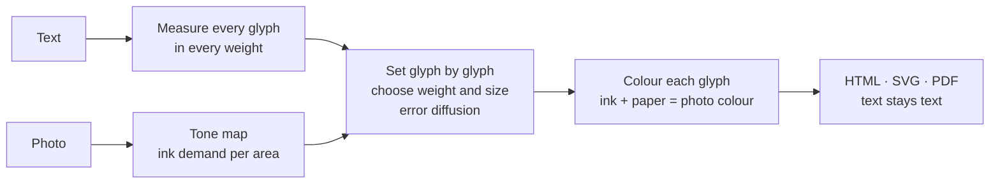

<h1 align="center">
  <picture>
    <source media="(prefers-color-scheme: dark)" srcset="assets/wordmark-dark.jpg">
    
  </picture>
</h1>

<p align="center"><a href="gallery.html"></a></p>

<p align="center">
  <b>ASCII art for the age of AI.</b><br>
  The picture is for people. The text stays for machines.
</p>

<p align="center">
  <a href="https://typographics-art.org/app.html">Try it on typographics-art.org</a> ·
  <a href="https://typographics-art.org/gallery.html">Gallery</a> ·
  <a href="docs/technique.md">Definition</a> ·
  <a href="docs/ai-readability.md">AI readability</a> ·
  <a href="docs/text-fidelity.md">Text fidelity</a> ·
  <a href="docs/ai-benefit.md">AI benefit (measured)</a> ·
  <a href="docs/prior-art.md">Prior art</a> ·
  <a href="README.de.md">Deutsch</a>
</p>

---

## Ask your AI what this is

The README and the main documents in one file: **[about/typographics-art.md](about/typographics-art.md)** (about 60 000 characters, also at [typographics-art.org/llms-full.txt](https://typographics-art.org/llms-full.txt)). Or hand it the same text as a one-pager, made with the technique itself: **[about/typographics-art.pdf](about/typographics-art.pdf)**. Then ask: *What is Typographics Art, and can you still read this page?*

## The idea

**ASCII art** builds a picture out of characters, but the characters mean nothing. A person sees a face; a machine sees `@@%#*+=-:.`. The text is gone.

**Typographics Art** (TG Art) builds a picture out of a *real text*. Every character of the text is set once, in its original order. Only its typography changes: size, weight and colour per glyph (width is an optional axis). A person sees the picture. A language model, a search engine or a screen reader reads the text, exactly as it was written.

| | ASCII art | Typographics Art |
|---|---|---|
| What is chosen | the **character** for each cell of a grid | the **typography** for each character of a text |
| The text | lost, replaced by shading characters | kept 1:1, in reading order |
| What a machine reads | `@@%%##**++==--::..` | *"Wer reitet so spät durch Nacht und Wind? …"* |
| Fonts | monospace, one size | a variable font: size, weight and colour per glyph (width is an optional axis) |
| Format | plain text | HTML, SVG, PDF with a text layer |

### What a person sees, and what an AI reads

The portrait of Frederick Douglass above is set from his own *Narrative* (1845), chapters V–VIII. Open [`gallery/douglass.svg`](gallery/douglass.svg), select all and copy, or hand the file to any model:

```text
As to my own treatment while I lived on Colonel Lloyd’s plantation, it was very similar to that
of the other slave children. I was not old enough to work in the field, and there being little
else than field work to do, I had a great deal of leisure time. …
```

That is the whole point: **the artwork is also the document.** No alt text needed; the content *is* the alt text.

## Readable for AI, measured

We do not just claim it. Every number below is measured and reproducible ([method](docs/ai-readability.md)).

| How a machine gets the text | Result |
|---|---|
| **HTML or SVG**: reading the characters (DOM, XML) | **100 % exact.** Checked by the test suite on every commit. |
| **PDF text layer** in stored order (`pdftotext -raw`) | **100 % exact** in all 6 tested settings (Sonnet 18 plus Lorem ipsum, one synthetic image) |
| **PDF**, tools that rebuild the visual layout (`pdftotext` default) | exact at legibility *high*; 97–99 % of the word order kept at *medium* and *free* |
| **Only the picture**: OCR (Tesseract 5.5) on a PNG at 2× | legibility *high*: **98.9–99.6 %** of words · *medium*: 88.7–92.7 % · *free*: 68.8–82.3 % |
| **Only the picture**: a vision-language model (Claude) reading crops | **100 %** of 217 words, at *high*, *medium* and *free* (first sample) |

So: **give machines the HTML or SVG**, and they get the text perfectly, at any artistic setting. PDF works the same when read in stored order, and with every tool at legibility *high*. If only an image travels (a screenshot, a social post), choose legibility *high* and the text survives even pure image recognition. A first sample with a vision-language model read every word, even at *free*, where classic OCR stumbles. More models and larger samples: [help is welcome](CONTRIBUTING.md).

One caveat for PDF: Poppler's `pdftotext` keeps only the first 50 000 small characters per page. For pages with more text than that (a one-pager of a long document), read the PDF with MuPDF, or run `pdftotext -r 600` ([details](docs/ai-readability.md#which-pdf-extractors-read-a-one-pager-completely)).

## Demonstrator: Moby-Dick in one picture

The strongest proof is a whole book. [**typographics-art.org/demo/moby-dick**](https://typographics-art.org/demo/moby-dick/) sets the complete text of *Moby-Dick* (1.2 million characters, 135 chapters) as a single 2 × 3 m poster in three panels, one motif per part of the book. Next to the zoomable poster, the page shows the proof:

- **Complete:** the text read back from the artwork has the same SHA-256 hash as the source text.
- **Read back correctly:** from the SVG master and from the print PDF, 100 random passages are found at their original positions, chapter structure and word frequencies are identical.
- **Usable by AI:** a defined question set (narrator, ship, captain, …) has every answer grounded in the extracted text; OCR samples measure what survives in a mere photo of the poster.
- **Reproducible:** download the book from Project Gutenberg, run two scripts, compare the hashes. Full report: [demo/moby-dick/proof.md](demo/moby-dick/proof.md).

Click anywhere on the poster and the page shows the text at that spot, read from the artwork's own line offsets.

## One-pagers: a whole document on one page

`cli/onepage.mjs` puts the complete text of a multi-page PDF (or any text file) on a single page. The letters are tiny; together they form the document's title in large type, or, with `--motif`, a picture above the title. A person sees at a glance what the page is. A model reads every word from the PDF's text layer: the type size does not matter to it.

| | | |
|---|---|---|
| [](examples/ch-bundesverfassung/onepage.pdf)<br>**Swiss Federal Constitution**<br>102 pages, 228 576 characters | [](examples/eu-ai-act/onepage.pdf)<br>**EU AI Act**<br>144 pages, 595 706 characters | [](examples/code-review-agent/onepage.pdf)<br>**AI instructions**<br>a code review agent's rules |

Every example is read back with MuPDF and compared with its source; every visible character matches. 31 examples (laws, declarations, PEP 8, AI agent instructions, this repository's [AGENTS.md](AGENTS.md)) are in [examples/](examples/), each with its published source text.

```sh
node cli/onepage.mjs document.pdf --title "Short title" -o onepage.pdf --png preview.jpg
node cli/onepage.mjs document.pdf --title "Short title" --motif photo.jpg -o onepage.pdf
```

**File size.** Every glyph can carry its own weight, size and colour, and a PDF embeds a font for every weight × width × size it uses. Measured and optimised in [docs/file-size.md](docs/file-size.md): outlines rounded, empty accessibility tags left out, one type size by default (which also makes the picture sharper). Of the five examples with a PDF source (Swiss constitution, German Basic Law, US Constitution, EU AI Act, Universal Declaration of Human Rights), three are *smaller* than their source (US Constitution 1.6 MB from 3.8 MB, EU AI Act 2.2 MB from 2.5 MB, Declaration 137 KB from 191 KB); the Swiss constitution is 1.6 times and the Basic Law 2.8 times larger; short plain-text sources grow most (3 KB of instructions → 67–105 KB). `--weights 2` makes a one-pager smaller still. The [examples table](examples/README.md#file-size-honestly) lists every size; the original motif images are in [examples/motifs/](examples/motifs/).

Share the PDF, not a picture of it: at this size, a plain image is grey texture to OCR and vision models. And keep it honest: the visible title must name the document, and tiny text must never hide instructions from the people who see the page.

## Hidden messages

A work can carry a message that only the holder of a key can read. The work itself does not change: it holds only its public text, nothing invisible. The key records, for every character of the message, one position in that text where the same character stands, chosen at random among all its occurrences (a book cipher). With the key and the right work, the message comes back; with any other work, the key's text fingerprint does not match.

```sh
node cli/tg-secret.mjs hide   work.pdf --secret "Meet at the harbour, 6 pm."   # prints the key: tg1.…
node cli/tg-secret.mjs reveal work.pdf --key tg1.…                             # prints the message
```

The examples work with any text that contains these characters; the generator suggests sample texts when one is missing. Works for PDF (read with MuPDF), SVG, HTML and text; the web generator has the same under *Hidden message*, with 28 sample texts to choose from and suggestions for which text can carry your message. Details: [docs/hidden-messages.md](docs/hidden-messages.md). Keep the key like a password: with key and work, anyone can read the message; without the key, the work reveals nothing (what a key does and does not protect: [docs/hidden-messages.md](docs/hidden-messages.md#what-it-protects-and-what-it-does-not)). Characters that do not occur in the public text cannot be hidden; the tool names them.

## The three rules

1. **Fidelity.** The text is never changed, reordered or shortened. Filler text (for example Lorem ipsum for a finer picture) is allowed only if it is declared.
2. **Text stays text.** The work is published as real text: HTML, SVG, or PDF with a text layer. Extracting it yields exactly the source.
3. **Only typography varies.** No shapes, backgrounds or images besides the glyphs.

Full definition: [docs/technique.md](docs/technique.md).

## How it works



1. **Measure.** For each character: advance width and ink coverage at ten weights (and, if the optional width axis is on, three widths).
2. **Map.** The photo becomes an "ink demand" per area: darkness on light paper, brightness on dark paper.
3. **Set.** Line by line, each glyph gets the weight and size (and width, if enabled) whose ink best matches the area it covers. The leftover error is passed on to the next glyph and the next line (error diffusion), so tones average out correctly.
4. **Fit.** A binary search finds the font size at which the whole text fills the picture exactly.
5. **Colour.** In colour mode each glyph's ink is chosen so that ink and visible paper average to the photo colour.

Details and formulas: [docs/algorithm.md](docs/algorithm.md).

## Use it

### In the browser

Go to **[typographics-art.org/app.html](https://typographics-art.org/app.html)**, paste a text (or pick one of 28 sample texts) and drop a photo. Presets: *AI-safe* (always legible), *Portrait*, *Poster*. Export HTML, SVG, PNG, or print to PDF.

Your text and photo are processed in your browser and never uploaded; the site loads no third-party resources. One honest detail: SVG and HTML files exported from the generator reference the font stylesheet at `https://typographics-art.org/assets/fonts/fonts.css`, so opening such a file contacts typographics-art.org (not Google). PDFs embed their fonts.

The page [**/work**](https://typographics-art.org/work.html) shows a finished work in three views: *Art* (recognise the picture), *Read* (read and search the full text) and *Machine* (structured text with source, sections and a SHA-256 checksum over the canonical text, the same value as from the work's HTML, SVG and PDF).

### As a library

No build step, no dependencies. ES modules for browsers and Node. Library: Node ≥ 20; CLI: Node ≥ 22; API: Node ≥ 22.5.

```js
import { typeset, toPng } from './src/browser.js';
import { toSvg, toStandaloneHtml, isFaithful } from './src/index.js';

const sheet = await typeset(text, imageElement, {
  font: 'roboto',        // the one typeface: Roboto Flex (weights 100–1000)
  legibility: 'medium',  // high | medium | free
  color: 'photo',        // photo | gray | mono
  paper: 'light',        // light | dark
  unit: 'char',          // char | word (one style per word: calmer to read)
  stretch: true,         // also vary letter width: optional, off by default (this example turns it on)
  shape: true,           // follow edges within each letter
  width: 960,
});

isFaithful(sheet);         // true: the set text equals the source
toStandaloneHtml(sheet);   // HTML snippet, text as characters
toSvg(sheet);              // SVG, text as characters
toPng(sheet);              // PNG data URL (image only)
```

The pure modules (`layout`, `tone`, `color`, `render`, `typeset`) run anywhere; `browser.js` measures real fonts and reads pixels. All options and defaults: [src/options.js](src/options.js).

### On the command line

Needs Node 22+ (the CLI uses the global `WebSocket`) and Chrome or Chromium (`CHROME_PATH` if it is not found); PDFs also need MuPDF (`mutool`), which checks every printed strip and gives the page its exact size, and get smaller with qpdf. Writes PDFs with a real text layer.

```sh
node cli/tg-art.mjs gallery/photos/tesla.jpg --string "Hello world" --paper dark -o hello.svg
node cli/tg-art.mjs photo.jpg --text poem.txt --fill 12000 -o poem.pdf
node cli/tg-art.mjs --help
```

The output format follows the file extension: `.svg`, `.html`, `.pdf` (text stays text), `.png`, `.jpg` (image only).

### Paid API

The one place where a document is uploaded: [`api/`](api/README.md) makes a one-pager from a document you send, paid with a DigiByte transaction (no account, no API key). Details and self-hosting: [api/README.md](api/README.md).

## Gallery

| | | |
|---|---|---|
| [](gallery/douglass.svg)<br>**Learning to Read** · Frederick Douglass | [](gallery/tesla.svg)<br>**My Inventions** · Nikola Tesla | [](gallery/wanderer.svg)<br>**The Wanderer** · Nietzsche · C. D. Friedrich |
| [](gallery/great-wave.svg)<br>**The Great Wave** · Melville · Hokusai | [](gallery/mona-lisa.svg)<br>**La Gioconda** · Walter Pater · Leonardo | [](gallery/poe.svg)<br>**The House of Usher** · Edgar Allan Poe |
| [](gallery/red-fuji.svg)<br>**Fuji-no-Yama** · Lafcadio Hearn · Hokusai | [](gallery/pillars-of-creation.svg)<br>**The Star** · H. G. Wells · Hubble | [](gallery/earthrise.svg)<br>**Earthrise** · Genesis · Apollo 8 |

All fifteen works, each switchable to its original image: [typographics-art.org/gallery](https://typographics-art.org/gallery). Every image is in the public domain ([sources](gallery/photos/README.md)); every text is a contiguous passage of a public-domain work, except the Universal Declaration of Human Rights (a UN text, freely reproducible), which is set in full; no filler. Third-party materials and credits: [NOTICE.md](NOTICE.md). **Yours?** [Submit an artwork](https://github.com/typ0graphic5/tg-art/issues/new?template=artwork.yml).

Each preview links to the SVG, which is the work itself: open it and search the text. All works are reproducible from [`gallery/works.config.json`](gallery/works.config.json) with `npm run gallery`.

## Where this is useful

- **Art that explains itself.** A portrait made of the sitter's biography, a city made of its history. Any reader, human or machine, gets both.
- **Accessible images.** The content is the description: screen readers read the text, no separate alt text is needed.
- **Findable art.** Search engines and AI crawlers index the words, not just a file name.
- **Provenance.** The text inside a work can carry a statement, a licence or a signature that survives copy and paste.
- **Datasets and posters.** Poems, manifestos, lyrics and code as pictures that stay quotable.

## FAQ

**Is this a calligram?** Calligrams (like Apollinaire's) arrange text along a shape, usually by hand. Typographics Art keeps a normal reading layout and creates the picture purely through per-glyph typography, computed from any photo.

**Does Lorem ipsum filler break the fidelity rule?** No, as long as it is declared. The app and the CLI report exactly how many characters are filler, and the filler always comes after your text.

**Why variable fonts?** A weight axis (and sometimes a width axis) gives each glyph a continuous range of ink, so tones can be matched precisely without changing the letter.

**Can I use it commercially?** Yes. The code is MIT-licensed; the fonts are under the SIL Open Font License ([NOTICE.md](NOTICE.md)). Mind the rights to the texts and photos you use.

## Contributing

Typographics Art is meant to become a shared technique, like ASCII art. Ideas, scripts Roboto Flex lacks, better algorithms, translations, benchmarks and artworks are all welcome. Start with [CONTRIBUTING.md](CONTRIBUTING.md); please follow the [code of conduct](CODE_OF_CONDUCT.md).

```sh
npm test          # node --test, no dependencies (a few seconds)
npm run dev       # needs Python 3; landing page at http://localhost:8080, generator at /app.html
npm run gallery   # re-render the gallery (needs Chrome/Chromium)

# only to deploy the website: the Moby-Dick zoom tiles first (Chrome, about 4 minutes, 522 tiles), then the site
node demo/moby-dick/build.mjs zoom
node scripts/build-site.mjs
```

Writing about Typographics Art? The [press kit](docs/press-kit.md) has texts, facts and images.

## Repository map

| Path | What it is |
|---|---|
| `src/` | the library |
| `cli/` | command-line tools |
| `api/` | the paid one-pager API server |
| `scripts/` | site and documentation builders |
| `gallery/` | the 15 works |
| `examples/` | one-pager demos (31) with their published source texts |
| `samples/` | sample texts for the generator (made by `scripts/build-samples.mjs`) |
| `demo/` | the Moby-Dick poster |
| `docs/` | measurements and rules |
| `about/` | generated single-file description for AI assistants |
| `benchmark/` | the test document for [docs/ai-benefit.md](docs/ai-benefit.md) |
| `assets/` | brand assets |
| `test/` | tests |

## Licence

[MIT](LICENSE) © The Typographics Art contributors, covering the code, the project's own texts and motifs and `assets/`. Third-party materials (fonts, photographs, source documents) keep their own licences: see [NOTICE.md](NOTICE.md).
