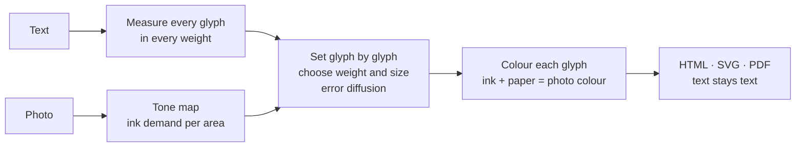

# Typographics Art: everything in one file

This file contains the README and the main documents of the open-source project Typographics Art (https://typographics-art.org, https://github.com/typ0graphic5/tg-art). It is meant to be handed to an AI assistant as a whole. Good first questions: What is Typographics Art? How is it different from ASCII art? Can a machine still read a work? How big do the PDFs get, and why?


---

<!-- README.md -->

## Overview

---

## Ask your AI what this is

The README and the main documents in one file: **[about/typographics-art.md](https://typographics-art.org/about/typographics-art.md)** (about 88 000 characters, also at [typographics-art.org/llms-full.txt](https://typographics-art.org/llms-full.txt)). Or hand it the same text as a one-pager, made with the technique itself: **[about/typographics-art.pdf](https://typographics-art.org/about/typographics-art.pdf)**. Then ask: *What is Typographics Art, and can you still read this page?*

## The idea

**ASCII art** builds a picture out of characters, but the characters mean nothing. A person sees a face; a machine sees `@@%#*+=-:.`. The text is gone.

**Typographics Art** (TG Art) builds a picture out of a *real text*. Every character of the text is set once, in its original order. Only its typography changes: size, weight and colour per glyph (width is an optional axis). A person sees the picture. A language model, a search engine or a screen reader reads the text, exactly as it was written.

| | ASCII art | Typographics Art |
|---|---|---|
| What is chosen | the **character** for each cell of a grid | the **typography** for each character of a text |
| The text | lost, replaced by shading characters | kept 1:1, in reading order |
| What a machine reads | `@@%%##**++==--::..` | *"Wer reitet so spät durch Nacht und Wind? …"* |
| Fonts | monospace, one size | a variable font: size, weight and colour per glyph (width is an optional axis) |
| Format | plain text | HTML, SVG, PDF with a text layer |

### What a person sees, and what an AI reads

The portrait of Frederick Douglass above is set from his own *Narrative* (1845), chapters V–VIII. Open [`gallery/douglass.svg`](https://typographics-art.org/gallery/douglass.svg), select all and copy, or hand the file to any model:

```text
As to my own treatment while I lived on Colonel Lloyd’s plantation, it was very similar to that
of the other slave children. I was not old enough to work in the field, and there being little
else than field work to do, I had a great deal of leisure time. …
```

That is the whole point: **the artwork is also the document.** No alt text needed; the content *is* the alt text.

## Readable for AI, measured

We do not just claim it. Every number below is measured and reproducible ([method](https://typographics-art.org/docs/ai-readability.md)).

| How a machine gets the text | Result |
|---|---|
| **HTML or SVG**: reading the characters (DOM, XML) | **100 % exact.** Checked by the test suite on every commit. |
| **PDF text layer** in stored order (`pdftotext -raw`) | **100 % exact** in all 6 tested settings (Sonnet 18 plus Lorem ipsum, one synthetic image) |
| **PDF**, tools that rebuild the visual layout (`pdftotext` default) | exact at legibility *high*; 97–99 % of the word order kept at *medium* and *free* |
| **Only the picture**: OCR (Tesseract 5.5) on a PNG at 2× | legibility *high*: **98.9–99.6 %** of words · *medium*: 88.7–92.7 % · *free*: 68.8–82.3 % |
| **Only the picture**: a vision-language model (Claude) reading crops | **100 %** of 217 words, at *high*, *medium* and *free* (first sample) |

So: **give machines the HTML or SVG**, and they get the text perfectly, at any artistic setting. PDF works the same when read in stored order, and with every tool at legibility *high*. If only an image travels (a screenshot, a social post), choose legibility *high* and the text survives even pure image recognition. A first sample with a vision-language model read every word, even at *free*, where classic OCR stumbles. More models and larger samples: [help is welcome](https://github.com/typ0graphic5/tg-art/blob/main/CONTRIBUTING.md).

One caveat for PDF: Poppler's `pdftotext` keeps only the first 50 000 small characters per page. For pages with more text than that (a one-pager of a long document), read the PDF with MuPDF, or run `pdftotext -r 600` ([details](https://typographics-art.org/docs/ai-readability.md#which-pdf-extractors-read-a-one-pager-completely)).

## Demonstrator: Moby-Dick in one picture

The strongest proof is a whole book. [**typographics-art.org/demo/moby-dick**](https://typographics-art.org/demo/moby-dick/) sets the complete text of *Moby-Dick* (1.2 million characters, 135 chapters) as a single 2 × 3 m poster in three panels, one motif per part of the book. Next to the zoomable poster, the page shows the proof:

- **Complete:** the text read back from the artwork has the same SHA-256 hash as the source text.
- **Read back correctly:** from the SVG master and from the print PDF, 100 random passages are found at their original positions, chapter structure and word frequencies are identical.
- **Usable by AI:** a defined question set (narrator, ship, captain, …) has every answer grounded in the extracted text; OCR samples measure what survives in a mere photo of the poster.
- **Reproducible:** download the book from Project Gutenberg, run two scripts, compare the hashes. Full report: [demo/moby-dick/proof.md](https://github.com/typ0graphic5/tg-art/blob/main/demo/moby-dick/proof.md).

Click anywhere on the poster and the page shows the text at that spot, read from the artwork's own line offsets.

## One-pagers: a whole document on one page

`cli/onepage.mjs` puts the complete text of a multi-page PDF (or any text file) on a single page. The letters are tiny; together they form the document's title in large type, or, with `--motif`, a picture above the title. A person sees at a glance what the page is. A model reads every word from the PDF's text layer: the type size does not matter to it.

| | | |
|---|---|---|
| <br>**Swiss Federal Constitution**<br>102 pages, 228 576 characters | <br>**EU AI Act**<br>144 pages, 595 706 characters | <br>**AI instructions**<br>a code review agent's rules |

Every example is read back with MuPDF and compared with its source; every visible character matches. 31 examples (laws, declarations, PEP 8, AI agent instructions, this repository's [AGENTS.md](https://github.com/typ0graphic5/tg-art/blob/main/AGENTS.md)) are in [examples/](https://github.com/typ0graphic5/tg-art/tree/main/examples), each with its published source text.

```sh
node cli/onepage.mjs document.pdf --title "Short title" -o onepage.pdf --png preview.jpg
node cli/onepage.mjs document.pdf --title "Short title" --motif photo.jpg -o onepage.pdf
```

**File size.** Every glyph can carry its own weight, size and colour, and a PDF embeds a font for every weight × width × size it uses. Measured and optimised in [docs/file-size.md](https://typographics-art.org/docs/file-size.md): outlines rounded, empty accessibility tags left out, one type size by default (which also makes the picture sharper). Of the five examples with a PDF source (Swiss constitution, German Basic Law, US Constitution, EU AI Act, Universal Declaration of Human Rights), three are *smaller* than their source (US Constitution 1.6 MB from 3.8 MB, EU AI Act 2.2 MB from 2.5 MB, Declaration 137 KB from 191 KB); the Swiss constitution is 1.6 times and the Basic Law 2.8 times larger; short plain-text sources grow most (3 KB of instructions → 67–105 KB). `--weights 2` makes a one-pager smaller still. The [examples table](https://github.com/typ0graphic5/tg-art/blob/main/examples/README.md#file-size-honestly) lists every size; the original motif images are in [examples/motifs/](https://typographics-art.org/examples/motifs/).

Share the PDF, not a picture of it: at this size, a plain image is grey texture to OCR and vision models. And keep it honest: the visible title must name the document, and tiny text must never hide instructions from the people who see the page.

## Hidden messages

A work can carry a message that only the holder of a key can read. The work itself does not change: it holds only its public text, nothing invisible. The key records, for every character of the message, one position in that text where the same character stands, chosen at random among all its occurrences (a book cipher). With the key and the right work, the message comes back; with any other work, the key's text fingerprint does not match.

```sh
node cli/tg-secret.mjs hide   work.pdf --secret "Meet at the harbour, 6 pm."   # prints the key: tg1.…
node cli/tg-secret.mjs reveal work.pdf --key tg1.…                             # prints the message
```

The examples work with any text that contains these characters; the generator suggests sample texts when one is missing. Works for PDF (read with MuPDF), SVG, HTML and text; the web generator has the same under *Hidden message*, with 28 sample texts to choose from and suggestions for which text can carry your message. Details: [docs/hidden-messages.md](https://typographics-art.org/docs/hidden-messages.md). Keep the key like a password: with key and work, anyone can read the message; without the key, the work reveals nothing (what a key does and does not protect: [docs/hidden-messages.md](https://typographics-art.org/docs/hidden-messages.md#what-it-protects-and-what-it-does-not)). Characters that do not occur in the public text cannot be hidden; the tool names them.

## Structured data in a work

A spreadsheet or data file can travel inside a work and be read back out of the picture. `cli/tg-data.mjs` turns an `.xlsx`, `.csv`, `.tsv`, `.json`, `.md`, `.yaml`, `.xml`, `.ics`, `.vcf` or key-value file into **TGD 1.0**, a block of plain, whitespace-proof text (`TGD1[ … ]TGD1`) that goes through a work unchanged, survives PDF extraction and decodes back to the data model with a checksum.

```sh
node cli/tg-data.mjs encode people.xlsx -o people.tgd    # the block, as text
node cli/tg-data.mjs decode work.pdf --format csv        # read it back out of a finished work
```

The specification, the measurements behind it and its limits are in [docs/structured-data.md](https://typographics-art.org/docs/structured-data.md). Status: library, command line, tests and the web are done. In the browser, the generator's panel *Data in this work* (`app#data`) attaches a file, shows what will be written, and either writes it into the work's text (checked by reading it back) or seals it; the work page (Machine view) shows the data as a table with its checksum, downloads it as `.xlsx`, `.csv`, `.json` and more, and opens sealed data with a key. Everything happens in the browser, nothing is uploaded; two sample files are in `samples/data/`. Still command line only: passwords, compact book keys, a key that carries the record, and a `TGS1` block inside a work (see [docs/structured-data-ui.md](https://typographics-art.org/docs/structured-data-ui.md), [docs/encrypted-data.md](https://typographics-art.org/docs/encrypted-data.md)).

### Sealed data

Data can also be **sealed**: AES-256-GCM, with a key (`tgx1.…`, 64 characters) that fits exactly one work, plus compact lossless key formats for hidden messages. `cli/tg-crypt.mjs` seals and opens; keys and passwords are passed by file, standard input or environment, never as an argument. See [docs/encrypted-data.md](https://typographics-art.org/docs/encrypted-data.md) and [docs/key-format.md](https://typographics-art.org/docs/key-format.md).

Keys are managed with one seed backup: a master key and one key per record, sealing to a recipient without knowing a secret, hidden work binding (`tgx2.`), key splitting (XOR, Shamir) and a 2-of-3 vault, with Argon2id for the extra password factor. **A password is never the only secret of a public record.** AES-256-GCM stays: see [docs/key-management.md](https://typographics-art.org/docs/key-management.md) and [docs/cipher-review.md](https://typographics-art.org/docs/cipher-review.md) (why a different cipher is not the answer). A plain-language page for non-experts explains the password rule, the three recommended setups, what is **not** promised and how to check everything yourself: [docs/passwords-and-keys.md](https://typographics-art.org/docs/passwords-and-keys.md) (German: [docs/passwords-and-keys.de.md](https://typographics-art.org/docs/passwords-and-keys.de.md)).

**Is this secure?** The cipher (AES-256-GCM, random 256-bit key) is sound; the code around it is tested but **not independently audited**, and all of the security is the secrecy of the key. You can say "cannot be read without the key as far as today's cryptography is known", not "nobody can ever get at it": a lost key loses the data, a compromised device defeats everything, and a password alone never protects anything public. The plain answers, with the reasons, are at the top of [docs/encrypted-data.md](https://typographics-art.org/docs/encrypted-data.md).

An internal adversarial review of the cryptographic code by an AI agent (October 2026, with fixes and tests) is in [docs/security-review-internal-2026-10.md](https://typographics-art.org/docs/security-review-internal-2026-10.md). It is **not** an independent audit and does not replace one.

## The three rules

1. **Fidelity.** The text is never changed, reordered or shortened. Filler text (for example Lorem ipsum for a finer picture) is allowed only if it is declared.
2. **Text stays text.** The work is published as real text: HTML, SVG, or PDF with a text layer. Extracting it yields exactly the source.
3. **Only typography varies.** No shapes, backgrounds or images besides the glyphs.

Full definition: [docs/technique.md](https://typographics-art.org/docs/technique.md).

## How it works



1. **Measure.** For each character: advance width and ink coverage at ten weights (and, if the optional width axis is on, three widths).
2. **Map.** The photo becomes an "ink demand" per area: darkness on light paper, brightness on dark paper.
3. **Set.** Line by line, each glyph gets the weight and size (and width, if enabled) whose ink best matches the area it covers. The leftover error is passed on to the next glyph and the next line (error diffusion), so tones average out correctly.
4. **Fit.** A binary search finds the font size at which the whole text fills the picture exactly.
5. **Colour.** In colour mode each glyph's ink is chosen so that ink and visible paper average to the photo colour.

Details and formulas: [docs/algorithm.md](https://typographics-art.org/docs/algorithm.md).

## Use it

### In the browser

Go to **[typographics-art.org/app.html](https://typographics-art.org/app.html)**, paste a text (or pick one of 28 sample texts) and drop a photo. Presets: *AI-safe* (always legible), *Portrait*, *Poster*. Export HTML, SVG, PNG, or print to PDF.

Your text and photo are processed in your browser and never uploaded; the site loads no third-party resources. One honest detail: SVG and HTML files exported from the generator reference the font stylesheet at `https://typographics-art.org/assets/fonts/fonts.css`, so opening such a file contacts typographics-art.org (not Google). PDFs embed their fonts.

The page [**/work**](https://typographics-art.org/work.html) shows a finished work in three views: *Art* (recognise the picture), *Read* (read and search the full text) and *Machine* (structured text with source, sections and a SHA-256 checksum over the canonical text, the same value as from the work's HTML, SVG and PDF).

### As a library

No build step, no dependencies. ES modules for browsers and Node. Library: Node ≥ 20; CLI: Node ≥ 22; API: Node ≥ 22.5.

```js
import { typeset, toPng } from './src/browser.js';
import { toSvg, toStandaloneHtml, isFaithful } from './src/index.js';

const sheet = await typeset(text, imageElement, {
  font: 'roboto',        // the one typeface: Roboto Flex (weights 100–1000)
  legibility: 'medium',  // high | medium | free
  color: 'photo',        // photo | gray | mono
  paper: 'light',        // light | dark
  unit: 'char',          // char | word (one style per word: calmer to read)
  stretch: true,         // also vary letter width: optional, off by default (this example turns it on)
  shape: true,           // follow edges within each letter
  width: 960,
});

isFaithful(sheet);         // true: the set text equals the source
toStandaloneHtml(sheet);   // HTML snippet, text as characters
toSvg(sheet);              // SVG, text as characters
toPng(sheet);              // PNG data URL (image only)
```

The pure modules (`layout`, `tone`, `color`, `render`, `typeset`) run anywhere; `browser.js` measures real fonts and reads pixels. All options and defaults: [src/options.js](https://github.com/typ0graphic5/tg-art/blob/main/src/options.js).

### On the command line

Needs Node 22+ (the CLI uses the global `WebSocket`) and Chrome or Chromium (`CHROME_PATH` if it is not found); PDFs also need MuPDF (`mutool`), which checks every printed strip and gives the page its exact size, and get smaller with qpdf. Writes PDFs with a real text layer.

```sh
node cli/tg-art.mjs gallery/photos/tesla.jpg --string "Hello world" --paper dark -o hello.svg
node cli/tg-art.mjs photo.jpg --text poem.txt --fill 12000 -o poem.pdf
node cli/tg-art.mjs --help
```

The output format follows the file extension: `.svg`, `.html`, `.pdf` (text stays text), `.png`, `.jpg` (image only).

### Paid API

The one place where a document is uploaded: [`api/`](https://github.com/typ0graphic5/tg-art/blob/main/api/README.md) makes a one-pager from a document you send, paid with a DigiByte transaction (no account, no API key). Details and self-hosting: [api/README.md](https://github.com/typ0graphic5/tg-art/blob/main/api/README.md).

## Gallery

| | | |
|---|---|---|
| <br>**Learning to Read** · Frederick Douglass | <br>**My Inventions** · Nikola Tesla | <br>**The Wanderer** · Nietzsche · C. D. Friedrich |
| <br>**The Great Wave** · Melville · Hokusai | <br>**La Gioconda** · Walter Pater · Leonardo | <br>**The House of Usher** · Edgar Allan Poe |
| <br>**Fuji-no-Yama** · Lafcadio Hearn · Hokusai | <br>**The Star** · H. G. Wells · Hubble | <br>**Earthrise** · Genesis · Apollo 8 |

All fifteen works, each switchable to its original image: [typographics-art.org/gallery](https://typographics-art.org/gallery). Every image is in the public domain ([sources](https://typographics-art.org/gallery/photos/README.md)); every text is a contiguous passage of a public-domain work, except the Universal Declaration of Human Rights (a UN text, freely reproducible), which is set in full; no filler. Third-party materials and credits: [NOTICE.md](https://github.com/typ0graphic5/tg-art/blob/main/NOTICE.md). **Yours?** [Submit an artwork](https://github.com/typ0graphic5/tg-art/issues/new?template=artwork.yml).

Each preview links to the SVG, which is the work itself: open it and search the text. All works are reproducible from [`gallery/works.config.json`](https://github.com/typ0graphic5/tg-art/blob/main/gallery/works.config.json) with `npm run gallery`.

## Where this is useful

- **Art that explains itself.** A portrait made of the sitter's biography, a city made of its history. Any reader, human or machine, gets both.
- **Accessible images.** The content is the description: screen readers read the text, no separate alt text is needed.
- **Findable art.** Search engines and AI crawlers index the words, not just a file name.
- **Provenance.** The text inside a work can carry a statement, a licence or a signature that survives copy and paste.
- **Datasets and posters.** Poems, manifestos, lyrics and code as pictures that stay quotable.

## FAQ

**Is this a calligram?** Calligrams (like Apollinaire's) arrange text along a shape, usually by hand. Typographics Art keeps a normal reading layout and creates the picture purely through per-glyph typography, computed from any photo.

**Does Lorem ipsum filler break the fidelity rule?** No, as long as it is declared. The app and the CLI report exactly how many characters are filler, and the filler always comes after your text.

**Why variable fonts?** A weight axis (and sometimes a width axis) gives each glyph a continuous range of ink, so tones can be matched precisely without changing the letter.

**Can I use it commercially?** Yes. The code is MIT-licensed; the fonts are under the SIL Open Font License ([NOTICE.md](https://github.com/typ0graphic5/tg-art/blob/main/NOTICE.md)). Mind the rights to the texts and photos you use.

## Contributing

Typographics Art is meant to become a shared technique, like ASCII art. Ideas, scripts Roboto Flex lacks, better algorithms, translations, benchmarks and artworks are all welcome. Start with [CONTRIBUTING.md](https://github.com/typ0graphic5/tg-art/blob/main/CONTRIBUTING.md); please follow the [code of conduct](https://github.com/typ0graphic5/tg-art/blob/main/CODE_OF_CONDUCT.md).

```sh
npm test          # node --test, no dependencies (a few seconds)
npm run dev       # needs Python 3; landing page at http://localhost:8080, generator at /app.html
npm run gallery   # re-render the gallery (needs Chrome/Chromium)

# only to deploy the website: the Moby-Dick zoom tiles first (Chrome, about 4 minutes, 522 tiles), then the site
node demo/moby-dick/build.mjs zoom
node scripts/build-site.mjs
```

Writing about Typographics Art? The [press kit](https://typographics-art.org/docs/press-kit.md) has texts, facts and images.

## Repository map

| Path | What it is |
|---|---|
| `src/` | the library |
| `cli/` | command-line tools |
| `api/` | the paid one-pager API server |
| `scripts/` | site and documentation builders |
| `gallery/` | the 15 works |
| `examples/` | one-pager demos (31) with their published source texts |
| `samples/` | sample texts for the generator (made by `scripts/build-samples.mjs`) |
| `demo/` | the Moby-Dick poster |
| `docs/` | measurements and rules |
| `about/` | generated single-file description for AI assistants |
| `benchmark/` | the test document for [docs/ai-benefit.md](https://typographics-art.org/docs/ai-benefit.md) |
| `assets/` | brand assets |
| `test/` | tests |

## Licence

[MIT](https://github.com/typ0graphic5/tg-art/tree/main/LICENSE) © The Typographics Art contributors, covering the code, the project's own texts and motifs and `assets/`. Third-party materials (fonts, photographs, source documents) keep their own licences: see [NOTICE.md](https://github.com/typ0graphic5/tg-art/blob/main/NOTICE.md).

---

<!-- docs/technique.md -->

## Definition of the technique

# Typographics Art: definition

**Typographics Art** (short **TG Art**) is the technique of forming a picture from a given text by setting that text character for character, in its original order, and varying only the typographic properties of each character.

It is the counterpart of ASCII art. ASCII art chooses *which character* fills each cell of a grid. Typographics Art keeps the characters the text dictates and chooses *how each one is set*.

## Rules

A work is Typographics Art when it follows all three rules.

### 1. Fidelity

- Every character of the source text appears exactly once, in reading order.
- No character is replaced, inserted, reordered or dropped.
- Whitespace may be normalised: runs of spaces, tabs and line breaks become a single space, and line breaks may fall at any space.
- Whitespace is layout, not text: a work may leave areas blank and widen the gap at a space (or indent a line) so that glyphs stand only where the picture needs ink. Only an existing space may grow; no character, not even a space, is inserted, and the normalised text stays identical.
- A word longer than a line may be broken between two characters. No hyphen is added.
- **Filler** (for example Lorem ipsum to reach a higher resolution) is allowed only when it is declared: it follows the source text, and the work states how many characters are filler.

### 2. Text stays text

- The work is published in a format that keeps the characters as text: HTML, SVG, or a PDF with a text layer.
- Extracting the text, by copy and paste, a screen reader or a program, yields the source text (rule 1 applies after whitespace normalisation).
- A raster export (PNG, JPEG) is a reproduction of the work, not the work itself.

### 3. Only typography varies

Per character, a work may vary:

- font size,
- font weight and other axes of a variable font (width, optical size, slant),
- typeface,
- colour and opacity,
- horizontal spacing (letter and word spacing), including wide gaps at spaces and indents that leave parts of the page blank.

It may not add shapes, strokes, backgrounds behind individual characters, or images. A single uniform paper colour is allowed.

## Legibility

The technique does not require every character to be legible to the eye at viewing size. Very fine works (tens of thousands of characters) are read by zooming in or by machines. Implementations should offer a legibility setting that limits how thin, small or faint a character may become.

## Hidden messages

A work may be paired with a key that selects characters of its public text in a secret order (a book cipher, `src/secret.js`). This does not touch the rules above: the work still contains exactly its declared text and nothing invisible; the message lives only in the key. Tiny or invisible text must never be used to hide anything in the work itself.

## Naming

- Technique: *Typographics Art*, short *TG Art*.
- A work: *a Typographics Art work*, *a TG Art piece*.
- German: *Typographics Art*, short *TG-Art*.

---

<!-- docs/algorithm.md -->

## How the setting works

# How the reference implementation works

The pipeline lives in `src/`. Everything except `browser.js` is pure and runs in Node.

## 1. Glyph metrics (`browser.js`)

For every distinct character of the text, at ten weight steps (and, for fonts with a width axis, at 75 %, 100 % and 125 % width) of the chosen variable font:

- **advance**: the width the browser lays the glyph out with, measured in the DOM at 40 px;
- **coverage**: the share of the glyph's cell (advance × line height) covered by ink, measured by rendering it to a canvas and summing alpha;
- **ink profile**: the share of ink in the left/right and top/bottom halves of the cell.

The optical size axis is pinned (`'opsz' 40`), so advances scale linearly with font size. `typeset()` loads the font's stylesheet first if the page does not link it; otherwise the browser would silently measure a fallback font.

## 2. Tone map (`tone.js`)

The image is centre-cropped to the output aspect ratio and reduced to at most 720 px wide. Each pixel becomes an *ink demand* between 0 and 1 (darkness on light paper, brightness on dark paper). Contrast, brightness and an unsharp mask ("emphasise edges") are applied. Summed-area tables make the mean demand and mean colour of any rectangle an O(1) lookup.

## 3. Candidates and lookup tables (`layout.js`)

A legibility level allows a set of weights, size factors and (in grey mode) lightening steps. Each combination is a candidate with an effective coverage

```
eff = coverage(char, weight) × size × (1 − grey) × lineRatio / 0.92
```

For every character, a table maps (target tone, size of the previous glyph) to the cheapest candidate:

```
cost = (eff − target)² + 0.00035·(1 − size) + 0.0002·grey + 0.004·|size − previousSize|
```

A further term `0.0012·|stretch − 1|` lets width change only where it buys tone. The size term keeps neighbouring glyphs at similar sizes; without it, small glyphs next to full-size ones read like stray capitals.

## 4. Setting (`layoutAt`)

Lines are filled word by word. For each glyph, the target is the mapped tone of the area it will cover, plus half of the previous glyph's error, plus the error the line above left in that column (error diffusion). With `shape` on, the target is the tone of the four half-cells weighted by the glyph's ink profile, so a glyph on an edge takes the tone of the side its ink is on. A word is set tentatively; if it does not fit, it moves to the next line and is set again there. In word mode, one candidate is chosen for the whole word from its average coverage.

### Short texts: blank space as layout (`gaps`)

A text of a few thousand characters has too few glyphs to cover a page. The plain layout spreads them thin over the whole sheet (3 000 characters make about 42 lines), the light areas of the picture are filled with pale type, and the title card, which only covers a tenth of the sheet, is a band of six lines: it dissolves into grey noise (measured on the examples, see below).

With `gaps` on, glyphs go only where the picture is dark and the blank sheet carries the light areas:

1. For every line, the band of the picture it covers is scanned in steps of 0.3 font sizes; stretches whose darkness is at least `GAP_INK` (0.25) are *ink segments*. Gaps shorter than 0.6 font sizes are bridged, segments narrower than 1.2 font sizes are dropped.
2. Words fill a segment in reading order. A word that does not fit the rest of its segment moves to the next segment of the line, or to the next line. A word wider than its whole segment is set anyway and spills into the blank (a gap inside a word would be read as a space by PDF text extractors). When a segment is full, its inner spaces widen to use up the slack (at most 2.5 font sizes each), so its right edge is as even as its left one.
3. The first segment of a line is entered by an indent (`text-indent` in HTML, the start x in SVG and PDF), the jump from one segment to the next is carried by the space between the two words (`word-spacing` on that one space).

**Whitespace is layout, not text.** Nothing is inserted: the widened gaps are the source's own spaces, a line starts with its first word, no character is replaced, moved or added, and lines are not justified in this mode. Rule 1 holds exactly as before; the canonical text of the output equals the canonical text of the input (`test/gaps.test.js`; every example is read back from the PDF with MuPDF and compared).

`fit` then searches the largest line height at which the text fits *the ink segments*; it is smaller than in the plain layout (the glyphs get smaller, the page has more rows, so the picture is resolved better). If the text does not fit them even at the smallest line height (for example on a blank picture), the plain layout is kept.

`options.gaps` is `'off'` (library default: photos keep their mid-tones), `'on'` or `'auto'`. One-pagers with a title card use `'auto'`: the gap layout is used when the plain layout has at most `SPARSE_LINES` (100) lines, that is when the picture would be resolved by fewer than a hundred rows; above that the plain layout is already fine and is kept unchanged (measured: PEP 8 with 167 lines and the Grundgesetz are bit-identical before and after). One-pagers with a motif photo always use `'off'`.

Cost: the type is smaller (the one-pager examples of 3 000 characters go from 6.6 mm to about 1.5 to 3 mm line height) and every gap starts a new text run, so the PDF is up to 50 % larger for the shortest texts (see `examples/*/check.json`). The text is still read from the text layer; at this size it is read by zooming, not at print size.

### Two edge cases found with real data

**A word longer than the line in the gap layout.** A token without spaces that is wider than the layout width (a 200-character URL, a base64 string, the `·`-joined lines of a structured-data block) is broken between characters. In the gap layout the line had already been entered by its indent (`x` = start of the first ink segment), but the break filled the full width `W` from zero, so a line ended `indent` pixels past the page edge. Chrome printed the glyphs outside the page box, and the PDF text layer (MuPDF) drops them: the printing check failed with `Line N does not read back from the PDF even when printed on its own`. Measured on a 1 163-character structured-data block (46 lines, `gaps: 'auto'`): line 35 had an indent of 1 329 px, 147 characters without a space, and a rendered width of 1 692 px (W = 1 698), so the line ended at 3 021 px on a 1 800 px page; MuPDF read back 40 of its 147 characters. With `gaps: 'off'` the indent is 0 and the same text works. Layout alone (fake metrics, no browser) reproduces it: every line was 50 px (bar picture) to 200 px (ink in the right half) too wide. Not Chrome, not `word-spacing`, not the text layer: plain geometry. The break now fills `W - x`; if not even one glyph fits behind the indent, that line starts at the margin instead (the indent is only a blank, so no text changes). A long token on a short text therefore costs a few extra lines, nothing else.

**Measured units equal laid-out units.** Metrics are measured for `graphemes(text)`; the layout split the text at every space and measured its words again. A space followed by a combining mark (Thai sara am after a space, a lone accent) is ONE cluster in the whole text but a space and a mark in the token, so the mark was looked up without ever being measured (`reading 'adv'`). `tokenize` now cuts along the same grapheme clusters: a cluster that is not exactly `' '` belongs to its word, so the units laid out are exactly the units measured, and joining the tokens still gives the normalised text. Emoji with skin-tone modifiers, ZWJ sequences, flags, Arabic and Devanagari did not crash before (their clusters contain no space); they are covered by `test/layout-edge.test.js` together with Thai.

## 5. Fitting (`fit`)

A binary search finds the largest line height at which the whole text fits the area, then rounds it down to a multiple of 1/64 px (stepping further down in the rare case where the rounded height does not fit, because glyph widths follow the chosen weights). If the text does not fit even at 3 px, the sheet grows downwards instead of dropping characters.

## 6. Colour (`color.js`)

In photo-colour mode, each glyph's ink is chosen so that ink and visible paper average to the photo colour of its cell:

```
ink = paper + (target − paper) / coverage
```

If that leaves the RGB cube, the vector towards the paper is shortened as a whole, which keeps the hue. A legibility cap keeps ink colours apart from the paper.

## 7. Output (`render.js`)

Lines are justified by distributing the remaining width over their inner spaces. That moves every glyph after the first space to the right, at the end of a line by a median 1.5 em and up to 5 % of the width (measured on the Swiss constitution one-pager). So once a line's words are fixed, its glyphs are chosen again at their justified positions, twice because the new widths change the spacing slightly, and the line's error is passed on from those positions (`settle` in `src/layout.js`). Without this, vertical edges frayed by several letters and colours slipped at the ends of lines.

A repeated character starts at least 0.12 of its own size after the previous one (`REPEAT_GAP`). PDF extractors treat a glyph that repeats the previous character closer than 0.1 em as a "fake bold" duplicate and drop it (MuPDF, `stext-device.c`); a tiny *l* followed by a large *l* lost a letter that way. HTML uses one span per run of equally styled glyphs; SVG uses `tspan`s that are positioned explicitly after every space. Both keep the characters in reading order, which is what makes rule 2 of the technique hold.

## PDF at physical size, always one page

The CLI prints the sheet as HTML in headless Chrome (`Page.printToPDF`) at its physical size. Chrome embeds the variable-font instances as Type 3 fonts and keeps every glyph as text.

Chrome prints a few hundred thousand glyphs per page in about a minute, but did not finish a 1.2-million-glyph page within 50 minutes. Large sheets are therefore printed in strips of at most about 220 000 glyphs and assembled onto **one page** by `cli/pdf-assemble.js` (a MuPDF script): each strip becomes a Form XObject at its offset, vectors, fonts and text layer unchanged, strips in reading order. PDF pages may be up to 5080 mm per side.

Details that keep the result exact:

- Chrome rounds page sizes (measured up to 0.22 mm off, and 210 mm became 209.89 mm). Each strip is printed 2 mm taller than its content, and the assembly keeps exactly the content height, placed at the exact cumulative offset; every PDF goes through the assembly, so an A4 one-pager is 210 × 297 mm. The last strip reaches down to the sheet's full height even when the text ends a few lines higher.
- Every strip is read back with MuPDF before it is used. Chrome (measured with version 154) sometimes leaves single glyphs out of a large print job, depending on the text printed before them in the same job; a strip that lost anything is split in half and printed again, down to single lines.
- No content stream may have more than 1 800 000 tokens: pypdf, behind many AI document loaders, stops reading a stream at 2 000 000 and silently drops the rest. Strips above that are split as well (`cli/pdf-tokens.js`).
- Line heights are rounded down to a multiple of 1/64 px, the unit browsers store layout positions in, so no renderer has to round them.

Checked on a 1 m poster printed once directly and once from four assembled strips: same page size, identical text layer (SHA-256). The images agree within less than a millimetre per line; the remaining difference was measured but not fully explained.

Read the text back with MuPDF (`mutool draw -F txt`). Poppler's `pdftotext` keeps only 50 000 characters smaller than 3 × 3 units per page at its default resolution (see `docs/ai-readability.md`).

Afterwards the PDF is made smaller without visible change: `cli/pdf-slim.js` rounds the Type 3 glyph outlines to whole units of their 1000-unit grid, and qpdf repacks the file. Chrome's accessibility tags are left out: they were one empty `/NonStruct` element per style run. Measurements in `docs/file-size.md`.

## Measuring quality

`scripts/legibility.mjs` + `scripts/legibility.py` measure how well the title of a one-pager can be read: the preview is shrunk to 300 px, compared with the title card it was set to (Pearson correlation of brightness, sharp and blurred 1.2 px), and tesseract tries to read the title from a thumbnail. Correlation is a rough proxy: it improves from about 0.45 to 0.62 (blurred 0.65 to 0.85) for the short examples; OCR on thumbnails reads the title in some, not all, cases, so look at the images too.

- **Fidelity**: `isFaithful(sheet)` compares the set text with the source.
- **Tone fidelity**: Pearson correlation between target tone and achieved coverage over all glyphs (`toneFidelity`). Error diffusion lowers it locally on purpose, so treat it as a rough indicator.

---

<!-- docs/ai-readability.md -->

## Machine readability, measured

# AI readability: method and results

Typographics Art claims that its works stay readable for machines. This page shows how that was measured, so anyone can repeat it and improve the numbers.

Measured on 2026-10-17 with the reference implementation (v0.1.0), Chromium headless, Tesseract 5.5.3 (`eng`), Poppler `pdftotext` 26.08.

## Setup

- **Text:** Shakespeare's Sonnet 18 (620 characters), filled with declared Lorem ipsum to 3 000 characters. The filler contains words like *officia*, which matters for ligatures (see below).
- **Image:** a red disc above a dark green band on a light background, 640 × 800 px.
- **Settings:** legibility *high*, *medium*, *free* × unit *char* (per letter) and *word* (per word); Roboto Flex, photo colours, light paper, width 900 px, width axis and shape awareness on.
- **Reference:** the text in the SVG output (all `<text>` content, whitespace normalised). The test suite separately asserts that this equals the source.

## What was measured

| Channel | Tool | Metric |
|---|---|---|
| HTML / SVG | DOM `innerText`, XML text content | exact equality with the source |
| PDF, stored order | `pdftotext -raw` | exact equality with the SVG text |
| PDF, layout reconstruction | `pdftotext` (default) | exact equality; word-order similarity |
| Image only | `tesseract` on a PNG rendered at 2× | share of source words recovered in order (word accuracy), character similarity |

Word accuracy is the number of words in the longest common subsequences between source and OCR output (Python `difflib`), divided by the number of source words.

## Results

| Legibility · unit | HTML/SVG | PDF raw | PDF layout | OCR words | OCR characters |
|---|---|---|---|---|---|
| high · char | exact | exact | exact | 98.9 % | 99.8 % |
| high · word | exact | exact | exact | 99.6 % | 99.9 % |
| medium · char | exact | exact | 97.0 % word order | 88.7 % | 96.9 % |
| medium · word | exact | exact | 97.3 % word order | 92.7 % | 98.0 % |
| free · char | exact | exact | 97.9 % word order | 82.3 % | 94.1 % |
| free · word | exact | exact | 99.1 % word order | 68.8 % | 72.8 % |

## Vision-language model (first sample)

Classic OCR knows only letter shapes. A vision-language model also knows language, so it should cope better with strong size and weight changes.

- **Model:** Claude (Anthropic, Opus 5.5), reading images directly.
- **Material:** one crop of five full lines per legibility level (*high*, *medium*, *free*; letter mode), cut from the 2× PNG, taken from the Lorem ipsum part so the word order cannot be known in advance. Medium and free were re-rendered with a different Lorem sequence after it turned out that the first medium crop repeated words already seen in the high crop; that reading was discarded.
- **Procedure:** transcription written down first, then compared with the ground truth from the SVG.

| Legibility | Words | Correct |
|---|---|---|
| high | 58 | 100 % |
| medium | 65 | 100 % |
| free | 94 | 100 % |

This is a small sample with one model, on crops rather than whole pages; whole pages at screen resolution are harder. It does show the direction: where Tesseract drops to 82 % at *free*, the language-aware model read everything.

## Findings that changed the code

Measuring found two real defects, both fixed before these results:

1. **Ligatures dropped letters in PDFs.** Chrome set "ffi" in *officia* as one ligature glyph, and its PDF text layer then mapped that glyph to "ff": the extracted text read *offcia*. Ligatures and kerning are now switched off in every output (`GLYPH_CSS` in `src/render.js`). That also keeps the layout exact, because glyphs are measured one by one.
2. **Word mode lacked size coherence.** Neighbouring words jumped between font sizes, and `pdftotext`'s layout mode moved the very first words of the text elsewhere. Word mode now uses the same size-coherence cost as letter mode. That fixed the start of the text, but over the full text layout-reconstructing extraction still moves some line fragments at medium and free legibility (table above). "Word order" is `difflib` similarity of the word sequences.

## A whole book: the Moby-Dick poster

The demonstrator in `demo/moby-dick/` sets 1.2 million characters on 2 × 3 m and runs the same kind of checks at that scale; its report is generated by the build (`demo/moby-dick/proof.md`). Three findings from it:

- **PDF extraction depends on the tool.** Poppler's `pdftotext` returns fewer letters than are in the file, mostly in light passages, while MuPDF (`mutool draw -F txt`) returns every visible character. The cause is a deliberate Poppler limit (see below): small glyphs, which light passages consist of, are dropped after the first 50 000 per page. The text is in the file; the proof extracts with MuPDF and reports Poppler separately.
- **Invisible direction marks** (U+200E/U+200F around one Hebrew word in the book's etymology) are not carried into the PDF text layer. The SVG master keeps them; the PDF test compares visible characters and says so.
- **OCR versus vision models at poster density.** With strong mixing of weights, widths, sizes and light colours, Tesseract recognises only part of the words, while a vision-language model reads the same segment images completely (manual sample in the report).

## Which PDF extractors read a one-pager completely

Measured on the ten core examples (the first ten of the 31 one-pagers in `examples/`) (`scripts/extractor-check.py`, results in `docs/extractor-check.json`; characters counted, exact text equality checked for MuPDF, which every build does):

| Extractor | read completely | notes |
|---|---|---|
| MuPDF (`mutool draw -F txt`), PyMuPDF | 10 of 10 | exact, in reading order |
| pdfminer.six | 10 of 10 | |
| pypdf | 10 of 10 | reads at most 2 000 000 tokens per content stream; the print strips are split until every stream stays below that (before: the EU AI Act lost 44 %) |
| Poppler `pdftotext` (default 72 dpi) | 6 of 10 | keeps only the first **50 000 characters smaller than 3 × 3 units per page** and drops the rest (`TextOutputDev.cc`, "tiny chars limit"); one-pagers above that lose most of their text (10–30 % read). Its default mode also drops a hyphen that ends a line, as for hyphenated words (1–4 characters on the small examples; `-raw` keeps them) |
| Poppler `pdftotext -r 600` | 10 of 10 apart from line-end dashes | the unit shrinks with the resolution, so the limit no longer applies; since one-pagers use one type size (no glyphs below the base size), this holds even for the EU AI Act at 0.5 mm type. With mixed sizes the AI Act reached only 81 % |

A known quirk: Chrome draws a character the font lacks (for example "→" in Roboto Flex) from a fallback font, and MuPDF then reads the following space as missing ("→ erlaubt" becomes "→erlaubt"); pdftotext keeps it. The visible characters are identical; the build reports such a page as not exact. The agent library avoids arrows for that reason.

Earlier versions of this page blamed Poppler's losses on Chrome's Type 3 fonts; that was wrong. A plain page of 120 000 characters in an ordinary font shows the same cut at 50 000.

## Recommendations

- **To hand a work to an AI, use HTML or SVG.** The text is exact at every setting. PDF is exact too when read in stored order; with legibility *high* it is exact for layout-reconstructing tools as well.
- **If only an image will travel** (screenshot, social media), use legibility *high*: even pure OCR recovers about 99 % of the words.
- **PDF extraction:** prefer MuPDF/PyMuPDF, pdfminer.six or pypdf (table above). With Poppler, pass a high resolution (`pdftotext -r 600` or more) for pages with more than 50 000 small characters. Tools that rebuild the visual layout can move line fragments when sizes vary a lot.

## Not measured yet

- More vision-language models, larger samples and whole pages instead of crops.
- Other OCR engines, scripts beyond Latin, and very fine works (tens of thousands of characters, where glyphs are a few pixels high).

Contributions with reproducible numbers are very welcome; open an issue or pull request.

---

<!-- docs/file-size.md -->

## File size, measured

# File size: what makes a PDF big, and what can be seen

A Typographics Art PDF carries the whole text plus the typography of every letter. This page measures where the bytes go, what was removed without visible change, and which settings change the picture. All numbers come from `scripts/size-study.mjs` (raw data in `docs/file-size-study.json`) on two one-pagers, printed with Chrome 154 and read back exactly in every case.

## Where the bytes are

Chrome writes every font instance it prints as a **Type 3 font**: one glyph outline per character used. It makes a separate font for every **weight × width × type size** (measured: 10 weights at 5 sizes gave 100 fonts, at one size 20), and large sheets printed in several strips carry their fonts once per strip. Every change of weight, width, size or colour also starts a new text run on the page. A PDF printed in one piece is therefore, within 3 % on 18 measured pages:

```
Chrome print ≈ 555 B × outlines + 7.2 B × runs + 0.9 B × letters + 14 KB
after slimming ≈ 328 B × outlines + 7.4 B × runs + 0.8 B × letters + 7 KB
```

*outlines* are distinct weight × width × size × character, *runs* the style changes (`pdfStats` and `estimatePdfBytes` in `src/render.js`; the app shows this estimate). The picture itself is made of letters only: no image is embedded.

## Removed without visible change

| Step | Saving | Why it is safe |
|---|---|---|
| Round glyph outlines to whole units (`cli/pdf-slim.js`) | −22 % (Swiss constitution) | at most 1/2000 of the type size; at 600 dpi no pixel changed by more than 32 of 255 levels, text identical |
| Leave out Chrome's accessibility tags | −12 % (Swiss constitution), −16 % (Basic Law) | they were one empty `/NonStruct` element per style run under one `/Document`: no headings, no paragraphs; text and order are unchanged |
| Repack with qpdf | −9 to −80 % (Swiss constitution −9 %, Basic Law −80 %) | lossless (object streams, stronger compression) |

## Which settings can be seen

*Likeness* is the correlation between the page and the picture it was set to (title or motif card), both blurred to 1.5 mm, in brightness and in colour (1 = identical). *Change to full* is the plain difference to the version with every variant. All rows include the slimming steps above; from "one width" on, the PDF is untagged.

### Swiss constitution (photo motif, colour)

| Setting | PDF | fonts in the PDF | likeness brightness / colour | change to full |
|---|---|---|---|---|
| all weights, widths and sizes, colour step 6, tagged PDF | 4.53 MB | 282 | 0.940 / 0.924 | 0.00 % |
| as published so far (colour step 24) | 3.53 MB | 193 | 0.939 / 0.923 | 0.25 % |
| without accessibility tags | 3.12 MB | 193 | 0.939 / 0.923 | 0.25 % |
| one width (no condensed/expanded) | 2.75 MB | 100 | 0.938 / 0.924 | 1.16 % |
| 4 weights, one width | 1.93 MB | 40 | 0.942 / 0.927 | 1.38 % |
| 2 weights, one width | 1.52 MB | 20 | 0.945 / 0.930 | 1.28 % |
| 1 weight, one width (a single font) | 1.34 MB | 10 | 0.943 / 0.945 | 3.32 % |
| 2 sizes, one width | 1.92 MB | 40 | 0.949 / 0.935 | 1.24 % |
| 1 size, one width | 1.65 MB | 20 | 0.963 / 0.954 | 1.46 % |
| colour step 48, one width | 2.65 MB | 100 | 0.938 / 0.923 | 1.20 % |
| colour step 96, one width | 2.63 MB | 100 | 0.931 / 0.918 | 1.39 % |
| 2 weights, 1 size, one width | 1.13 MB | 4 | 0.946 / 0.939 | 1.82 % |
| 1 weight, 2 sizes, one width | 1.07 MB | 4 | 0.951 / 0.951 | 3.40 % |
| 1 weight, 1 size, one width: only colour or grey is left | 0.85 MB | 2 | 0.911 / 0.900 | 4.03 % |

### Basic Law (title card, grey)

| Setting | PDF | fonts in the PDF | likeness brightness / colour | change to full |
|---|---|---|---|---|
| all weights, widths and sizes, colour step 6, tagged PDF | 0.73 MB | 22 | 0.995 / 0.995 | 0.00 % |
| as published so far (colour step 24) | 0.73 MB | 22 | 0.995 / 0.995 | 0.00 % |
| without accessibility tags | 0.61 MB | 22 | 0.995 / 0.995 | 0.00 % |
| one width (no condensed/expanded) | 0.55 MB | 17 | 0.995 / 0.995 | 0.30 % |
| 4 weights, one width | 0.55 MB | 15 | 0.983 / 0.983 | 0.60 % |
| 2 weights, one width | 0.58 MB | 12 | 0.977 / 0.977 | 0.77 % |
| 1 weight, one width (a single font) | 0.68 MB | 6 | 0.982 / 0.982 | 2.20 % |
| 2 sizes, one width | 0.55 MB | 12 | 0.995 / 0.995 | 0.31 % |
| 1 size, one width | 0.72 MB | 13 | 0.994 / 0.994 | 0.43 % |
| colour step 48, one width | 0.55 MB | 17 | 0.995 / 0.995 | 0.30 % |
| colour step 96, one width | 0.55 MB | 17 | 0.995 / 0.995 | 0.30 % |
| 2 weights, 1 size, one width | 0.54 MB | 4 | 0.994 / 0.994 | 0.42 % |
| 1 weight, 2 sizes, one width | 0.60 MB | 3 | 0.979 / 0.979 | 2.72 % |
| 1 weight, 1 size, one width: only colour or grey is left | 0.60 MB | 2 | 0.961 / 0.961 | 5.12 % |

What this shows:

- **One type size is sharper.** Mixing sizes made horizontal streaks; with one size the photo motif follows its picture more closely (0.963 instead of 0.940) at a third of the size of the full version. On the title card it makes no difference.
- **Weight carries the brightness.** Two weights keep the picture; a single weight loses contrast. With neither weights nor sizes left, only colour draws the picture and likeness drops the most.
- **Width variants are not worth it.** Dropping condensed and expanded changes nothing measurable and saves 12 %.
- **Coarser colours hardly save.** Colour steps of 48 or 96 instead of 24 save 4 %; step 48 looks the same, step 96 worse. Colour changes are cheap in a PDF.

One-pagers therefore use **one size and no width variants** by default (`cli/onepage-core.mjs`); `--weights 2` makes them smaller still. In the app, the font-cuts slider limits the weights and shows the expected PDF size. Works made as art (gallery, posters) keep their sizes: there the texture of mixed sizes is a choice.

## Reproduce

```sh
node scripts/size-study.mjs              # prints every setting, writes docs/file-size-study.json (about 45 minutes)
node scripts/size-study.mjs --evaluate   # measures the PDFs of the last run again
```

---

<!-- docs/hidden-messages.md -->

## Hidden messages

# Hidden messages

A Typographics Art work can carry a message that only the holder of a key can read. The work itself is not changed: it contains exactly its public text, nothing invisible, no extra characters. The message lives only in the key.

## How it works

It is a book cipher over the work's public text.

1. **The public text** is taken the way a machine reads the work: whitespace normalised, invisible format characters (soft hyphens, direction marks) removed, split into grapheme clusters (`canonicalText` in `src/secret.js`). The same text comes out of the HTML, the SVG and the PDF (read with MuPDF).
2. **Hiding:** for every character of the secret, all its occurrences in the public text are collected and one is chosen at random (Web Crypto, without modulo bias). The key is the list of chosen positions.
3. **Fingerprint:** the key starts with the first 8 bytes of the SHA-256 of the public text. Revealing with another work, or with a changed text, is detected and refused instead of producing garbage.
4. **Revealing:** the characters at the listed positions, joined, are the secret.

## The key

`tg1.` followed by base64url of: 8 bytes text fingerprint, then the positions as variable-length integers (about 3 bytes per character for texts of up to two million characters). The key grows by about 4 characters per character of the secret on top of a short header: measured on a 47 000-character text, 26 characters of secret gave a key of 106 characters; a 30-character secret gives about 120 to 140.

## Use

```sh
node cli/tg-secret.mjs hide   work.pdf --secret "Meet at the harbour, 6 pm."   # prints the key
node cli/tg-secret.mjs reveal work.pdf --key tg1.…                             # prints the message
```

The key is the secret, so it is better not to put it on the command line, where it shows up in the process list and in the shell history: `reveal` also takes it from a file (`--key-file key.txt`), from standard input (`--key-stdin`) or from the environment variable `TG_SECRET_KEY`.

The CLI reads PDF (via MuPDF), SVG, HTML and plain text. In the [web generator](https://typographics-art.org/app), the panel *Hidden message* does the same for the current work. In code: `hideSecret(publicText, secret)` and `revealSecret(publicText, key)` from `src/index.js`.

## What it protects, and what it does not

- **The work reveals nothing.** Without the key it is an ordinary work; there is no hidden layer to find, because there is none.
- **The key is the secret.** Whoever has the key and the work can read the message. Share the key over another channel and keep it like a password.
- **Random positions:** the same secret gives a different key every time, and repeated letters of the secret point to different places, so the key does not show which letters repeat.
- **Not a replacement for encryption** where the message must stay secret even from someone who may get the key: then encrypt the message first and hide the ciphertext's characters, or use proper encryption.

## Limits

- A character that does not occur in the public text cannot be hidden; the tool names the missing characters. Longer texts contain more characters; digits and rare symbols may be absent from short ones.
- The key fits exactly one text. Re-setting the same text into a new picture keeps the key valid (the text is the same); changing even one character of the text makes it invalid.
- One PDF quirk: after a character drawn from a fallback font (for example "→"), MuPDF may read a following space as missing; such a work's PDF text then differs from its source and the key made from the source does not fit the PDF (see `docs/ai-readability.md`).

## Honesty

This does not touch the [rules of the technique](https://typographics-art.org/docs/technique.md): the work contains its declared text and nothing else. Tiny or invisible text must never be used to hide anything inside a work.

---

<!-- docs/passwords-and-keys.md -->

## Passwords, keys and seeds

# Passwords, keys and seeds: how it works here, and what we do not promise

This page is for people who want to know whether they can trust the way Typographics Art protects data, without reading the cryptography papers. It explains the design in plain words, gives the reasons, and says plainly what is **not** covered. Everything is open source; every number below was measured or is marked as an estimate or a citation, and the last section shows how to check it yourself. The technical documents behind it are [encrypted-data.md](https://typographics-art.org/docs/encrypted-data.md), [key-management.md](https://typographics-art.org/docs/key-management.md) and [cipher-review.md](https://typographics-art.org/docs/cipher-review.md). A German version of this page: [passwords-and-keys.de.md](https://typographics-art.org/docs/passwords-and-keys.de.md).

## 1. In one minute

- **The lock is strong.** Sealed data uses AES-256-GCM, a standard cipher that your browser or Node provides. We did not invent a cipher, and we looked at the alternatives (section 7): none is worth the risk of adding code.
- **A password is the weak point of every lock like this, so a password never stands alone.** For anything public or permanent, the real protection is a long random secret that nobody types. A password can only be an *additional* factor mixed with it. The tools refuse to publish a record that is protected by a password only.
- **You hold the key; we cannot recover it.** The page does its work in your browser and does not send your data, key, seed or password anywhere (the site loads nothing from third parties, and the browser enforces that with a content security policy). That also means: if you lose the key, the data is gone, and nobody can help you.
- **It is not independently audited.** The cipher is standard; the code around it (formats, binding, key handling) was written for this project, tested, and reviewed by automated tools, but no outside cryptographer has reviewed it. If losing or leaking the data would really hurt, get a review first.

## 2. The secrets, and what each one is for

| Secret | What it is | Typed by a person? | Used for |
|---|---|---|---|
| **Random key** (`tgx1.…`, `tgx2.…`) | 256 random bits, shown as about 60 characters | No: copy and paste, or a file | Opens one sealed record. This is the default protection. |
| **Seed** (12, 18 or 24 recovery words, or hex) | The one backup from which a **master key** and one **key per record** are derived | Words are written down and typed rarely | Opens everything that was sealed from it; a single record key can be given away without exposing the rest. |
| **Password / passphrase** | Something a person remembers | Yes | Only as an *extra* factor (never alone for public data). |
| **Share** (`tgsh1.…`) | One piece of a key split in several pieces | No | A key that needs several pieces from different hands (any k of n). |
| **Passkey** (WebAuthn, the phone or a security key) | A hardware-bound secret that cannot be guessed | No: the device does it | One factor of a 2-of-3 vault; works in a test browser with a virtual passkey, **not yet checked on real devices** (you can check yours: `/passkey-check`). |

## 3. Why a password is the weak point

A cipher with a 256-bit key is, for all practical purposes, impossible to break by guessing. A password is not a 256-bit key; it is something a human invented. What matters is how many guesses an attacker needs, and how fast they can guess.

If your sealed record is **public**, anyone can copy it and try guesses **offline, for ever**, at whatever speed their hardware allows; nobody can slow them down or notice. The table shows how long it takes to try *every* secret of a given strength. Speeds: the first column is measured on the development machine (a slow, deliberately expensive key derivation, about 10 guesses per second per core, 32 cores, projected linearly); the other two are **estimates**, not measurements.

| Strength of the secret | This machine | A GPU farm (estimate) | A state-scale effort (estimate) |
|---|---|---|---|
| 28 bits (a typical human password) | 9 days | 45 minutes | 27 seconds |
| 40 bits (a *good* human password) | 102 years | 127 days | 1.3 days |
| 50 bits | 100 000 years | 357 years | 3.6 years |
| 66 bits (6 random words) | 7·10^9 years | 2.3·10^7 years | 2.3·10^5 years |
| 88 bits (8 random words) | 3·10^16 years | 10^14 years | 10^12 years |
| 128 bits (a random key) | 3·10^28 years | 10^26 years | 10^24 years |
| 256 bits (our default) | 10^67 years | 10^65 years | 10^63 years |

Two things decide the design:

1. **People do not pick random passwords.** What people call a strong password is around 28 to 40 bits, and those rows fall within days to years.
2. **A human secret leaks in human ways**: typed into a page that is not ours, caught by a keylogger, written on paper, said aloud. A 256-bit key is something nobody types.

(Full derivation and the exact figures: [cipher-review.md](https://typographics-art.org/docs/cipher-review.md), section 0.1.)

## 4. The rule, and what enforces it

> **A human-chosen password is never the only secret protecting a record that is public or permanent.**

What the code does about it (all tested, see section 9):

- The default protection of a sealed record is a random 256-bit secret, or a record key derived from your seed.
- A password can be mixed in as an additional factor: the secret is then the random part and the stretched password together, so guessing the password alone gets an attacker nowhere.
- `seal` with a password and no random secret is refused unless you add `--accept-password-only`, which is meant for local files you keep to yourself.
- `publish` (and the library check `assertPublishable()`) refuse a record protected by a password only.
- The password factor is stretched with **Argon2id**, a memory-hard function (64 MiB and 3 passes by default, about 1 second in Chromium and 2 in Firefox): every guess costs the attacker memory and time, which blunts GPUs. It makes guessing slower; it does not make a weak password strong.
- In a **vault** (a key kept by several factors, section 5) the passphrase can never open anything alone: the code refuses to build a vault in which a set of factors that opens it contains only passphrases.

## 5. What we recommend instead (three setups)

| Setup | Who it is for | What you keep | If you lose... |
|---|---|---|---|
| **A. A random key, in a password manager or a file** | Most people, most data | One key per record (about 60 characters) | the key: the record is lost |
| **B. One seed, many records** | Someone who seals a lot | The seed (12 to 24 words, written on paper, stored safely). Each record gets its own key derived from it | the seed: everything sealed from it is lost; a thief with the seed opens everything |
| **C. A vault with 2 of 3 factors** | Someone who wants easy access *and* a safety net | Any two of: the seed backup, a passkey, a passphrase | one factor: nothing, the other two still open it; a passphrase alone opens nothing |

**Before you rely on a passkey, check your device** with the device check at [typographics-art.org/passkey-check](https://typographics-art.org/passkey-check): it tests, in your browser and without sending anything, whether your passkey or security key returns the same secret every time. Not every browser and device supports it, and a synced passkey may behave differently from a hardware key. Keep the seed backup as the way back in either way.

**Use a separate seed for data.** Do not use the seed of a wallet that holds money: whoever steals it would get your data as well, and a lost wallet seed would lose your data. (The platform's own wallet is watch-only and its seed is held by the operator, so it is never a place for private user data.)

**A good passphrase is generated, not invented.** The tools can draw words uniformly from the BIP-39 list (2048 words, 11 bits per word, exactly uniform): 6 words are 66 bits, 8 words 88 bits. Eight generated words are a strong *extra* factor; we still do not advise them as the *only* protection of a permanent public record (88 bits is not 128, and people handle words, not random bytes, with all the leaks of section 3).

## 6. What we do not promise

- **No outside audit.** The cipher is standard, the code around it is ours. Section 9 says what was done; none of it replaces an expert review. We recommend one before anything valuable is sealed and shared.
- **The internal review is not an audit.** An AI agent reviewed the cryptographic code adversarially in October 2026 ([report](https://typographics-art.org/docs/security-review-internal-2026-10.md)): it checked the building blocks against published test vectors, wrote independent re-implementations to compare with, fuzzed every parser, and found and fixed real defects. It is one reader with a fresh context and a shell, not a cryptographer, and it can miss what a human expert would find; do not read it as an audit.
- **A lost key is lost data.** There is no recovery, no reset, no support desk that can open it.
- **A compromised device defeats everything.** A malicious browser extension, malware or a stolen unlocked phone can read what you type and see what the page decrypts. Encryption protects data at rest and in transit, not a machine that is already hostile.
- **Metadata is not hidden.** A sealed record shows its size (unless padded), and whoever receives it knows that it exists and when it was shared.
- **The book-cipher hidden messages are not encryption.** They hide a message in a work's public text from someone who does not know the scheme; use sealed data for anything that must stay secret ([hidden-messages.md](https://typographics-art.org/docs/hidden-messages.md)).
- **Quantum computers:** AES-256 keeps 128 bits against the best known quantum search, which is still out of reach. The *asymmetric* part (sealing to a public key, `tgr1.`) uses X25519, which a large quantum computer would break; a hybrid with a post-quantum scheme is designed, not built, because browsers do not offer one yet.

## 7. Why we did not choose something else

| Alternative | What we found | Decision |
|---|---|---|
| A different cipher (ChaCha20-Poly1305, XChaCha20, AES-GCM-SIV) | Not available in the browsers' built-in crypto (measured in Chromium 154 and Firefox 153); the security class is the same; it would mean adding a code library | Keep AES-256-GCM |
| Two ciphers in a row | Almost nothing gained, real cost and more code | No |
| A bigger key | AES-256 is already the largest standard key | Nothing to do |
| Password-only, with a very slow derivation | Slow only multiplies the cost for the attacker by a constant; the password's few bits remain the limit, and the record can be attacked for ever | Refused for public data |
| Keeping your keys on a server "for recovery" | Then the operator can read your data, and so can anyone who breaks in | Not offered: keys stay with you |
| Hiding which "book" a key belongs to as the protection | That is obscurity worth about 17 to 20 bits (a few hundred thousand to a million candidate texts), and an attacker can check each candidate automatically | Used only to avoid *naming* the work in a key (`tgx2.`), never as the protection |

## 8. The practical short list

**Do**
- Let the tool generate the key; store it in a password manager or an offline note.
- Keep a second copy of the key or the seed somewhere separate (a safe, a sealed envelope).
- Use a separate seed for data, not your wallet's.
- Test opening a record before you delete anything else.
- Prefer the file, standard-input or environment ways to give a key to the command line.

**Do not**
- Do not rely on a password alone for anything that is public.
- Do not put a key or seed into a chat, an e-mail, a screenshot or a URL.
- Do not type your seed into a page that is not the one you opened from typographics-art.org, and not on a device you do not trust.

## 9. Check it yourself

Everything here is reproducible from the repository (Node 22 or newer):

```sh
node --test test/                       # the whole suite, including the key and cipher tests
node scripts/cipher-probe.mjs           # which primitives exist in this Node (and, with a browser, there)
node scripts/crypt-measure.mjs          # the key-length and size tables of encrypted-data.md
node cli/tg-crypt.mjs --help            # the commands; secrets only by file, standard input or environment
```

- The conformance vectors (frozen inputs and outputs) are in `test/fixtures/`; the Trezor BIP-39 vector and the published SLIP-21 test keys are among them, so the seed derivation can be compared with other tools.
- The browser and Node produce byte-identical results for the key derivation (checked in headless Chromium and Firefox).
- The vendored Argon2id code (`assets/vendor/noble-hashes/`, MIT) has its integrity checked against the published package; its output equals Node's own Argon2id.
- Every limit is enforced before work is done (a 5 MB "key", a 200 MB record or a compression bomb is refused in well under a second; tested).
- Error messages never contain a key, password or message (tested), and secrets are never accepted as command-line arguments.

If you find a mistake in the design, the code or this page, please say so: see [SECURITY.md](https://github.com/typ0graphic5/tg-art/blob/main/SECURITY.md) for private reports and [CONTRIBUTING.md](https://github.com/typ0graphic5/tg-art/blob/main/CONTRIBUTING.md) for the rest. A mistake found and fixed in the open is how this kind of project earns trust.

## 10. Glossary

- **Cipher**: the procedure that scrambles data with a key (here AES-256-GCM).
- **Key**: the secret that opens a sealed record. **Seed**: the backup from which keys are derived. **Share**: one piece of a split key.
- **Record**: the sealed (encrypted) data.
- **KDF** (key derivation function): turns a password into a key; a **memory-hard** KDF such as Argon2id makes every guess expensive.
- **Offline attack**: guessing against a copy of the record, with no server that could slow or stop the attacker.
- **Bits of strength**: a secret of n bits needs about 2^n guesses to find by trial.
- **Audit**: a review of the code by independent experts.

---

<!-- examples/README.md -->

## One-pager examples

# Examples: whole documents on one page

Each example puts the **complete text** of a document on a single A4 page. The letters are tiny; together they form the document's title in large type, or a picture with the title beneath it ([original motifs](https://typographics-art.org/examples/motifs/) for comparison). A person sees at a glance what the page is. A machine reads every word from the PDF's text layer: the type size does not matter to it.

Every page is checked by reading it back with MuPDF and comparing it with the source text. The table is generated by `node examples/build.mjs`.

> **Note on languages:** the AI instructions are English; the agent library (`agent-bibliothek`, `agent-regel-*`, `agent-prompts-*`) is **German on purpose**, written for German-speaking teams, and its ids follow its language.

> **Important:** the text is read from the PDF, not from the picture. Exported as a plain image (PNG, JPEG), type this small is grey texture to OCR and vision models. Share the PDF.

## Laws

| | Document | Source | On one page | File size | Read back from the PDF |
|---|---|---|---|---|---|
|  | **[Bundesverfassung der Schweizerischen Eidgenossenschaft, SR 101, Stand am 3. März 2024](https://typographics-art.org/examples/ch-bundesverfassung/onepage.pdf)** · [motif](https://typographics-art.org/examples/motifs/ch-bundesverfassung-1874.jpg) | 102 pages, 31,129 words · [original](https://www.fedlex.admin.ch/filestore/fedlex.data.admin.ch/eli/cc/1999/404/20240303/de/pdf-a/fedlex-data-admin-ch-eli-cc-1999-404-20240303-de-pdf-a.pdf) | 228,576 characters at 0.754 mm | 1.65 MB (original 1.05 MB) | ✓ every visible character identical (exact) |
|  | **[Grundgesetz für die Bundesrepublik Deutschland, gesetze-im-internet.de](https://typographics-art.org/examples/de-grundgesetz/onepage.pdf)** | 51 pages, 26,180 words · [original](https://www.gesetze-im-internet.de/gg/GG.pdf) | 190,286 characters at 0.844 mm | 738 KB (original 266 KB) | ✓ every visible character identical (exact) |
|  | **[The Constitution of the United States of America, House Document 110-50 (pocket edition, with the Declaration of Independence)](https://typographics-art.org/examples/us-constitution/onepage.pdf)** · [motif](https://typographics-art.org/examples/motifs/us-constitution-hintermeister-1925.jpg) | 85 pages, 44,527 words · [original](https://www.govinfo.gov/content/pkg/CDOC-110hdoc50/pdf/CDOC-110hdoc50.pdf) | 303,928 characters at 0.661 mm | 1.63 MB (original 3.83 MB) | ✓ every visible character identical (exact) |
|  | **[Regulation (EU) 2024/1689 laying down harmonised rules on artificial intelligence (Artificial Intelligence Act), Official Journal](https://typographics-art.org/examples/eu-ai-act/onepage.pdf)** · [motif](https://typographics-art.org/examples/motifs/eu-ai-act-network.png) | 144 pages, 91,421 words · [original](https://publications.europa.eu/resource/cellar/dc8116a1-3fe6-11ef-865a-01aa75ed71a1.0006.01/DOC_1) | 595,706 characters at 0.446 mm | 2.20 MB (original 2.46 MB) | ✓ every visible character identical |

## Declarations

| | Document | Source | On one page | File size | Read back from the PDF |
|---|---|---|---|---|---|
|  | **[Universal Declaration of Human Rights, English text, OHCHR](https://typographics-art.org/examples/un-human-rights/onepage.pdf)** | 8 pages, 1,779 words · [original](https://www.ohchr.org/sites/default/files/UDHR/Documents/UDHR_Translations/eng.pdf) | 10,733 characters at 1.24 mm | 140 KB (original 191 KB) | ✓ every visible character identical (exact) |

## AI instructions

| | Document | Source | On one page | File size | Read back from the PDF |
|---|---|---|---|---|---|
|  | **[PEP 8 – Style Guide for Python Code (reStructuredText source)](https://typographics-art.org/examples/pep-8/onepage.pdf)** | 7,153 words · [original](https://raw.githubusercontent.com/python/peps/main/peps/pep-0008.rst) | 47,423 characters at 1.704 mm | 327 KB (original 50 KB) | ✓ every visible character identical (exact) |
|  | **[Code review agent: operating instructions (written for this repository)](https://typographics-art.org/examples/code-review-agent/onepage.pdf)** | 594 words | 3,514 characters at 3.161 mm | 106 KB (original 3 KB) | ✓ every visible character identical (exact) |
|  | **[Customer support assistant: policy (fictional shop, written for this repository)](https://typographics-art.org/examples/support-assistant/onepage.pdf)** | 557 words | 3,165 characters at 1.59 mm | 108 KB (original 3 KB) | ✓ every visible character identical (exact) |
|  | **[Research assistant: rules for sources and claims (written for this repository)](https://typographics-art.org/examples/research-assistant/onepage.pdf)** | 444 words | 2,625 characters at 1.528 mm | 101 KB (original 3 KB) | ✓ every visible character identical (exact) |
|  | **[AGENTS.md of this repository](https://typographics-art.org/examples/agents-md/onepage.pdf)** | 671 words | 4,495 characters at 1.148 mm | 140 KB (original 5 KB) | ✓ every visible character identical (exact) |

## Agent library

| | Document | Source | On one page | File size | Read back from the PDF |
|---|---|---|---|---|---|
|  | **[Wissens- und Aufgabenbibliothek für KI-Agenten: alle 20 Dateien in einem Dokument (written for this repository)](https://typographics-art.org/examples/agent-bibliothek/onepage.pdf)** | 30,205 words | 225,554 characters at 0.786 mm | 890 KB (original 224 KB) | ✓ every visible character identical (exact) |
|  | **[Agenten-Bibliothek: Übersicht, drei Teile, Felder eines Standard-Prompts](https://typographics-art.org/examples/agent-library-readme/onepage.pdf)** | 950 words | 7,350 characters at 1.801 mm | 155 KB (original 7 KB) | ✓ every visible character identical (exact) |
|  | **[Agenten-Bibliothek: Wissen gezielt bereitstellen (neun Bereiche)](https://typographics-art.org/examples/agent-library-wissen/onepage.pdf)** | 1,094 words | 8,441 characters at 2.018 mm | 162 KB (original 8 KB) | ✓ every visible character identical (exact) |
|  | **[Agenten-Regel 1: Quellen und Belege](https://typographics-art.org/examples/agent-regel-quellen/onepage.pdf)** | 639 words | 4,432 characters at 2.559 mm | 130 KB (original 4 KB) | ✓ every visible character identical (exact) |
|  | **[Agenten-Regel 2: Unsicherheit](https://typographics-art.org/examples/agent-regel-unsicherheit/onepage.pdf)** | 584 words | 4,022 characters at 2.918 mm | 128 KB (original 4 KB) | ✓ every visible character identical (exact) |
|  | **[Agenten-Regel 3: Aufgabenbearbeitung](https://typographics-art.org/examples/agent-regel-aufgaben/onepage.pdf)** | 567 words | 3,984 characters at 2.842 mm | 116 KB (original 4 KB) | ✓ every visible character identical (exact) |
|  | **[Agenten-Regel 4: Berechtigungen](https://typographics-art.org/examples/agent-regel-berechtigungen/onepage.pdf)** | 521 words | 3,625 characters at 2.971 mm | 120 KB (original 4 KB) | ✓ every visible character identical (exact) |
|  | **[Agenten-Regel 5: Datenschutz](https://typographics-art.org/examples/agent-regel-datenschutz/onepage.pdf)** | 509 words | 3,768 characters at 2.986 mm | 125 KB (original 4 KB) | ✓ every visible character identical (exact) |
|  | **[Agenten-Regel 6: Qualitätsprüfung](https://typographics-art.org/examples/agent-regel-qualitaet/onepage.pdf)** | 537 words | 3,788 characters at 2.917 mm | 118 KB (original 4 KB) | ✓ every visible character identical (exact) |
|  | **[Agenten-Regel 7: Ausgabeformate](https://typographics-art.org/examples/agent-regel-ausgabe/onepage.pdf)** | 553 words | 3,980 characters at 2.774 mm | 134 KB (original 4 KB) | ✓ every visible character identical (exact) |
|  | **[Agenten-Regel 8: Umgang mit Fremdinhalten](https://typographics-art.org/examples/agent-regel-fremdinhalte/onepage.pdf)** | 516 words | 3,835 characters at 2.948 mm | 114 KB (original 4 KB) | ✓ every visible character identical (exact) |
|  | **[Agenten-Prompts: Softwareentwicklung (7 Prompts)](https://typographics-art.org/examples/agent-prompts-code/onepage.pdf)** | 2,572 words | 19,347 characters at 2.64 mm | 207 KB (original 19 KB) | ✓ every visible character identical (exact) |
|  | **[Agenten-Prompts: Software-Sicherheit (4 Prompts)](https://typographics-art.org/examples/agent-prompts-sec/onepage.pdf)** | 1,695 words | 13,532 characters at 1.23 mm | 203 KB (original 13 KB) | ✓ every visible character identical (exact) |
|  | **[Agenten-Prompts: Recherche (5 Prompts)](https://typographics-art.org/examples/agent-prompts-recherche/onepage.pdf)** | 2,548 words | 18,980 characters at 2.674 mm | 200 KB (original 19 KB) | ✓ every visible character identical (exact) |
|  | **[Agenten-Prompts: Dokumente (5 Prompts)](https://typographics-art.org/examples/agent-prompts-dokumente/onepage.pdf)** | 2,460 words | 18,345 characters at 2.712 mm | 201 KB (original 18 KB) | ✓ every visible character identical (exact) |
|  | **[Agenten-Prompts: Datenanalyse (5 Prompts)](https://typographics-art.org/examples/agent-prompts-daten/onepage.pdf)** | 2,181 words | 16,382 characters at 0.928 mm | 206 KB (original 16 KB) | ✓ every visible character identical (exact) |
|  | **[Agenten-Prompts: Schreiben (5 Prompts)](https://typographics-art.org/examples/agent-prompts-schreiben/onepage.pdf)** | 1,966 words | 15,008 characters at 0.963 mm | 207 KB (original 15 KB) | ✓ every visible character identical (exact) |
|  | **[Agenten-Prompts: Unternehmen (4 Prompts)](https://typographics-art.org/examples/agent-prompts-unternehmen/onepage.pdf)** | 2,323 words | 17,639 characters at 2.74 mm | 210 KB (original 18 KB) | ✓ every visible character identical (exact) |
|  | **[Agenten-Prompts: Projektmanagement (5 Prompts)](https://typographics-art.org/examples/agent-prompts-projekt/onepage.pdf)** | 2,490 words | 18,012 characters at 2.743 mm | 196 KB (original 18 KB) | ✓ every visible character identical (exact) |
|  | **[Agenten-Prompts: Design und Produkt (4 Prompts)](https://typographics-art.org/examples/agent-prompts-design/onepage.pdf)** | 2,637 words | 20,051 characters at 2.565 mm | 229 KB (original 20 KB) | ✓ every visible character identical (exact) |
|  | **[Agenten-Prompts: Agentenbetrieb (5 Prompts)](https://typographics-art.org/examples/agent-prompts-betrieb/onepage.pdf)** | 2,771 words | 20,107 characters at 2.592 mm | 208 KB (original 20 KB) | ✓ every visible character identical (exact) |

## File size, honestly

Every glyph carries its own weight, width and size, and in colour mode its own colour; in the PDF every weight × width × type size is a separate embedded font, and every change of style starts a new text run. The picture itself is made of letters only; no image is embedded. Measured on these examples, the one-pager is 0.4 to 2.8 times the size of its PDF source (us-constitution 0.4, un-human-rights 0.7, eu-ai-act 0.9, ch-bundesverfassung 1.6, de-grundgesetz 2.8; below 1 means smaller); plain-text sources grow far more (pep-8: 50 KB → 327 KB; code-review-agent: 3 KB → 106 KB; support-assistant: 3 KB → 108 KB; research-assistant: 3 KB → 101 KB; agents-md: 5 KB → 140 KB; agent-bibliothek: 224 KB → 890 KB; agent-library-readme: 7 KB → 155 KB; agent-library-wissen: 8 KB → 162 KB; agent-regel-quellen: 4 KB → 130 KB; agent-regel-unsicherheit: 4 KB → 128 KB; agent-regel-aufgaben: 4 KB → 116 KB; agent-regel-berechtigungen: 4 KB → 120 KB; agent-regel-datenschutz: 4 KB → 125 KB; agent-regel-qualitaet: 4 KB → 118 KB; agent-regel-ausgabe: 4 KB → 134 KB; agent-regel-fremdinhalte: 4 KB → 114 KB; agent-prompts-code: 19 KB → 207 KB; agent-prompts-sec: 13 KB → 203 KB; agent-prompts-recherche: 19 KB → 200 KB; agent-prompts-dokumente: 18 KB → 201 KB; agent-prompts-daten: 16 KB → 206 KB; agent-prompts-schreiben: 15 KB → 207 KB; agent-prompts-unternehmen: 18 KB → 210 KB; agent-prompts-projekt: 18 KB → 196 KB; agent-prompts-design: 20 KB → 229 KB; agent-prompts-betrieb: 20 KB → 208 KB), because the source is bare text while the one-pager carries fonts and styling.

What is done about it, each step measured in [docs/file-size.md](https://typographics-art.org/docs/file-size.md): glyph outlines are rounded to whole units of the 1000-unit glyph grid (invisible: at most 1/2000 of the type size), Chrome's empty accessibility tags are left out, the PDF is repacked with qpdf, photo colours are rounded to steps of 24 (of 255 per channel), and one-pagers use one type size and no width variants, which also makes their pictures sharper. With `--weights` (CLI) or the font-cuts slider (app) fewer weights are used, which makes files much smaller still. The table shows the optimised size next to the original.

## Limits

- **Short texts make coarse pictures.** The letters are the pixels. Up to about 100 lines of plain type (roughly 15 000 characters) the title is therefore set only where it is dark, with blank space between the words elsewhere (whitespace is layout, not text; see [docs/algorithm.md](https://typographics-art.org/docs/algorithm.md)): the letters get smaller and the title readable, at the price of tiny type (1 to 3 mm). Photo motifs still need from about 20 000 characters on.
- **Motifs need rights.** Only public-domain images and motifs drawn for this project are used; see [motifs/](https://typographics-art.org/examples/motifs/).

## How the text is taken

- **PDFs** are read with MuPDF exactly as stored, including page numbers, footnotes and words hyphenated at line ends. The one-pager reproduces the original's text layer, not a cleaned-up copy.
- **Text files** (Markdown, reStructuredText) are taken as they are.
- Whitespace is normalised to single spaces, as in all Typographics Art.

## Licences of the sources

| Example | Licence |
|---|---|
| ch-bundesverfassung | Not protected by copyright (Art. 5 URG, Swiss Copyright Act: laws and official decrees) |
| de-grundgesetz | Not protected by copyright (§ 5 UrhG, German Copyright Act: official works) |
| us-constitution | Public domain (work of the United States Government) |
| eu-ai-act | Reuse permitted with acknowledgement (Commission Decision 2011/833/EU). Source: EUR-Lex, © European Union |
| un-human-rights | United Nations text, freely reproducible |
| pep-8 | Public domain (stated in the document) |
| code-review-agent | MIT, Typographics Art contributors |
| support-assistant | MIT, Typographics Art contributors |
| research-assistant | MIT, Typographics Art contributors |
| agents-md | MIT, Typographics Art contributors |
| agent-bibliothek | Written for this repository (MIT) |
| agent-library-readme | Written for this repository (MIT) |
| agent-library-wissen | Written for this repository (MIT) |
| agent-regel-quellen | Written for this repository (MIT) |
| agent-regel-unsicherheit | Written for this repository (MIT) |
| agent-regel-aufgaben | Written for this repository (MIT) |
| agent-regel-berechtigungen | Written for this repository (MIT) |
| agent-regel-datenschutz | Written for this repository (MIT) |
| agent-regel-qualitaet | Written for this repository (MIT) |
| agent-regel-ausgabe | Written for this repository (MIT) |
| agent-regel-fremdinhalte | Written for this repository (MIT) |
| agent-prompts-code | Written for this repository (MIT) |
| agent-prompts-sec | Written for this repository (MIT) |
| agent-prompts-recherche | Written for this repository (MIT) |
| agent-prompts-dokumente | Written for this repository (MIT) |
| agent-prompts-daten | Written for this repository (MIT) |
| agent-prompts-schreiben | Written for this repository (MIT) |
| agent-prompts-unternehmen | Written for this repository (MIT) |
| agent-prompts-projekt | Written for this repository (MIT) |
| agent-prompts-design | Written for this repository (MIT) |
| agent-prompts-betrieb | Written for this repository (MIT) |

## Why AI instructions?

Instructions for AI systems (system prompts, policies, agent rules such as [AGENTS.md](https://github.com/typ0graphic5/tg-art/blob/main/AGENTS.md)) are long texts that people rarely read in full. As a one-pager, a person recognises at a glance which instructions a page carries, and a model still receives every rule. That only works if it stays honest: the visible title must name the document, and the full text must be the declared document. Tiny text must never be used to hide instructions from the people who see the page.

## Make your own

```sh
node cli/onepage.mjs document.pdf --title "Short title" -o onepage.pdf --png preview.jpg
```

Short titles work best: the fewer characters a document has, the coarser the picture its letters can form.
