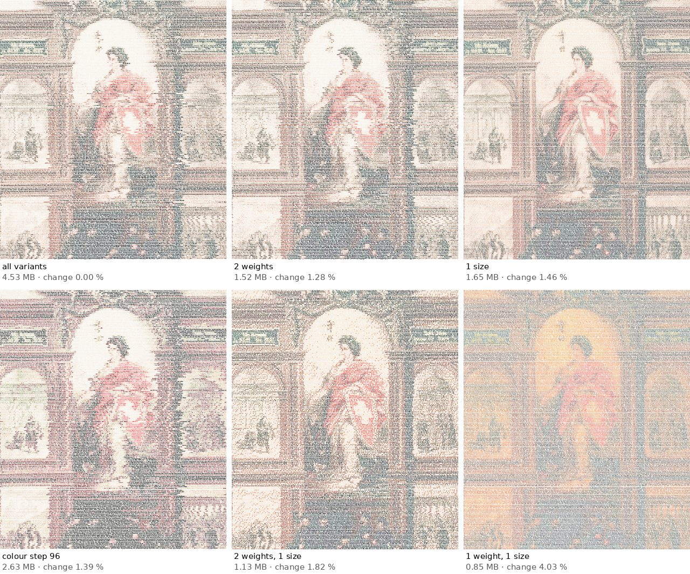

# File size: what makes a PDF big, and what can be seen

A Typographics Art PDF carries the whole text plus the typography of every letter. This page measures where the bytes go, what was removed without visible change, and which settings change the picture. All numbers come from `scripts/size-study.mjs` (raw data in `docs/file-size-study.json`) on two one-pagers, printed with Chrome 154 and read back exactly in every case.

## Where the bytes are

Chrome writes every font instance it prints as a **Type 3 font**: one glyph outline per character used. It makes a separate font for every **weight × width × type size** (measured: 10 weights at 5 sizes gave 100 fonts, at one size 20), and large sheets printed in several strips carry their fonts once per strip. Every change of weight, width, size or colour also starts a new text run on the page. A PDF printed in one piece is therefore, within 3 % on 18 measured pages:

```
Chrome print ≈ 555 B × outlines + 7.2 B × runs + 0.9 B × letters + 14 KB
after slimming ≈ 328 B × outlines + 7.4 B × runs + 0.8 B × letters + 7 KB
```

*outlines* are distinct weight × width × size × character, *runs* the style changes (`pdfStats` and `estimatePdfBytes` in `src/render.js`; the app shows this estimate). The picture itself is made of letters only: no image is embedded.

## Removed without visible change

| Step | Saving | Why it is safe |
|---|---|---|
| Round glyph outlines to whole units (`cli/pdf-slim.js`) | −22 % (Swiss constitution) | at most 1/2000 of the type size; at 600 dpi no pixel changed by more than 32 of 255 levels, text identical |
| Leave out Chrome's accessibility tags | −12 % (Swiss constitution), −16 % (Basic Law) | they were one empty `/NonStruct` element per style run under one `/Document`: no headings, no paragraphs; text and order are unchanged |
| Repack with qpdf | −9 to −80 % (Swiss constitution −9 %, Basic Law −80 %) | lossless (object streams, stronger compression) |

## Which settings can be seen

*Likeness* is the correlation between the page and the picture it was set to (title or motif card), both blurred to 1.5 mm, in brightness and in colour (1 = identical). *Change to full* is the plain difference to the version with every variant. All rows include the slimming steps above; from "one width" on, the PDF is untagged.

### Swiss constitution (photo motif, colour)

| Setting | PDF | fonts in the PDF | likeness brightness / colour | change to full |
|---|---|---|---|---|
| all weights, widths and sizes, colour step 6, tagged PDF | 4.53 MB | 282 | 0.940 / 0.924 | 0.00 % |
| as published so far (colour step 24) | 3.53 MB | 193 | 0.939 / 0.923 | 0.25 % |
| without accessibility tags | 3.12 MB | 193 | 0.939 / 0.923 | 0.25 % |
| one width (no condensed/expanded) | 2.75 MB | 100 | 0.938 / 0.924 | 1.16 % |
| 4 weights, one width | 1.93 MB | 40 | 0.942 / 0.927 | 1.38 % |
| 2 weights, one width | 1.52 MB | 20 | 0.945 / 0.930 | 1.28 % |
| 1 weight, one width (a single font) | 1.34 MB | 10 | 0.943 / 0.945 | 3.32 % |
| 2 sizes, one width | 1.92 MB | 40 | 0.949 / 0.935 | 1.24 % |
| 1 size, one width | 1.65 MB | 20 | 0.963 / 0.954 | 1.46 % |
| colour step 48, one width | 2.65 MB | 100 | 0.938 / 0.923 | 1.20 % |
| colour step 96, one width | 2.63 MB | 100 | 0.931 / 0.918 | 1.39 % |
| 2 weights, 1 size, one width | 1.13 MB | 4 | 0.946 / 0.939 | 1.82 % |
| 1 weight, 2 sizes, one width | 1.07 MB | 4 | 0.951 / 0.951 | 3.40 % |
| 1 weight, 1 size, one width: only colour or grey is left | 0.85 MB | 2 | 0.911 / 0.900 | 4.03 % |

### Basic Law (title card, grey)

| Setting | PDF | fonts in the PDF | likeness brightness / colour | change to full |
|---|---|---|---|---|
| all weights, widths and sizes, colour step 6, tagged PDF | 0.73 MB | 22 | 0.995 / 0.995 | 0.00 % |
| as published so far (colour step 24) | 0.73 MB | 22 | 0.995 / 0.995 | 0.00 % |
| without accessibility tags | 0.61 MB | 22 | 0.995 / 0.995 | 0.00 % |
| one width (no condensed/expanded) | 0.55 MB | 17 | 0.995 / 0.995 | 0.30 % |
| 4 weights, one width | 0.55 MB | 15 | 0.983 / 0.983 | 0.60 % |
| 2 weights, one width | 0.58 MB | 12 | 0.977 / 0.977 | 0.77 % |
| 1 weight, one width (a single font) | 0.68 MB | 6 | 0.982 / 0.982 | 2.20 % |
| 2 sizes, one width | 0.55 MB | 12 | 0.995 / 0.995 | 0.31 % |
| 1 size, one width | 0.72 MB | 13 | 0.994 / 0.994 | 0.43 % |
| colour step 48, one width | 0.55 MB | 17 | 0.995 / 0.995 | 0.30 % |
| colour step 96, one width | 0.55 MB | 17 | 0.995 / 0.995 | 0.30 % |
| 2 weights, 1 size, one width | 0.54 MB | 4 | 0.994 / 0.994 | 0.42 % |
| 1 weight, 2 sizes, one width | 0.60 MB | 3 | 0.979 / 0.979 | 2.72 % |
| 1 weight, 1 size, one width: only colour or grey is left | 0.60 MB | 2 | 0.961 / 0.961 | 5.12 % |



What this shows:

- **One type size is sharper.** Mixing sizes made horizontal streaks; with one size the photo motif follows its picture more closely (0.963 instead of 0.940) at a third of the size of the full version. On the title card it makes no difference.
- **Weight carries the brightness.** Two weights keep the picture; a single weight loses contrast. With neither weights nor sizes left, only colour draws the picture and likeness drops the most.
- **Width variants are not worth it.** Dropping condensed and expanded changes nothing measurable and saves 12 %.
- **Coarser colours hardly save.** Colour steps of 48 or 96 instead of 24 save 4 %; step 48 looks the same, step 96 worse. Colour changes are cheap in a PDF.

One-pagers therefore use **one size and no width variants** by default (`cli/onepage-core.mjs`); `--weights 2` makes them smaller still. In the app, the font-cuts slider limits the weights and shows the expected PDF size. Works made as art (gallery, posters) keep their sizes: there the texture of mixed sizes is a choice.

## Reproduce

```sh
node scripts/size-study.mjs              # prints every setting, writes docs/file-size-study.json (about 45 minutes)
node scripts/size-study.mjs --evaluate   # measures the PDFs of the last run again
```
